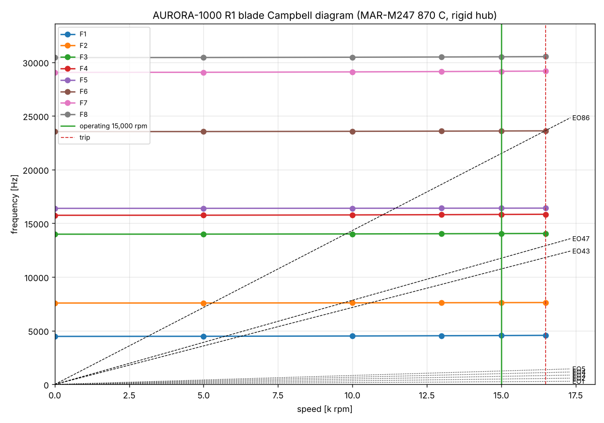
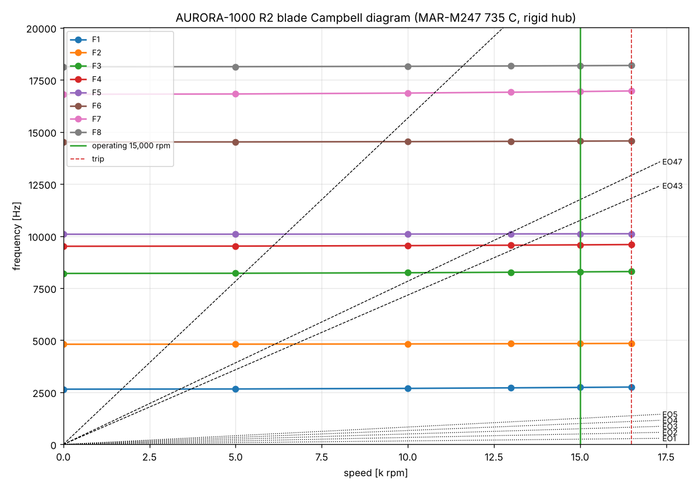

# AURORA-1000: طرح مفهومی توربین گازی ۱ مگاواتی با گیربکس، متصل به شبکه

تاریخ: ۲۰۲۶-۱۰-۲۸ · محاسبه: `sim/mw1_concept_study.py` (نتایج: `sim/mw1_results.json`) · طرح: `sim/mw1_layout_sketch.py`
سایت: برازجان، ۵۰ m، گاز شهری (ایستگاه ۴ bar، حداقل ۳٫۵ bar، ظرفیت ۱۰۰۰ m³/h)، کار دائم ۲۴/۷

## ۱. خلاصه و پیشنهاد

| | مقدار |
|---|---|
| معماری | **تک‌محور، با recuperator**، دور ثابت **۱۵٬۰۰۰ rpm**، گیربکس سیاره‌ای ۱۰:۱ به ژنراتور سنکرون ۱۵۰۰ rpm |
| کمپرسور | **دو پلهٔ گریز از مرکز** روی یک محور، Ø422 mm، نسبت فشار کل **۳٫۸** |
| توربین | **دو پلهٔ محوری**، هر پره و دیسک **یک‌تکه ریخته‌گری دقیق در خلأ** (blisk، MAR-M247)، Dm 461 mm |
| محفظهٔ احتراق | یک **محفظهٔ استوانه‌ای بیرونی (can)** با احتراق پیش‌مخلوط کم‌NOx (DLE) |
| TIT | **۹۵۰ °C**، بدون خنک‌کاری پره‌ها |
| توان خالص برق | **۱۰۰۰ kW** (هوای ورودی خنک‌شده تا ۱۵ °C) |
| راندمان برق خالص | **۳۶٫۶ %** با بازده محتاطانهٔ اجزا؛ **۳۸٫۵ %** با بازده‌هایی که ابعادگذاری نشان می‌دهد |
| مصرف گاز | **۲۷۱–۲۸۵ m³/h** (حدود ۶٫۵–۶٫۹ هزار m³ در روز)؛ **بدون بوستر گاز** |
| گرمای قابل استفاده (CHP، اگزوز ۲۵۰ °C ← ۹۰ °C) | **~۹۴۰–۱۰۳۰ kW** ← راندمان کل **~۷۴ %** (چیلر جذبی یا آب گرم) |
| روز داغ ۴۶ °C بدون خنک‌کن ورودی | ~۸۵۰–۸۶۰ kW، ۳۳–۳۵ % |
| عمر پرهٔ پلهٔ اول (خزش، با ضریب ۱٫۵ روی تنش) | **~۳×۱۰⁵ ساعت** (بیش از ۳۰ سال کار دائم) |
| قطعات ریختگی خلأ | ۲ blisk توربین + ۲ حلقهٔ NGV (یا ۲۴ سگمنت NGV) + لاینر محفظه (اختیاری) |
| ابعاد پکیج | ~۹ × ۲٫۵ × ۲٫۸ m (با recuperator)، حدود ۱۲–۱۶ تن |

**چرا این طرح؟**
- فشار گاز شهری شما (۳٫۵ bar) دقیقاً با سیکل recuperated با نسبت فشار ~۴ جور است. بیشترین فشار محفظه بدون بوستر **۳٫۶۷ bar** است و این طرح در **۳٫۵۵ bar** کار می‌کند. نسبت فشار بهینهٔ این سیکل ۴٫۴ است و ماندن روی ۳٫۸ فقط **۰٫۱۵ ٪** راندمان کم می‌کند (نمودار بخش ۲). پس کمپرسور گاز لازم نیست، که هم مصرف داخلی و هم قطعهٔ پرتعمیر را حذف می‌کند.
- دور ۱۵٬۰۰۰ rpm از توربین‌های هم‌کلاس پایین‌تر است: Kawasaki M1A-17 با ۲۲٬۰۰۰ و OPRA OP16 با ۲۶٬۰۰۰ rpm کار می‌کنند. همین دور پایین است که تنش ریشهٔ پره را به ۹۰ MPa می‌رساند و عمر بسیار بالا می‌دهد. در ۱۸٬۰۰۰ rpm عمر به ~۳×۱۰⁴ ساعت و در ۲۱٬۰۰۰ به ~۴×۱۰³ ساعت می‌افتد.
- بدون خنک‌کاری پره‌ها، ساخت ارزان است و قالب‌های ریخته‌گری ساده‌اند (بدون مغزهٔ سرامیکی کانال خنک‌کاری).

## ۱٫۱ تصمیم‌های شما (۲۰۲۶-۱۰-۲۸) و اثرشان

| تصمیم | اثر |
|---|---|
| **۱ MW خالص** (کل مجموعه) | توربین گازی ~۹۲۴ kW + توربین بخار ~۷۶ kW؛ دبی هوا ۵٫۸ kg/s؛ ابعاد توربین ~۳ ٪ کوچک‌تر از جدول‌های بخش ۳ |
| **گرمای اضافه ← توربین بخار** | بهترین ترکیب: **recuperator کامل + بویلر بازیافت کم‌فشار (۵ bar) + توربین بخار کوچک** ← **۴۱٫۴ % برق خالص، ۲۵۲ m³/h گاز** (بخش ۸) |
| **شبکهٔ ۲۰ kV** | دو ژنراتور ۴۰۰ V روی یک تابلو LV، **یک ترانس ۱۶۰۰ kVA، 0.4/20 kV** و تابلو ۲۰ kV با حفاظت اتصال به شبکه (بخش ۳٫۴) |
| **recuperator خریداری می‌شود** | ε 0.90 (هرچه بیشتر بهتر: با ε 0.92 به ۴۲٫۱ ٪ می‌رسد) |

## ۲. مقایسهٔ معماری‌ها (۱۰۰۰ kW خالص، ورودی ۱۵ °C)

| معماری | دبی هوا kg/s | η برق | گاز m³/h | فشار محفظه bar | بوستر | دمای اگزوز | توضیح |
|---|---|---|---|---|---|---|---|
| سیکل ساده PR 10.5، TIT 1050 °C (مثل Kawasaki M1A-17 / OPRA OP16) | 4.4 | **26.2 %** | 398 | 10.1 | **20 kW لازم** | 560 °C | راندمان پایین، گاز ۴۰ ٪ بیشتر |
| **recuperated PR 3.8، TIT 950 °C (پیشنهادی)** | 6.6 | **36.6 %** | **285** | 3.55 | **ندارد** | 250 °C | ساده، ارزان، عمر بالا |
| recuperated PR 4.5 + بوستر | 6.2 | 36.7 % | 285 | 4.20 | 2 kW | 267 °C | +۰٫۱ ٪ ولی یک دستگاه اضافه |
| recuperated PR 3.8، TIT 1000 °C | 6.1 | 37.8 % | 276 | 3.55 | ندارد | 257 °C | +۱٫۲ ٪، ولی پوشش حرارتی و عمر کمتر |
| intercooled + recuperated، PR 7، دو محور (مثل Aurelia A400) | 4.5 | **40.0 %** | 261 | 6.5 | **7 kW** | 230 °C | بهترین راندمان، ولی ۲ محور، intercooler و بوستر |

**پیشنهاد:** نسل اول **recuperated تک‌محور PR 3.8** باشد. اگر بعداً راندمان بیشتر خواستید، همین کمپرسور دوپله جای intercooler بین دو پله را دارد. مسیر ارتقا به نسخهٔ intercooled (~۴۰ ٪) باز می‌ماند.

**مقایسهٔ صادقانه با موتور گازسوز (پیستونی):** موتورهای گازی ۱ MW (مثل Jenbacher و MWM) به **۴۰–۴۴ %** برق می‌رسند. برتری توربین در این‌هاست:
- تعمیرات خیلی کمتر: بدون تعویض روغن هر ۲–۴ هزار ساعت، بدون شمع و سرسیلندر؛ بازرسی بخش داغ هر ~۲۵–۳۰ هزار ساعت.
- لرزش کم، وزن و حجم کمتر.
- گرمای اگزوز تمیز و داغ برای چیلر جذبی.
- NOx پایین.
- کار دائم بی‌دردسر.

با CHP، راندمان کل هر دو در حدود ۷۵–۸۵ ٪ است.

## ۳. ساختار ماشین

### ۳٫۱ روتور (تک‌محور، دور ثابت ۱۵٬۰۰۰ rpm)

| بخش | مشخصه |
|---|---|
| کمپرسور پلهٔ ۱ | پروانهٔ گریز از مرکز Ø422 mm، U2 ≈ 332 m/s، Ns ≈ 0.70، فرز ۵ محوره از **Al 2618-T61** |
| کمپرسور پلهٔ ۲ | همان قطر، دمای خروج ~۱۷۳ °C ← **Ti-6Al-4V** (آلومینیوم در کار دائم بالای ~۱۵۰ °C خزش دارد) |
| دیفیوزر و کراس‌اوور | دیفیوزر پره‌دار، کانال برگشت بین دو پله (جای intercooler آینده) |
| بازده کمپرسور (برآورد) | η ≈ ۰٫۸۵ برای دو پله (۰٫۸۲۵ برای یک پلهٔ PR 3.8 با Ø607 mm و U2 477 m/s) |
| توربین | **۲ پلهٔ محوری**: ψ = 1.25، φ = 0.50، Um = 362 m/s، Dm = 461 mm |
| ارتفاع پره | پلهٔ ۱: ۳۱ mm (hub/tip 0.87)، خروجی: ۵۸ mm (hub/tip 0.78)؛ لقی نوک ۰٫۴ mm |
| بازده توربین (برآورد) | η ≈ ۰٫۹۰–۰٫۹۲ |
| اتصال‌ها | blisk‌ها و پروانه‌ها با **کوپلینگ Curvic** و یک **پیچ مرکزی (tie bolt)** به هم بسته می‌شوند (روش Kawasaki و Solar) |
| یاتاقان‌ها | دو یاتاقان ژورنال **tilting-pad** روغنی + یاتاقان کف‌گرد (thrust) سمت سرد؛ روغن مشترک با گیربکس |

**چرا دو blisk جدا و نه یک قطعهٔ ریختگی دوپله؟** بین دو پلهٔ چرخان یک ردیف پرهٔ ثابت (NGV2) هست. اگر دو پله یک‌تکه ریخته شوند، NGV2 جای سوار شدن ندارد، مگر اینکه دوتکه و پیچی شود. این کار نشتی و پیچیدگی می‌آورد. روش رایج و ارزان‌تر این است: **دو blisk جدا، هر دو در یک ریخته‌گری خلأ و از یک بوته (یک ذوب و یک کیفیت)**، که بعد با کوپلینگ Curvic جفت می‌شوند. هر blisk حدود Ø۵۲۰ mm است و در توان ریخته‌گری‌های دقیق خلأ (investment casting) است.

### ۳٫۲ قطعات ثابت
- **NGV1 و NGV2:** ریخته‌گری خلأ از **MAR-M247 یا IN738LC**. یا حلقهٔ کامل، یا ۸–۱۲ سگمنت (سگمنت ارزان‌تر است و جداگانه تعویض می‌شود). NGV1 داغ‌ترین قطعه است؛ با یک لایه پوشش حرارتی (TBC) کار می‌کند و خنک‌کاری فیلمی ساده را اختیاری می‌گذاریم.
- **محفظهٔ احتراق:**
  - یک can بیرونی و عمودی (مثل Kawasaki M1A که یک can دارد)، احتراق پیش‌مخلوط کم‌NOx (DLE).
  - هوای ورودی ~۶۱۳ °C از recuperator می‌آید. هدف NOx زیر **۲۵ ppm** (۱۵ ٪ O2) است.
  - لاینر از Hastelloy X یا Haynes 230 با TBC.
  - خوبی can بیرونی: تعمیر و تعویض بدون باز کردن موتور.
- **بدنه:** چدن نشکن (کمپرسور) و فولاد مقاوم به حرارت (توربین، مثلاً 1.4828)؛ پوستهٔ توربین با عایق بیرونی.
- **recuperator:**
  - ۳٫۱ MW، ε = 0.90، NTU ≈ 7.3، سطح ~۴۳۰ m².
  - نوع **primary surface** یا plate-fin از فولاد ضدزنگ 347، وزن ۳–۵ تن.
  - **گران‌ترین قطعهٔ پکیج** است و باید از یک سازندهٔ مجرب خریده شود.

### ۳٫۳ گیربکس (مشخصات برای سفارش ساخت)

| مشخصه | مقدار |
|---|---|
| نوع | **سیاره‌ای ستاره‌ای (star epicyclic) یک‌پله**؛ یا دوپلهٔ موازی هلیکال دوبل (ارزان‌تر، بزرگ‌تر) |
| دور ورودی / خروجی | **15,000 / 1,500 rpm**، نسبت **10.0 : 1** |
| توان | **1,100 kW** پیوسته (۱٫۱۵ × توان شفت)، ضریب سرویس AGMA ≥ ۱٫۴ برای ژنراتور ۲۴/۷ |
| استاندارد | **API 613** (موازی) یا **API 677 / AGMA 6123** (سیاره‌ای) |
| راندمان | ≥ ۹۸٫۵ % (تلفات ~۱۶ kW به روغن) |
| یاتاقان‌ها | ژورنال هیدرودینامیک؛ روغن ISO VG 32 مشترک با توربین |
| کوپلینگ‌ها | ورودی: دیافراگمی یا دیسکی پرسرعت؛ خروجی: دیسکی |
| سازندگان نمونه | Flender، Renk، Allen Gears، Lufkin، ZF (گیربکس OPRA را ZF می‌سازد) |

### ۳٫۴ ژنراتور و اتصال به شبکه
- **ژنراتور سنکرون ۴ قطبی، ۱۲۵۰ kVA (cosφ 0.8)، ۱۵۰۰ rpm، ۵۰ Hz**، بدون جاروبک با AVR.
  - ولتاژ **۴۰۰ V**. توربین بخار هم یک ژنراتور ~۱۲۵ kVA و ۴۰۰ V دارد. هر دو روی یک تابلو LV (۲۵۰۰ A) جمع می‌شوند.
  - **ترانس افزاینده ۱۶۰۰ kVA، 0.4/20 kV، Dyn11، روغنی ONAN**.
  - **تابلو ۲۰ kV (RMU)** با دژنکتور، رلهٔ حفاظت اتصال به شبکه و کنتور دوطرفه.
  - ولتاژ ۶٫۳ kV برای ژنراتور لازم نیست. در این توان، ۴۰۰ V با ترانس ارزان‌تر و رایج‌تر است.
  - راندمان ~۹۷ ٪، خنک‌کاری هوا (IP23، یا IP54 برای گردوغبار برازجان).
- **سنکرون‌سازی و حفاظت:**
  - رلهٔ سنکرون (25)، حفاظت ولتاژ و فرکانس (27/59/81)، جریان معکوس توان (32)، اضافه‌جریان (50/51)، اتصال زمین (51N)، ROCOF و vector shift برای جزیره‌شدن.
  - مطابق الزامات اتصال شرکت توزیع (توانیر) و IEEE 1547.
- **بدون الکترونیک قدرت بزرگ:** ژنراتور مستقیم به شبکه وصل است. ساده و ارزان است و کیفیت برق عالی دارد. راه‌اندازی با **موتور استارتر AC + VFD کوچک** (~۶۰–۸۰ kW) روی گیربکس است، یا ژنراتور در حالت موتور با soft-start.

## ۴. عمر و دوام

| قطعه | شرایط | برآورد |
|---|---|---|
| blisk پلهٔ ۱ | تنش ریشه ۹۰ MPa، فلز ~۸۷۰ °C در ریشه | گسیختگی خزشی با ضریب ۱٫۵ روی تنش: **~۳×۱۰⁵ h** |
| blisk پلهٔ ۲ | تنش ریشه ۱۶۹ MPa، فلز ~۶۸۰ °C | > ۱۰⁶ h |
| NGV1 | داغ‌ترین قطعه، بدون تنش گریز از مرکز | عمر با **اکسیداسیون** و خستگی حرارتی محدود است؛ پوشش آلومینایدی + TBC؛ بازرسی و تعویض در ~۳۰ هزار ساعت |
| لاینر محفظه | | بازرسی ۸ هزار ساعت، تعویض ۲۵–۳۰ هزار ساعت |
| پروانه‌های کمپرسور | Ti / Al، U2 332 m/s | بیش از ۱۰۰ هزار ساعت (عمر ترک خستگی با تعداد روشن‌وخاموش) |
| گیربکس و یاتاقان‌ها | | بازرسی ۲۵ هزار ساعت، عمر طراحی ۱۰۰ هزار ساعت |
| **برنامهٔ تعمیرات** | | **بازرسی بخش داغ ~۲۵–۳۰ هزار ساعت، اورهال اساسی ~۶۰ هزار ساعت** (حدود ۷ سال کار دائم) |

- عدد خزش بر اساس یک منحنی Larson-Miller تقریبی برای MAR-M247 است. برای طراحی جزئی باید با داده‌های رسمی آلیاژ و تحلیل سه‌بعدی تنش و دما (مثل کاری که برای E1 کردیم) تأیید شود.
- ارتعاش پره‌ها، دیسک‌ها و دینامیک روتور در **بخش ۱۲** با FEA بررسی شده‌اند (rev 3). عددهای این جدول برآورد مرحلهٔ مفهومی‌اند.

## ۵. هزینه و زمان (برآورد اولیه، با عدم‌قطعیت ±۳۰–۵۰ ٪)

| بخش | نمونهٔ اول (دلار) | تولید سری (دلار) |
|---|---|---|
| هستهٔ موتور (روتور، ریخته‌گری‌ها، بدنه، محفظه، یاتاقان‌ها) | 300–450k | 150–220k |
| recuperator | 200–350k | 120–200k |
| گیربکس | 80–150k | 50–90k |
| ژنراتور، تابلو، سنکرون و حفاظت، ترانس | 120–200k | 90–140k |
| روغن، سوخت (DLE)، فیلتر و خنک‌کن ورودی، کنترل، پکیج و اگزوز | 150–250k | 100–150k |
| **جمع** | **~0.85–1.4 M$** | **~0.5–0.8 M$ (۵۰۰–۸۰۰ $/kW)** |

- **زمان:** طراحی جزئی و شبیه‌سازی ۶–۹ ماه؛ ساخت قطعات (ریخته‌گری خلأ ~۴–۶ ماه برای قالب و نمونه) و مونتاژ ۶–۹ ماه؛ تست ۳–۶ ماه. **جمعاً ~۱٫۵–۲ سال تا نمونهٔ کارکرده.**
- **ریسک‌های اصلی:**
  1. احتراق پیش‌مخلوط با هوای ۶۱۳ °C: ریسک flashback، نیاز به تست روی rig.
  2. رسیدن به بازده ۰٫۸۵ کمپرسور و ۰٫۹۰ توربین در نمونهٔ اول. واقع‌بینانه است که نمونهٔ اول **۳۳–۳۵ ٪** بدهد و بعد از بهینه‌سازی به ۳۶–۳۸ ٪ برسد.
  3. recuperator: عمر و نشتی در کار حرارتی دائم.
  4. تأیید اتصال به شبکه.

## ۶. استفاده از کارهای قبلی پروژه
- روش طراحی پره‌ها (مقاطع، فیلت، صاف‌سازی B-spline)، تحلیل FEA دیسک، خزش، ارتعاش (Campbell، تقارن چرخشی) و تحویل به فیوژن، همه از کار E1 آماده و آزموده‌اند.
- همین زنجیره برای blisk‌های AURORA-1000 اجرا می‌شود.
- طراحی CCHP (چیلر جذبی، برج خنک‌کن، خنک‌کن هوای ورودی) و برق و کنترل هم قابل استفادهٔ مستقیم است.

## ۷. قدم‌های بعدی پیشنهادی
1. **تأیید فرضیه‌ها با شما:**
   - توان دقیق (۱ MW خالص یا ناخالص؟)
   - CHP لازم است یا فقط برق؟
   - ولتاژ اتصال (۲۰ kV؟)
   - آیا سفارش recuperator از خارج ممکن است؟
2. طراحی meanline دقیق کمپرسور دوپله و توربین دوپله، با همان کیفیت E1.
3. طرح اولیهٔ محفظهٔ احتراق DLE و محاسبهٔ NOx.
4. دینامیک روتور (یاتاقان‌ها، سرعت بحرانی) و انتخاب نهایی ۱۵٬۰۰۰ rpm.
5. مدل سه‌بعدی، FEA blisk‌ها و ارتعاش، و تحویل به فیوژن.
6. درخواست قیمت از سازندگان گیربکس، recuperator و ژنراتور.

## ۸. توربین بخار برای گرمای اضافه (`sim/mw1_steam_bottoming.py`، بخار با IAPWS-97)

فرض‌ها:
- بویلر بازیافت (HRSG) یک‌فشاره با pinch 15 K و دودکش ≥ ۱۰۰ °C.
- توربین بخار کندانسی با η ایزنتروپیک 0.70 و چرخ‌دنده تا ۱۵۰۰ rpm.
- کندانسور ۵۰ °C با برج خنک‌کن (دمای مرطوب تابستان برازجان ~۲۸–۲۹ °C).
- مصرف پمپ‌ها و فن برج در حساب است.

همه برای **۱۰۰۰ kW خالص کل**:

| حالت | توربین گاز | توربین بخار | η برق | گاز m³/h | بخار | توضیح |
|---|---|---|---|---|---|---|
| A: فقط توربین گاز با recuperator | 1000 | — | 38.5 % | 271 | — | |
| **B: A + توربین بخار کوچک (پیشنهادی)** | **924** | **76** | **41.4 %** | **252** | **5 bar، 222 °C** | بویلر کم‌فشار، ساده |
| C: A + ORC به جای بخار (مقایسه) | 892 | 108 | 42.8 % | 244 | — | +۴۰ ٪ توان بیشتر از همان گرما، بدون آب و بویلر |
| D: recuperator نیمه (ε 0.6) + بخار | 778 | 222 | 35.2 % | 297 | 15 bar | بدتر |
| E: بدون recuperator، PR 3.8 + بخار | 564 | 436 | 34.3 % | 304 | 50 bar، 450 °C | سیکل ترکیبی کلاسیک: **بدتر** |
| F: بدون recuperator، PR 8 / 1000 °C + بوستر + بخار | 688 | 312 | 38.0 % | 274 | 50 bar | بویلر پرفشار + بوستر |
| G: بدون recuperator، PR 12 / 1100 °C (پرهٔ خنک‌شونده) + بخار | 701 | 299 | 38.8 % | 269 | 50 bar | پیچیده و گران |

**نتیجه‌ها:**
1. **سیکل ترکیبی کلاسیک (E، F، G) در این مقیاس بازنده است.** توربین بخار ۳۰۰–۴۰۰ کیلوواتی راندمان پایینی دارد، و بویلر ۵۰ bar و آب‌شیرین‌کن و اپراتور بویلر می‌خواهد. توربین گاز با recuperator به‌تنهایی (A) بهتر یا هم‌تراز است.
2. **بهترین راه: recuperator کامل و یک توربین بخار کوچک کم‌فشار** روی اگزوز ۲۵۰ °C (B). +۷۶ kW برق و **۷ ٪ گاز کمتر** (۲۵۲ به جای ۲۷۱ m³/h).
3. هرچه ε بیشتر، بهتر:

   | ε | 0.80 | 0.85 | 0.88 | 0.90 | 0.92 |
   |---|---|---|---|---|---|
   | η کل | 38.4 % | 39.7 % | 40.7 % | 41.4 % | 42.1 % |

   فشار بهینهٔ بخار در همهٔ این حالت‌ها ~۵ bar است.
4. **ORC از همان گرما ۴۰ ٪ برق بیشتر می‌دهد** (۱۰۸ در برابر ۷۶ kW) و آب، بویلر و تصفیه نمی‌خواهد. اگر قید «بخار» ندارید، ORC بهتر است. اگر بخار را ترجیح می‌دهید (مثلاً بعداً بخار فرایندی هم لازم دارید)، حالت B کاملاً عملی است.

**تجهیزات بخش بخار (حالت B):**

| تجهیز | مشخصه |
|---|---|
| بویلر بازیافت (HRSG) | لوله‌آتشی یا لوله‌آبی بسته‌ای، ~۶۰۰ kW حرارتی، ۵ bar، سوپرهیت ۲۲۰ °C، دودکش ~۱۲۰ °C |
| توربین بخار | ~۸۰–۹۰ kW ناخالص، کندانسی، تک‌پله یا اکسپندر پیچی بخار (screw expander)، با گیربکس به ۱۵۰۰ rpm. نمونه‌ها: Siemens SST-040 (از ~۷۵ kW)، اکسپندرهای پیچی Heliex و Kaishan |
| ژنراتور | ~۱۲۵ kVA، ۴۰۰ V، سنکرون یا آسنکرون، روی همان تابلو |
| کندانسور | آبی با برج خنک‌کن (مشترک با چیلر یا جدا) یا هواخنک (در برازجان کندانس ~۶۰ °C، توان ~۱۵ ٪ کمتر) |
| دی‌اریتور، پمپ تغذیه، تصفیهٔ آب (سختی‌گیر + RO) | استاندارد بویلرهای کم‌فشار |
| هزینهٔ تقریبی | **~۲۰۰–۳۰۰ هزار دلار** برای +۷۶ kW. صرفه‌اش به قیمت گاز و قیمت فروش برق بستگی دارد. ماژول ORC هم‌قیمت است، با توان بیشتر |

## ۹. تصمیم نهایی: فقط توربین گاز با recuperator + استفادهٔ مستقیم از گرما (CHP و CCHP)

تصمیم کاربر (۲۰۲۶-۱۰-۲۸): توربین بخار و ORC نمی‌صرفد. توربین گاز با recuperator می‌ماند و گرمای اگزوز مستقیم مصرف می‌شود.

- **راندمان برق** در این اندازه سقفی حدود ۳۸–۴۲ ٪ دارد. راندمان برق بالای ۵۵ ٪ فقط در نیروگاه‌های سیکل ترکیبی صدها مگاواتی دیده می‌شود.
- **هدف ۵۵ ٪+** با **راندمان کل** (برق + گرمای مفید، بر پایهٔ LHV سوخت) به دست می‌آید:

| گرمای اگزوز ۲۴۶ °C سرد تا | گرمای مفید | راندمان کل (برق ۳۸٫۵ ٪) |
|---|---|---|
| ۱۲۰ °C | 786 kW | 68.8 % |
| **۹۰ °C** (آب داغ ۹۵/۷۵ °C) | **970 kW** | **75.9 %** |
| ۷۰ °C | 1093 kW | 80.6 % |
| ۵۰ °C (مرحلهٔ دوم کم‌دما) | 1215 kW | 85.4 % |

- سوخت ۲۵۹۵ kW (LHV)، ۲۷۱ m³/h.
- میعان بخار آب اگزوز ممکن نیست، چون نقطهٔ شبنم ~۳۱ °C است و در برازجان آب سردتر از آن در دسترس نیست.
- با بازده محتاطانهٔ اجزا (برق ۳۶٫۶ ٪)، راندمان کل حدود ۱ ٪ کمتر است.

**طرح پیشنهادی استفاده از گرما:**
1. **مبدل اگزوز به آب داغ** (اکونومایزر لوله‌پره‌دار، آب تحت فشار ۹۵/۷۵ °C، ~۹۷۰ kW).
2. **تابستان: چیلر جذبی تک‌اثره LiBr، ~۶۵۰–۶۸۰ kW سرما (COP 0.7):**
   - **~۳۳۵ kW برای خنک کردن هوای ورودی توربین** از ۴۶ °C به ۱۵ °C. بدون این کار، توربین در روز داغ ۸۶۰ kW با ۳۵٫۲ ٪ می‌دهد؛ با آن، **۱۰۰۰ kW با ۳۸٫۵ ٪**. یعنی **+۱۴۰ kW برق** در گرم‌ترین ساعت‌ها، بیشتر از کل توربین بخار.
   - **~۳۲۰ kW سرمای اضافه** برای ساختمان، سردخانه یا فروش.
3. **زمستان:** آب داغ برای گرمایش یا شبکهٔ گرمایش (~۹۷۰ kW).
4. **همهٔ سال:** آب گرم مصرفی از مرحلهٔ دوم کم‌دما (تا ۵۰ °C، +~۲۵۰ kW).
5. **گزینهٔ ویژهٔ استان بوشهر:** آب‌شیرین‌کن حرارتی چنداثره (MED) با آب ۷۰ °C، ~۲۵۰–۳۰۰ m³ آب شیرین در روز.

**هزینهٔ تقریبی:**

| تجهیز | دلار |
|---|---|
| مبدل اگزوز | 40–70k |
| چیلر جذبی ۶۵۰ kW | 150–250k |
| برج خنک‌کن چیلر (~۱٫۶ MW دفع حرارت) | 40–60k |
| کویل و سیستم خنک‌کن ورودی | 20–30k |
| **جمع** | **~۲۵۰–۴۰۰k** |

با این هزینه، برق تابستان حفظ می‌شود و ~۳۲۰ kW سرمای اضافه می‌ماند، پس از بخش بخار بسیار باصرفه‌تر است.

## ۱۰. طرح انتخاب‌شده: AURORA-1000 CCHP با راندمان کل ~۷۵–۷۶ ٪ (`sim/mw1_meanline.py`)

تصمیم کاربر (۲۰۲۶-۱۰-۲۸): مدل ۷۶ ٪ اجرا می‌شود. سرمای چیلر جذبی برای خنک کردن هوای ورودی توربین و یک سردخانهٔ جدید مصرف می‌شود.

**ترازنامه** (توربین گاز ۱۰۲۰ kW خالص؛ ۲۰ kW آن برای پمپ‌ها و فن‌های CCHP، پس **۱۰۰۰ kW خالص به شبکه**):

| | مقدار |
|---|---|
| هوا / گاز | 6.32 kg/s / **276 m³/h** |
| راندمان برق | 38.5 % (هدف؛ محتاطانه ۳۶–۳۷ ٪) |
| آب داغ از اگزوز | **990 kW**، 11.8 kg/s، 95/75 °C |
| چیلر جذبی LiBr تک‌اثره | **~۶۹۰ kW سرما** (COP 0.70)، آب سرد 7/12 °C |
| خنک کردن هوای ورودی (۴۶ °C، ۳۰ ٪ ← ۱۵ °C) | پیک **338 kW** + **~۱۹۰ لیتر در ساعت آب میعان** (قابل استفاده) |
| سرمای سردخانه | **~۳۵۵ kW تابستان / ~۶۹۰ kW زمستان** |
| برج خنک‌کن | ~1.7 MW دفع حرارت |
| **راندمان کل** | **~۷۵ ٪** (برق ۱۰۰۰ + گرمای مفید ۹۹۰ kW بر سوخت ~۲۶۵۰ kW) |

**نکتهٔ سردخانه:** چیلر LiBr آب سرد را حداقل تا ~۵–۷ °C می‌رساند.

| نوع سردخانه | راه‌حل |
|---|---|
| **بالای صفر، +۸ تا +۱۳ °C** (موز، گوجه، مرکبات و سبزی‌های حساس به سرما) | مستقیم با همین آب سرد |
| **۰ تا +۴ °C** (میوه و خرما) یا **زیر صفر** (انجماد) | **۱)** چیلر جذبی **آمونیاک-آب** که با آب داغ ~۱۳۰–۱۵۰ °C از همان اگزوز کار می‌کند (تا −۳۰ °C، COP ~۰٫۵)؛ یا **۲)** کمپرسور برقی که کندانسورش با آب سرد LiBr خنک می‌شود (مصرف برقش ~۴۰–۵۰ ٪ کمتر) |

**طراحی اولیهٔ meanline در ۱۵٬۰۰۰ rpm:**

| بخش | مشخصه |
|---|---|
| کمپرسور پلهٔ ۱ (Al 2618) | PR 2.01، η 0.86، ورودی Ø256 mm (هاب Ø97)، Mrel نوک 0.71، خروجی Ø413 mm، U2 324 m/s، b2 35 mm، ۱۳ پره + ۱۳ اسپلیتر، backsweep 40° |
| کمپرسور پلهٔ ۲ (Ti-6Al-4V) | PR 1.92، η 0.85، ورودی Ø220 mm، Ø448 mm، U2 352 m/s، b2 19 mm، خروجی ۱۷۵ °C |
| توربین (۲ پله، ریختگی خلأ MAR-M247) | Dm 463 mm، Um 364 m/s، ψ 1.25، φ 0.50، درجهٔ واکنش 0.45، زاویهٔ خروج NGV 67° |
| پلهٔ ۱ | ۹۵۰ ← ۸۱۳ °C، ۳٫۵۵ ← ۲٫۰۴ bar، ارتفاع پره ۲۵/۳۱/۳۸ mm، **۴۷ NGV / ۵۹ پرهٔ روتور** (نهایی بعد از تست‌ها: ۴۳ / ۵۹، بخش ۱۲)، وتر محوری ۲۶ mm، گلوگاه ۱۷۷ cm²، دمای نسبی روتور ۸۷۷ °C |
| پلهٔ ۲ | ۸۱۳ ← ۶۷۲ °C، ۲٫۰۴ ← ۱٫۰۹ bar، ۳۸/۴۹/۶۳ mm، **۳۳ NGV / ۳۶ پره**، وتر ۳۷/۴۲ mm (نهایی: **۴۷ NGV** با وتر ۲۶ mm / ۳۶ پره، بخش ۱۲) |

## ۱۱. سردخانهٔ مرکبات (تصمیم کاربر ۲۰۲۶-۱۰-۲۹)

**دمای نگهداری** (رطوبت نسبی ۸۵–۹۵ ٪): مرکبات به سرمازدگی حساس‌اند.

| محصول | دما |
|---|---|
| لیموترش و لیموی سبز | ۹–۱۳ °C |
| گریپ‌فروت | ۱۰–۱۵ °C |
| پرتقال | ۳–۹ °C (رقم‌های گرمسیری بیشتر ۵–۸ °C) |
| نارنگی | ۴–۷ °C |

**نتیجه:** چیلر جذبی LiBr کافی است و چیلر آمونیاکی لازم نیست.
- چیلر برای آب سرد **۵/۱۰ °C** سفارش داده شود (LiBr دمای پایین، COP ~۰٫۶۸).
- با کویل‌های هوای بزرگ و اختلاف دمای کم (برای حفظ رطوبت و جلوگیری از چروکیدگی میوه)، اتاق‌ها روی **+۷ تا +۱۲ °C** نگه داشته می‌شوند.
- برای اتاق‌های نارنگی و پرتقال ۴–۵ °C، یک چیلر برقی کوچک کمکی (~۵۰ kW) که کندانسورش با آب برج خنک می‌شود، فقط برای همان اتاق‌ها کافی است.

**هم‌زمانی خوب:** فصل برداشت مرکبات در جنوب (آبان تا اسفند) همان فصلی است که توربین به خنک‌کن ورودی نیاز ندارد. پس در اوج بار سردخانه **همهٔ ~۶۹۰ kW** سرما به سردخانه می‌رسد. در تابستان که هوا داغ است، سردخانه بار کمتری دارد و ~۳۵۵ kW کافی است.

**ظرفیت تقریبی:**
- بار نگهداری یک سردخانهٔ ۳۰۰۰ تنی در برازجان:
  - دیوار و سقف: ~۳۰ kW
  - تنفس میوه: ~۲۵ W/t، یعنی ~۷۵ kW
  - فن، در، روشنایی و افراد: ~۴۰ kW
  - **جمع ~۱۴۵ kW**
- پیش‌سرمایش میوهٔ ورودی (۳۰ ← ۸ °C، ~۸۴ kJ/kg) با ~۱۰۰ تن در روز در ۱۲ ساعت: **~۲۰۰ kW**.
- ← **سردخانهٔ ~۳۰۰۰–۴۰۰۰ تنی** با ورود روزانه تا ~۱۰۰ تن در فصل برداشت. در تابستان سردخانهٔ پر بدون ورود میوه هم با ۳۵۵ kW اداره می‌شود.

**منابع داده‌های مقایسه:** Kawasaki Technical Review No. 173 و بروشور M1A-17؛ برگهٔ مشخصات OPRA OP16؛ معرفی Aurelia A400 در Turbomachinery Magazine و پروژهٔ CORDIS FUTURBINE.

## ۱۲. طراحی دقیق توربین و تست‌های شبیه‌سازی (rev 3، ۲۰۲۶-۱۰-۲۹)

درخواست کاربر: «تمرکز روی خود توربین که کار دقیقی دربیاد و تست‌هایش زده شود؛ چیلر خریداری می‌شود.»

### ۱۲٫۱ هندسهٔ نهایی ردیف‌ها (`cad/engine/a1000_turbine.py`، نتایج: `sim/a1000_turbine_design.json`)

| ردیف | تعداد | x LE–TE [mm] | شعاع هاب–نوک [mm] | وتر / ضخامت بیشینه | زاویهٔ جریان ورود/خروج | Zweifel | ماخ خروج |
|---|---|---|---|---|---|---|---|
| NGV1 (ثابت) | **43** | 0–26 | 218–245 | 40 / 8.0 mm | 0° / 68–66° | 0.85–1.03 | 0.74–0.67 |
| R1 (blisk 1) | **59** | 34–60 | 214–249 | 31→34 / **6.6→2.4 mm** | 35°→2° / −62°→−65° | 0.94–1.01 | 0.59–0.67 |
| NGV2 (ثابت) | **47** | 69–95 | 210–254 | 39 / 7.8 mm | 0° / 69–65° | 0.72–1.00 | 0.82–0.69 |
| R2 (blisk 2) | **36** | 106–148 | 203–260 | 49→55 / **9.8→3.4 mm** | 43°→−9° / −60°→−66° | 1.00–1.11 | 0.60–0.75 |

- مقاطع: صفحهٔ هم‌دیس (conformal)، لبهٔ فرار گرد ۱ mm (قابل ریخته‌گری)، گلوگاه با حل gauging و انحراف Carter، گردابهٔ آزاد. مقاطع روتور روی مرکز سطح و مقاطع NGV روی لبهٔ فرار روی هم چیده شده‌اند.
- گلوگاه NGV1 در دهانهٔ لبهٔ فرار **۱۶۰ cm²** است (meanline با قانون کسینوس: ۱۷۷). اختلاف از انحراف جریان در خروجی زیرصوت می‌آید و تنظیم نهایی با CFD و چرخش ±۱° پره‌ها انجام می‌شود.
- جرم‌ها: پرهٔ R1 ۳۶ g (×۵۹)، پرهٔ R2 ۱۳۵ g (×۳۶)؛ blisk 1 حدود **۴۴٫۵ kg** و blisk 2 حدود **۵۱ kg**. NGV1: ۴۳ پره × ۵۶ g؛ NGV2: ۴۷ × ۸۳ g.

### ۱۲٫۲ تغییرات طراحی که تست‌ها لازم کردند

| # | مشکل (از کدام تست) | اصلاح |
|---|---|---|
| ۱ | ۲×۴۷ = EO94 مود ۶ پرهٔ R1 را در ۱۵٬۳۰۰ rpm قطع می‌کرد (Campbell) | NGV1 از ۴۷ به **۴۳** پره |
| ۲ | تنش ریشهٔ R1 برابر ۱۲۹ MPa در ۸۷۰ °C بود؛ عمر خزشی با ضریب حاشیه‌ای (FEA) | **باریک‌شدن پره** (ضخامت ۲۱٪ ← ۷٪ وتر، وتر محوری نوک ۱۵٪ کوتاه‌تر) ← **۱۱۰ MPa**، تنش بیشینه از ۴۱۵ به ۱۹۳ MPa |
| ۳ | دیسک با گوشه‌های تیز ۱۰۶۱–۱۳۲۵ MPa (FEA دیسک) | جان مخروطی با فیلت‌های بزرگ ← ۴۱۹ / ۵۲۰ MPa |
| ۴ | سکوی داغ R1 (۸۰۰ °C) را دیسک سردتر نگه می‌داشت و تنش حرارتی محیطی ~۵۲۰ MPa می‌ساخت (ترک TMF) | **شیار آزادسازی حرارتی (rim slot)** بین هر دو پره، عمق ۱۰ mm، با سوراخ ۳ mm در انتها و پین آب‌بند |
| ۵ | ته شیار R1 در ۷۳۷ °C فقط ۳٫۳×۱۰⁴ ساعت عمر داشت (خزش) | **هوای purge** از خروجی کمپرسور (~۱٫۲٪ دبی، ۱۷۵ °C) روی وجه جلوی blisk 1 و شیارها ← الزام: ته شیار ≤ **۷۱۰ °C** ← ۱٫۵×۱۰⁵ ساعت |
| ۶ | مود ۳ پرهٔ R2 (۸۲۸۲ Hz) دقیقاً روی ضربهٔ دنبالهٔ ۳۳ پرهٔ NGV2 (۸۲۵۰ Hz، فاصلهٔ ۰٫۴٪) بود: **تشدید مستقیم** | NGV2 از ۳۳ به **۴۷ پره** با وتر محوری ۲۶ mm ← EO47 = ۱۱٬۷۵۰ Hz درست در فاصلهٔ مودهای ۵ و ۶ پرهٔ R2 و ۲ و ۳ پرهٔ R1. Zweifel همان ماند، توربین ۱۱ mm کوتاه‌تر شد و NGV2 ۱٫۶ kg سبک‌تر. |
| ۷ | تکیه‌گاه صلب یاتاقان‌ها مود مخروطی روتور را در ۱۷٬۳۵۰ rpm می‌گذاشت (فقط ۱۰٪ بالای MCS) (دینامیک روتور) | **damper فیلم روغنی (SFD) با فنر مرکزکن** زیر هر دو یاتاقان tilting-pad |
| ۸ | لافت CAD در لبهٔ فرار تا می‌خورد (مش‌زن خطا می‌داد) | بازنمونه‌برداری هر بخش پروفیل جدا، و مقاطع CAD با فاصلهٔ یکنواخت در ارتفاع |

### ۱۲٫۳ تست ۱: تنش و خزش پره‌ها (`sim/engine/a1000_blade_fea.py`، CalculiX، C3D10)

مدل: پره روی سکوی صلب، NLGEOM گریز از مرکز، MAR-M247 در دمای نسبی گاز. مش R1 با ۸۷ هزار و R2 با ۱۴۲ هزار المان مرتبه دو.

| در ۱۵٬۰۰۰ rpm | R1 (۸۷۰ °C) | R2 (۷۳۵ °C) |
|---|---|---|
| تنش شعاعی میانگین مقطع خالص بالای فیلت | **110 MPa** (بیشینه 164) | **185 MPa** (بیشینه 346) |
| تنش در ۲۵ / ۵۰ / ۷۵٪ ارتفاع | 101 / 69 / 37 MPa | 182 / 113 / 60 MPa |
| von Mises بیشینه (فیلت ریشه / لبهٔ فرار) | 193 MPa ← حاشیهٔ تسلیم **4.1** | 378 MPa ← حاشیهٔ تسلیم **2.2** |
| عمر گسیختگی خزشی (Larson-Miller، ضریب ۱٫۲۵ روی تنش) | **2.7×10⁵ h** | 1.4×10⁷ h |
| تنش ارتعاشی مجاز در ریشه (Goodman، HCF 10⁷) | 175 MPa | 186 MPa |
| خمش گازی (تخمین) | ~6 MPa | ~5 MPa |

### ۱۲٫۴ تست ۲: ارتعاش پره‌ها و تداخل با مرتبه‌های تحریک

فرکانس‌های طبیعی در ۱۵٬۰۰۰ rpm (هاب صلب، سخت‌شدگی گریز از مرکز ۱–۳٪):

| مود | ۱ | ۲ | ۳ | ۴ | ۵ | ۶ | ۷ | ۸ |
|---|---|---|---|---|---|---|---|---|
| R1 [Hz] | 4550 | 7615 | 14044 | 15825 | 16412 | 23599 | 29159 | 30508 |
| R2 [Hz] | 2735 | 4841 | 8282 | 9580 | 10109 | 14560 | 16942 | 18182 |

| تحریک | R1 | R2 | لازم |
|---|---|---|---|
| EO 1–5 (محفظهٔ can، ورودی، ۵ پایهٔ اگزوز) | ≥ ۲۶۴٪ | ≥ ۱۱۹٪ | ۱۰٪ |
| دنبالهٔ NGV1 (EO43) | ۲۹٪ | ۶٪ (ضعیف، از دو ردیف گذشته) | ۱۰٪ / ۵٪ |
| NGV2 (EO47: میدان فشار روی R1، دنباله روی R2) | ۲۰٪ | **۱۴٪** | ۱۰٪ |
| ۲×NPF (EO86 روی R1) | ۹٫۸٪ (عبور گذرا در ۱۶٬۴۷۳ rpm، نزدیک trip) | — | ۵٪ |

**ابزار انتخاب تعداد پره‌ها** (`sim/engine/a1000_vane_count.py`) همهٔ ترکیب‌های NGV1 و NGV2 را با فرکانس‌های هر دو روتور، محدودهٔ Zweifel و aliasing می‌سنجد.

### ۱۲٫۵ تست ۳: دیسک‌ها (`sim/engine/a1000_disc_fea.py`، تقارن محوری CAX6)

مدل: نیروی گریز از مرکز + کشش پره‌ها + میدان دمای شعاعی، با شیار rim (نوار ارتوتروپ) و purge روی R1.

| | R1 | R2 |
|---|---|---|
| von Mises بیشینه در ۱۵k / trip ۱۶٫۵k | 419 / 448 MPa (فیلت زیر rim، ۶۳۵ °C) | 520 / 593 MPa (۶۳۰ °C) |
| حاشیهٔ تسلیم در trip | **1.83** | **1.39** |
| ترکیدن (تنش محیطی میانگین، ۸۵٪ UTS) | **۱٫۹۴×** دور کار | **۱٫۸۴×** (لازم ≥ ۱٫۳۴×) |
| نقطهٔ بحرانی خزش (ته شیار) | 410 MPa در ۷۱۰ °C ← **1.5×10⁵ h** (ضریب ۱٫۲۵) | 3×10⁶ h |
| LCF روشن‌وخاموش (Manson، ضریب ۲ روی کرنش و ۲۰ روی عمر) | 1.8×10⁵ سیکل | 3.8×10⁴ سیکل (لازم ۱۰⁴) |
| رشد شعاعی rim (مکانیکی + حرارتی) | 1.62 mm | 1.62 mm |

### ۱۲٫۶ تست ۴: دینامیک روتور (`sim/engine/a1000_rotordynamics.py`)

مدل:
- المان تیر Timoshenko با اثر ژیروسکوپی، در مختصات مختلط.
- روتور کامل ۱۹۲ kg: کوپلینگ، collar کف‌گرد، دو پروانه، درام، دو blisk و پیچ مرکزی.
- دو یاتاقان tilting-pad، Ø110×55 mm.

| | چیدمان A: بین دو یاتاقان (یاتاقان عقب در هاب اگزوز با ۵ پایه) + SFD (**انتخاب**) | A با تکیه‌گاه صلب | B: توربین آویزان |
|---|---|---|---|
| مودهای صلب | 4,003 و 6,829 rpm، میرایی زیاد (AF 2.3 و 1.2) | 8,410 و **17,350 rpm** (۱۰٪ بالای MCS) | 6,085 و 17,150 rpm |
| اولین مود خمشی | **24,211 rpm**، حاشیهٔ **۵۴٪** (API 617: ۲۴٪) | > 26,000 rpm | 25,890 rpm |
| ارتعاش نامیزانی API در محدودهٔ کار | **2.6 µm** (حد 22 µm) | 1.7 µm | 2.3 µm |

نتیجه: روتور در کار **فوق‌بحرانی نسبت به دو مود صلب** است و هر دو مود با میرایی زیاد هنگام راه‌اندازی رد می‌شوند. نسبت به مود خمشی **زیربحرانی** است و از آن فاصلهٔ زیادی دارد. SFD (Ø150، طول ۳۰ mm، لقی ۰٫۱۵ mm) با فنر قفسه‌ای ۲٫۵×۱۰⁷ N/m.

### ۱۲٫۷ تست ۵: لقی نوک پره در کار

| | R1 | R2 |
|---|---|---|
| رشد rim دیسک (FEA) | 1.62 mm | 1.62 mm |
| کشیدگی پره (FEA) + انبساط حرارتی پره | 0.02 + 0.44 mm | 0.08 + 0.57 mm |
| **رشد کل روتور** | **2.07 mm** | **2.28 mm** |
| لقی سرد / هدف در کار | 0.50 / 0.45 mm | 0.60 / 0.55 mm |
| دمای لازم حلقهٔ نگه‌دارندهٔ shroud (فولاد 1.4828) | **~۴۷۰ °C** | **~۵۰۰ °C** |

الزام: حلقهٔ shroud با هوای خروجی کمپرسور خنک شود و shroud از honeycomb سایشی (Hastelloy X) باشد. برخورد سبک در گذرا به این ترتیب بی‌خطر است.

### ۱۲٫۸ جمع‌بندی تست‌ها (`sim/engine/a1000_turbine_checks.py`)

**همهٔ ۲۶ معیار قبول شدند.** کم‌حاشیه‌ترین‌ها:
1. خزش ریشهٔ پرهٔ R1: ۲٫۷×۱۰⁵ h در برابر هدف ۱۰⁵.
2. خزش ته شیار دیسک R1: ۱٫۵×۱۰⁵ h. وابسته به الزام purge.
3. LCF دیسک R2: ۳٫۸×۱۰⁴ سیکل در برابر ۱۰⁴.

### ۱۲٫۹ الزامات طراحی جزئی و ساخت که از تست‌ها درآمد

1. **ریخته‌گری:**
   - هر دو blisk از MAR-M247 با ریخته‌گری دقیق در خلأ، از یک ذوب.
   - HIP برای بستن تخلخل (عمر خستگی).
   - بازرسی پرتونگاری و FPI ۱۰۰٪.
   - لبهٔ فرار ≥ ۱ mm و فیلت ریشهٔ ۳ / ۳٫۵ mm.
2. **ماشین‌کاری بعد از ریخته‌گری:**
   - کوپلینگ‌های Curvic، سطح داخلی سکو، نوک پره‌ها (گرد کردن تا قطر نهایی).
   - **شیارهای rim** با EDM.
   - بالانس دینامیکی هر blisk و سپس روتور کامل (G2.5).
3. **هوای ثانویه:**
   - purge وجه جلوی blisk 1 و شیارها با ~۱٫۲٪ هوای خروجی کمپرسور. الزام: ته شیار R1 ≤ ۷۱۰ °C.
   - خنک‌کاری حلقهٔ shroud تا ~۴۷۰–۵۰۰ °C.
   - این دماها باید با تحلیل حرارتی مزدوج (CHT) تأیید شوند.
4. **NGV1:** پوشش آلومینایدی + TBC. تنش مکانیکی ناچیز است (خمش گازی ~۱ MPa)؛ عمر با اکسیداسیون و TMF تعیین می‌شود.
5. **یاتاقان‌ها:**
   - tilting-pad Ø110 با preload ~۰٫۳، روی SFD + فنر قفسه‌ای.
   - یاتاقان عقب در هاب دیفیوزر اگزوز با ۵ پایه؛ روغن و هوای بافر از داخل پایه‌ها.
6. **پایش ارتعاش:**
   - دو پراب مجاورتی در هر یاتاقان.
   - حد هشدار ~۲۵ µm و trip ~۴۰ µm (API 670).

### ۱۲٫۱۰ محدودیت‌ها و قدم بعدی

- داده‌های ماده تیپیک‌اند و منحنی Larson-Miller تقریبی است. برای سفارش ریخته‌گری باید داده‌های تأییدشدهٔ سازنده (MAR-M247 equiaxed + HIP) گرفته شود.
- میدان دما فرضی است (پره = دمای نسبی گاز، دیسک با قانون توانی). CFD ردیف‌ها و CHT دیسک قدم بعدی است.
- پاسخ اجباری (دامنهٔ تنش ارتعاشی در عبورهای گذرا) هنوز محاسبه نشده؛ فقط حاشیهٔ فرکانسی و تنش مجاز Goodman داریم.
- قدم بعد:
  - CFD سه‌بعدی دو پله (راندمان، زاویه‌ها، گلوگاه).
  - تحلیل CHT هوای ثانویه.
  - مدل sector سه‌بعدی شیار rim (ضریب تمرکز تنش سوراخ ته شیار).
  - انتقال قطعات به فیوژن برای نقشه‌های ساخت.
