# AURORA-1000: طرح مفهومی توربین گازی ۱ مگاواتی با گیربکس، متصل به شبکه

تاریخ: ۲۰۲۶-۱۰-۲۸ · محاسبه: `sim/mw1_concept_study.py` (نتایج: `sim/mw1_results.json`) · طرح: `sim/mw1_layout_sketch.py`
سایت: برازجان، ۵۰ m، گاز شهری (ایستگاه ۴ bar، حداقل ۳٫۵ bar، ظرفیت ۱۰۰۰ m³/h)، کار دائم ۲۴/۷

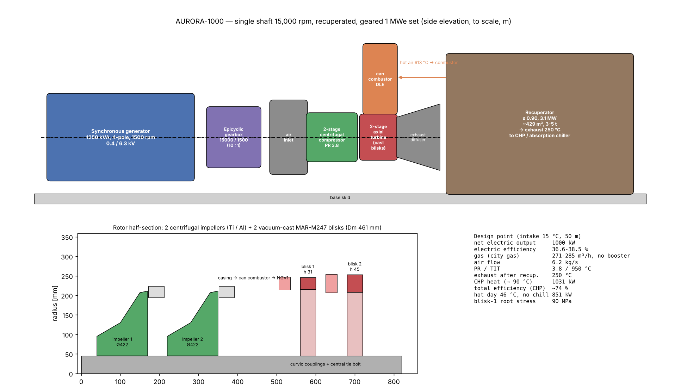

## ۱. خلاصه و پیشنهاد

| | مقدار |
|---|---|
| معماری | **تک‌محور، با recuperator**، دور ثابت **۱۵٬۰۰۰ rpm**، گیربکس سیاره‌ای ۱۰:۱ به ژنراتور سنکرون ۱۵۰۰ rpm |
| کمپرسور | **دو پلهٔ گریز از مرکز** روی یک محور، Ø422 mm، نسبت فشار کل **۳٫۸** |
| توربین | **دو پلهٔ محوری**، هر پره و دیسک **یک‌تکه ریخته‌گری دقیق در خلأ** (blisk، MAR-M247)، Dm 463 mm؛ NGV1 ۴۸ / R1 ۵۹ / NGV2 ۲۴ / R2 ۳۶ پره (بخش ۱۲) |
| محفظهٔ احتراق | یک **محفظهٔ استوانه‌ای بیرونی (can)** با احتراق پیش‌مخلوط کم‌NOx (DLE) |
| TIT | **۹۵۰ °C**، بدون خنک‌کاری پره‌ها |
| توان خالص برق | **۱۰۰۰ kW** (هوای ورودی خنک‌شده تا ۱۵ °C) |
| راندمان برق خالص | **۳۶٫۶ %** با بازده محتاطانهٔ اجزا؛ **۳۸٫۵ %** با بازده‌هایی که ابعادگذاری نشان می‌دهد |
| مصرف گاز | **۲۷۱–۲۸۵ m³/h** (حدود ۶٫۵–۶٫۹ هزار m³ در روز)؛ **بدون بوستر گاز** |
| گرمای قابل استفاده (CHP، اگزوز ۲۵۰ °C ← ۹۰ °C) | **~۹۴۰–۱۰۳۰ kW** ← راندمان کل **~۷۴ %** (چیلر جذبی یا آب گرم) |
| روز داغ ۴۶ °C بدون خنک‌کن ورودی | ~۸۵۰–۸۶۰ kW، ۳۳–۳۵ % |
| عمر پرهٔ پلهٔ اول (خزش، منحنی حداقل MAR-M247، ۱۰۰ MPa در ۸۶۵ °C) | **~۲٫۶×۱۰⁵ ساعت** (بیش از ۳۰ سال کار دائم؛ بخش ۱۲٫۳) |
| قطعات ریختگی خلأ | ۲ blisk توربین (۴۴ و ۵۳ kg) + ۲ حلقهٔ کامل NGV (۴۸ و ۲۴ پره) + لاینر محفظه (اختیاری) |
| ابعاد پکیج | ~۹ × ۲٫۵ × ۲٫۸ m (با recuperator)، حدود ۱۲–۱۶ تن |

**چرا این طرح؟**
- فشار گاز شهری شما (۳٫۵ bar) دقیقاً با سیکل recuperated با نسبت فشار ~۴ جور است. بیشترین فشار محفظه بدون بوستر **۳٫۶۷ bar** است و این طرح در **۳٫۵۵ bar** کار می‌کند. نسبت فشار بهینهٔ این سیکل ۴٫۴ است و ماندن روی ۳٫۸ فقط **۰٫۱۵ ٪** راندمان کم می‌کند (نمودار بخش ۲). پس کمپرسور گاز لازم نیست، که هم مصرف داخلی و هم قطعهٔ پرتعمیر را حذف می‌کند.
- دور ۱۵٬۰۰۰ rpm از توربین‌های هم‌کلاس پایین‌تر است: Kawasaki M1A-17 با ۲۲٬۰۰۰ و OPRA OP16 با ۲۶٬۰۰۰ rpm کار می‌کنند. همین دور پایین است که تنش ریشهٔ پرهٔ پلهٔ اول را به ۱۰۰ MPa نگه می‌دارد و بدون خنک‌کاری عمر بالا می‌دهد (برآورد مفهومی: در ۱۸٬۰۰۰ rpm عمر به ~۳×۱۰⁴ ساعت و در ۲۱٬۰۰۰ به ~۴×۱۰³ ساعت می‌افتد).
- بدون خنک‌کاری پره‌ها، ساخت ارزان است و قالب‌های ریخته‌گری ساده‌اند (بدون مغزهٔ سرامیکی کانال خنک‌کاری).

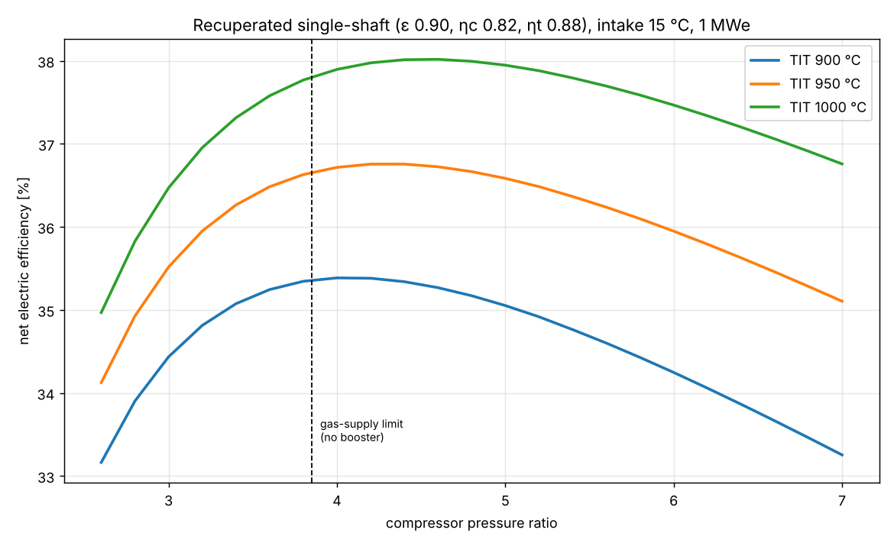

## ۱٫۱ تصمیم‌های شما (۲۰۲۶-۱۰-۲۸) و اثرشان

| تصمیم | اثر |
|---|---|
| **۱ MW خالص** (کل مجموعه) | توربین گازی ~۹۲۴ kW + توربین بخار ~۷۶ kW؛ دبی هوا ۵٫۸ kg/s؛ ابعاد توربین ~۳ ٪ کوچک‌تر از جدول‌های بخش ۳ |
| **گرمای اضافه ← توربین بخار** | بهترین ترکیب: **recuperator کامل + بویلر بازیافت کم‌فشار (۵ bar) + توربین بخار کوچک** ← **۴۱٫۴ % برق خالص، ۲۵۲ m³/h گاز** (بخش ۸) |
| **شبکهٔ ۲۰ kV** | دو ژنراتور ۴۰۰ V روی یک تابلو LV، **یک ترانس ۱۶۰۰ kVA، 0.4/20 kV** و تابلو ۲۰ kV با حفاظت اتصال به شبکه (بخش ۳٫۴) |
| **recuperator خریداری می‌شود** | ε 0.90 (هرچه بیشتر بهتر: با ε 0.92 به ۴۲٫۱ ٪ می‌رسد) |

## ۲. مقایسهٔ معماری‌ها (۱۰۰۰ kW خالص، ورودی ۱۵ °C)

| معماری | دبی هوا kg/s | η برق | گاز m³/h | فشار محفظه bar | بوستر | دمای اگزوز | توضیح |
|---|---|---|---|---|---|---|---|
| سیکل ساده PR 10.5، TIT 1050 °C (مثل Kawasaki M1A-17 / OPRA OP16) | 4.4 | **26.2 %** | 398 | 10.1 | **20 kW لازم** | 560 °C | راندمان پایین، گاز ۴۰ ٪ بیشتر |
| **recuperated PR 3.8، TIT 950 °C (پیشنهادی)** | 6.6 | **36.6 %** | **285** | 3.55 | **ندارد** | 250 °C | ساده، ارزان، عمر بالا |
| recuperated PR 4.5 + بوستر | 6.2 | 36.7 % | 285 | 4.20 | 2 kW | 267 °C | +۰٫۱ ٪ ولی یک دستگاه اضافه |
| recuperated PR 3.8، TIT 1000 °C | 6.1 | 37.8 % | 276 | 3.55 | ندارد | 257 °C | +۱٫۲ ٪، ولی پوشش حرارتی و عمر کمتر |
| intercooled + recuperated، PR 7، دو محور (مثل Aurelia A400) | 4.5 | **40.0 %** | 261 | 6.5 | **7 kW** | 230 °C | بهترین راندمان، ولی ۲ محور، intercooler و بوستر |

**پیشنهاد:** نسل اول **recuperated تک‌محور PR 3.8** باشد. اگر بعداً راندمان بیشتر خواستید، همین کمپرسور دوپله جای intercooler بین دو پله را دارد. مسیر ارتقا به نسخهٔ intercooled (~۴۰ ٪) باز می‌ماند.

**مقایسهٔ صادقانه با موتور گازسوز (پیستونی):** موتورهای گازی ۱ MW (مثل Jenbacher و MWM) به **۴۰–۴۴ %** برق می‌رسند. برتری توربین در این‌هاست:
- تعمیرات خیلی کمتر: بدون تعویض روغن هر ۲–۴ هزار ساعت، بدون شمع و سرسیلندر؛ بازرسی بخش داغ هر ~۲۵–۳۰ هزار ساعت.
- لرزش کم، وزن و حجم کمتر.
- گرمای اگزوز تمیز و داغ برای چیلر جذبی.
- NOx پایین.
- کار دائم بی‌دردسر.

با CHP، راندمان کل هر دو در حدود ۷۵–۸۵ ٪ است.

## ۳. ساختار ماشین

### ۳٫۱ روتور (تک‌محور، دور ثابت ۱۵٬۰۰۰ rpm)

| بخش | مشخصه |
|---|---|
| کمپرسور پلهٔ ۱ | پروانهٔ گریز از مرکز Ø422 mm، U2 ≈ 332 m/s، Ns ≈ 0.70، فرز ۵ محوره از **Al 2618-T61** (طرح جزئی rev 1: Ø426 mm، U2 334 m/s، بخش ۱۳) |
| کمپرسور پلهٔ ۲ | همان قطر، دمای خروج ~۱۷۳ °C ← **Ti-6Al-4V** (آلومینیوم در کار دائم بالای ~۱۵۰ °C خزش دارد)؛ طرح جزئی rev 1: Ø476 mm، U2 374 m/s، بخش ۱۳ |
| دیفیوزر و کراس‌اوور | دیفیوزر پره‌دار، کانال برگشت بین دو پله (جای intercooler آینده) |
| بازده کمپرسور (برآورد) | η ≈ ۰٫۸۵ برای دو پله (۰٫۸۲۵ برای یک پلهٔ PR 3.8 با Ø607 mm و U2 477 m/s) |
| توربین | **۲ پلهٔ محوری**: ψ = 1.25، φ = 0.50، درجهٔ واکنش 0.45، Um = 364 m/s، Dm = 463 mm |
| ارتفاع پره | R1: ۳۵ mm (hub/tip 0.86)، R2: ۵۷ mm (hub/tip 0.78)؛ لقی نوک سرد ۰٫۵ / ۰٫۶ mm، در کار ۰٫۴۵ / ۰٫۵۵ mm |
| بازده توربین (برآورد) | η ≈ ۰٫۹۰–۰٫۹۲ |
| اتصال‌ها | blisk‌ها و پروانه‌ها با **کوپلینگ Curvic** و یک **پیچ مرکزی (tie bolt)** به هم بسته می‌شوند (روش Kawasaki و Solar) |
| یاتاقان‌ها | دو یاتاقان ژورنال **tilting-pad** روغنی + یاتاقان کف‌گرد (thrust) سمت سرد؛ روغن مشترک با گیربکس |

**چرا دو blisk جدا و نه یک قطعهٔ ریختگی دوپله؟** بین دو پلهٔ چرخان یک ردیف پرهٔ ثابت (NGV2) هست. اگر دو پله یک‌تکه ریخته شوند، NGV2 جای سوار شدن ندارد، مگر اینکه دوتکه و پیچی شود. این کار نشتی و پیچیدگی می‌آورد. روش رایج و ارزان‌تر این است: **دو blisk جدا، هر دو در یک ریخته‌گری خلأ و از یک بوته (یک ذوب و یک کیفیت)**، که بعد با کوپلینگ Curvic جفت می‌شوند. هر blisk حدود Ø۵۲۰ mm است و در توان ریخته‌گری‌های دقیق خلأ (investment casting) است.

### ۳٫۲ قطعات ثابت
- **NGV1 و NGV2:** ریخته‌گری خلأ از **MAR-M247**، **حلقهٔ کامل** (NGV1 ۴۸ پره، NGV2 ۲۴ پره؛ در صورت نیاز هر دو در ۸ سگمنت). NGV1 داغ‌ترین قطعه است؛ با پوشش آلومینایدی + TBC و بدون خنک‌کاری کار می‌کند (بخش ۱۲٫۹).
- **محفظهٔ احتراق:**
  - یک can بیرونی و عمودی (مثل Kawasaki M1A که یک can دارد)، احتراق پیش‌مخلوط کم‌NOx (DLE).
  - هوای ورودی ~۶۱۳ °C از recuperator می‌آید. هدف NOx زیر **۲۵ ppm** (۱۵ ٪ O2) است.
  - لاینر از Hastelloy X یا Haynes 230 با TBC.
  - خوبی can بیرونی: تعمیر و تعویض بدون باز کردن موتور.
- **بدنه:** چدن نشکن (کمپرسور) و فولاد مقاوم به حرارت (توربین، مثلاً 1.4828)؛ پوستهٔ توربین با عایق بیرونی.
- **recuperator:**
  - ۳٫۱ MW، ε = 0.90، NTU ≈ 7.3، سطح ~۴۳۰ m².
  - نوع **primary surface** یا plate-fin از فولاد ضدزنگ 347، وزن ۳–۵ تن.
  - **گران‌ترین قطعهٔ پکیج** است و باید از یک سازندهٔ مجرب خریده شود.

### ۳٫۳ گیربکس (مشخصات برای سفارش ساخت)

| مشخصه | مقدار |
|---|---|
| نوع | **سیاره‌ای ستاره‌ای (star epicyclic) یک‌پله**؛ یا دوپلهٔ موازی هلیکال دوبل (ارزان‌تر، بزرگ‌تر) |
| دور ورودی / خروجی | **15,000 / 1,500 rpm**، نسبت **10.0 : 1** |
| توان | **1,100 kW** پیوسته (۱٫۱۵ × توان شفت)، ضریب سرویس AGMA ≥ ۱٫۴ برای ژنراتور ۲۴/۷ |
| استاندارد | **API 613** (موازی) یا **API 677 / AGMA 6123** (سیاره‌ای) |
| راندمان | ≥ ۹۸٫۵ % (تلفات ~۱۶ kW به روغن) |
| یاتاقان‌ها | ژورنال هیدرودینامیک؛ روغن ISO VG 32 مشترک با توربین |
| کوپلینگ‌ها | ورودی: دیافراگمی یا دیسکی پرسرعت؛ خروجی: دیسکی |
| سازندگان نمونه | Flender، Renk، Allen Gears، Lufkin، ZF (گیربکس OPRA را ZF می‌سازد) |

### ۳٫۴ ژنراتور و اتصال به شبکه
- **ژنراتور سنکرون ۴ قطبی، ۱۲۵۰ kVA (cosφ 0.8)، ۱۵۰۰ rpm، ۵۰ Hz**، بدون جاروبک با AVR.
  - ولتاژ **۴۰۰ V**. توربین بخار هم یک ژنراتور ~۱۲۵ kVA و ۴۰۰ V دارد. هر دو روی یک تابلو LV (۲۵۰۰ A) جمع می‌شوند.
  - **ترانس افزاینده ۱۶۰۰ kVA، 0.4/20 kV، Dyn11، روغنی ONAN**.
  - **تابلو ۲۰ kV (RMU)** با دژنکتور، رلهٔ حفاظت اتصال به شبکه و کنتور دوطرفه.
  - ولتاژ ۶٫۳ kV برای ژنراتور لازم نیست. در این توان، ۴۰۰ V با ترانس ارزان‌تر و رایج‌تر است.
  - راندمان ~۹۷ ٪، خنک‌کاری هوا (IP23، یا IP54 برای گردوغبار برازجان).
- **سنکرون‌سازی و حفاظت:**
  - رلهٔ سنکرون (25)، حفاظت ولتاژ و فرکانس (27/59/81)، جریان معکوس توان (32)، اضافه‌جریان (50/51)، اتصال زمین (51N)، ROCOF و vector shift برای جزیره‌شدن.
  - مطابق الزامات اتصال شرکت توزیع (توانیر) و IEEE 1547.
- **بدون الکترونیک قدرت بزرگ:** ژنراتور مستقیم به شبکه وصل است. ساده و ارزان است و کیفیت برق عالی دارد. راه‌اندازی با **موتور استارتر AC + VFD کوچک** (~۶۰–۸۰ kW) روی گیربکس است، یا ژنراتور در حالت موتور با soft-start.

## ۴. عمر و دوام

| قطعه | شرایط | برآورد |
|---|---|---|
| blisk پلهٔ ۱ | تنش مقطع خالص ریشه ۱۰۰ MPa، فلز ~۸۶۵ °C | گسیختگی خزشی روی منحنی حداقل: **~۲٫۶×۱۰⁵ h** (مجاز ۱۰⁵ h: ۱۲۴ MPa) |
| blisk پلهٔ ۲ | تنش مقطع خالص ریشه ۱۸۸ MPa، فلز ~۷۲۳ °C | ~۲٫۷×۱۰⁷ h |
| NGV1 | داغ‌ترین قطعه، بدون تنش گریز از مرکز | عمر با **اکسیداسیون** و خستگی حرارتی محدود است؛ پوشش آلومینایدی + TBC؛ بازرسی و تعویض در ~۳۰ هزار ساعت |
| لاینر محفظه | | بازرسی ۸ هزار ساعت، تعویض ۲۵–۳۰ هزار ساعت |
| پروانه‌های کمپرسور | Ti / Al، U2 332 m/s | بیش از ۱۰۰ هزار ساعت (عمر ترک خستگی با تعداد روشن‌وخاموش) |
| گیربکس و یاتاقان‌ها | | بازرسی ۲۵ هزار ساعت، عمر طراحی ۱۰۰ هزار ساعت |
| **برنامهٔ تعمیرات** | | **بازرسی بخش داغ ~۲۵–۳۰ هزار ساعت، اورهال اساسی ~۶۰ هزار ساعت** (حدود ۷ سال کار دائم) |

- عددهای خزش از منحنی master Larson–Miller و منحنی حداقل MAR-M247 (بخش ۱۲٫۳) و FEA سه‌بعدی پره‌اند. برای سفارش ریخته‌گری باید با دادهٔ تأییدشدهٔ ریخته‌گر جایگزین شوند.
- ارتعاش پره‌ها و دیسک‌ها (مدل کامل cyclic)، دیسک‌ها و دینامیک روتور در **بخش ۱۲** (rev 5) بررسی شده‌اند.

## ۵. هزینه و زمان (برآورد اولیه، با عدم‌قطعیت ±۳۰–۵۰ ٪)

| بخش | نمونهٔ اول (دلار) | تولید سری (دلار) |
|---|---|---|
| هستهٔ موتور (روتور، ریخته‌گری‌ها، بدنه، محفظه، یاتاقان‌ها) | 300–450k | 150–220k |
| recuperator | 200–350k | 120–200k |
| گیربکس | 80–150k | 50–90k |
| ژنراتور، تابلو، سنکرون و حفاظت، ترانس | 120–200k | 90–140k |
| روغن، سوخت (DLE)، فیلتر و خنک‌کن ورودی، کنترل، پکیج و اگزوز | 150–250k | 100–150k |
| **جمع** | **~0.85–1.4 M$** | **~0.5–0.8 M$ (۵۰۰–۸۰۰ $/kW)** |

- **زمان:** طراحی جزئی و شبیه‌سازی ۶–۹ ماه؛ ساخت قطعات (ریخته‌گری خلأ ~۴–۶ ماه برای قالب و نمونه) و مونتاژ ۶–۹ ماه؛ تست ۳–۶ ماه. **جمعاً ~۱٫۵–۲ سال تا نمونهٔ کارکرده.**
- **ریسک‌های اصلی:**
  1. احتراق پیش‌مخلوط با هوای ۶۱۳ °C: ریسک flashback، نیاز به تست روی rig.
  2. رسیدن به بازده ۰٫۸۵ کمپرسور و ۰٫۹۰ توربین در نمونهٔ اول. واقع‌بینانه است که نمونهٔ اول **۳۳–۳۵ ٪** بدهد و بعد از بهینه‌سازی به ۳۶–۳۸ ٪ برسد.
  3. recuperator: عمر و نشتی در کار حرارتی دائم.
  4. تأیید اتصال به شبکه.

## ۶. استفاده از کارهای قبلی پروژه
- روش طراحی پره‌ها (مقاطع، فیلت، صاف‌سازی B-spline)، تحلیل FEA دیسک، خزش، ارتعاش (Campbell، تقارن چرخشی) و تحویل به فیوژن، همه از کار E1 آماده و آزموده‌اند.
- همین زنجیره برای blisk‌های AURORA-1000 اجرا می‌شود.
- طراحی CCHP (چیلر جذبی، برج خنک‌کن، خنک‌کن هوای ورودی) و برق و کنترل هم قابل استفادهٔ مستقیم است.

## ۷. قدم‌های بعدی پیشنهادی
1. **تأیید فرضیه‌ها با شما:**
   - توان دقیق (۱ MW خالص یا ناخالص؟)
   - CHP لازم است یا فقط برق؟
   - ولتاژ اتصال (۲۰ kV؟)
   - آیا سفارش recuperator از خارج ممکن است؟
2. طراحی meanline دقیق کمپرسور دوپله و توربین دوپله، با همان کیفیت E1.
3. طرح اولیهٔ محفظهٔ احتراق DLE و محاسبهٔ NOx.
4. دینامیک روتور (یاتاقان‌ها، سرعت بحرانی) و انتخاب نهایی ۱۵٬۰۰۰ rpm.
5. مدل سه‌بعدی، FEA blisk‌ها و ارتعاش، و تحویل به فیوژن.
6. درخواست قیمت از سازندگان گیربکس، recuperator و ژنراتور.

## ۸. توربین بخار برای گرمای اضافه (`sim/mw1_steam_bottoming.py`، بخار با IAPWS-97)

فرض‌ها:
- بویلر بازیافت (HRSG) یک‌فشاره با pinch 15 K و دودکش ≥ ۱۰۰ °C.
- توربین بخار کندانسی با η ایزنتروپیک 0.70 و چرخ‌دنده تا ۱۵۰۰ rpm.
- کندانسور ۵۰ °C با برج خنک‌کن (دمای مرطوب تابستان برازجان ~۲۸–۲۹ °C).
- مصرف پمپ‌ها و فن برج در حساب است.

همه برای **۱۰۰۰ kW خالص کل**:

| حالت | توربین گاز | توربین بخار | η برق | گاز m³/h | بخار | توضیح |
|---|---|---|---|---|---|---|
| A: فقط توربین گاز با recuperator | 1000 | — | 38.5 % | 271 | — | |
| **B: A + توربین بخار کوچک (پیشنهادی)** | **924** | **76** | **41.4 %** | **252** | **5 bar، 222 °C** | بویلر کم‌فشار، ساده |
| C: A + ORC به جای بخار (مقایسه) | 892 | 108 | 42.8 % | 244 | — | +۴۰ ٪ توان بیشتر از همان گرما، بدون آب و بویلر |
| D: recuperator نیمه (ε 0.6) + بخار | 778 | 222 | 35.2 % | 297 | 15 bar | بدتر |
| E: بدون recuperator، PR 3.8 + بخار | 564 | 436 | 34.3 % | 304 | 50 bar، 450 °C | سیکل ترکیبی کلاسیک: **بدتر** |
| F: بدون recuperator، PR 8 / 1000 °C + بوستر + بخار | 688 | 312 | 38.0 % | 274 | 50 bar | بویلر پرفشار + بوستر |
| G: بدون recuperator، PR 12 / 1100 °C (پرهٔ خنک‌شونده) + بخار | 701 | 299 | 38.8 % | 269 | 50 bar | پیچیده و گران |

**نتیجه‌ها:**
1. **سیکل ترکیبی کلاسیک (E، F، G) در این مقیاس بازنده است.** توربین بخار ۳۰۰–۴۰۰ کیلوواتی راندمان پایینی دارد، و بویلر ۵۰ bar و آب‌شیرین‌کن و اپراتور بویلر می‌خواهد. توربین گاز با recuperator به‌تنهایی (A) بهتر یا هم‌تراز است.
2. **بهترین راه: recuperator کامل و یک توربین بخار کوچک کم‌فشار** روی اگزوز ۲۵۰ °C (B). +۷۶ kW برق و **۷ ٪ گاز کمتر** (۲۵۲ به جای ۲۷۱ m³/h).
3. هرچه ε بیشتر، بهتر:

   | ε | 0.80 | 0.85 | 0.88 | 0.90 | 0.92 |
   |---|---|---|---|---|---|
   | η کل | 38.4 % | 39.7 % | 40.7 % | 41.4 % | 42.1 % |

   فشار بهینهٔ بخار در همهٔ این حالت‌ها ~۵ bar است.
4. **ORC از همان گرما ۴۰ ٪ برق بیشتر می‌دهد** (۱۰۸ در برابر ۷۶ kW) و آب، بویلر و تصفیه نمی‌خواهد. اگر قید «بخار» ندارید، ORC بهتر است. اگر بخار را ترجیح می‌دهید (مثلاً بعداً بخار فرایندی هم لازم دارید)، حالت B کاملاً عملی است.

**تجهیزات بخش بخار (حالت B):**

| تجهیز | مشخصه |
|---|---|
| بویلر بازیافت (HRSG) | لوله‌آتشی یا لوله‌آبی بسته‌ای، ~۶۰۰ kW حرارتی، ۵ bar، سوپرهیت ۲۲۰ °C، دودکش ~۱۲۰ °C |
| توربین بخار | ~۸۰–۹۰ kW ناخالص، کندانسی، تک‌پله یا اکسپندر پیچی بخار (screw expander)، با گیربکس به ۱۵۰۰ rpm. نمونه‌ها: Siemens SST-040 (از ~۷۵ kW)، اکسپندرهای پیچی Heliex و Kaishan |
| ژنراتور | ~۱۲۵ kVA، ۴۰۰ V، سنکرون یا آسنکرون، روی همان تابلو |
| کندانسور | آبی با برج خنک‌کن (مشترک با چیلر یا جدا) یا هواخنک (در برازجان کندانس ~۶۰ °C، توان ~۱۵ ٪ کمتر) |
| دی‌اریتور، پمپ تغذیه، تصفیهٔ آب (سختی‌گیر + RO) | استاندارد بویلرهای کم‌فشار |
| هزینهٔ تقریبی | **~۲۰۰–۳۰۰ هزار دلار** برای +۷۶ kW. صرفه‌اش به قیمت گاز و قیمت فروش برق بستگی دارد. ماژول ORC هم‌قیمت است، با توان بیشتر |

## ۹. تصمیم نهایی: فقط توربین گاز با recuperator + استفادهٔ مستقیم از گرما (CHP و CCHP)

تصمیم کاربر (۲۰۲۶-۱۰-۲۸): توربین بخار و ORC نمی‌صرفد. توربین گاز با recuperator می‌ماند و گرمای اگزوز مستقیم مصرف می‌شود.

- **راندمان برق** در این اندازه سقفی حدود ۳۸–۴۲ ٪ دارد. راندمان برق بالای ۵۵ ٪ فقط در نیروگاه‌های سیکل ترکیبی صدها مگاواتی دیده می‌شود.
- **هدف ۵۵ ٪+** با **راندمان کل** (برق + گرمای مفید، بر پایهٔ LHV سوخت) به دست می‌آید:

| گرمای اگزوز ۲۴۶ °C سرد تا | گرمای مفید | راندمان کل (برق ۳۸٫۵ ٪) |
|---|---|---|
| ۱۲۰ °C | 786 kW | 68.8 % |
| **۹۰ °C** (آب داغ ۹۵/۷۵ °C) | **970 kW** | **75.9 %** |
| ۷۰ °C | 1093 kW | 80.6 % |
| ۵۰ °C (مرحلهٔ دوم کم‌دما) | 1215 kW | 85.4 % |

- سوخت ۲۵۹۵ kW (LHV)، ۲۷۱ m³/h.
- میعان بخار آب اگزوز ممکن نیست، چون نقطهٔ شبنم ~۳۱ °C است و در برازجان آب سردتر از آن در دسترس نیست.
- با بازده محتاطانهٔ اجزا (برق ۳۶٫۶ ٪)، راندمان کل حدود ۱ ٪ کمتر است.

**طرح پیشنهادی استفاده از گرما:**
1. **مبدل اگزوز به آب داغ** (اکونومایزر لوله‌پره‌دار، آب تحت فشار ۹۵/۷۵ °C، ~۹۷۰ kW).
2. **تابستان: چیلر جذبی تک‌اثره LiBr، ~۶۵۰–۶۸۰ kW سرما (COP 0.7):**
   - **~۳۳۵ kW برای خنک کردن هوای ورودی توربین** از ۴۶ °C به ۱۵ °C. بدون این کار، توربین در روز داغ ۸۶۰ kW با ۳۵٫۲ ٪ می‌دهد؛ با آن، **۱۰۰۰ kW با ۳۸٫۵ ٪**. یعنی **+۱۴۰ kW برق** در گرم‌ترین ساعت‌ها، بیشتر از کل توربین بخار.
   - **~۳۲۰ kW سرمای اضافه** برای ساختمان، سردخانه یا فروش.
3. **زمستان:** آب داغ برای گرمایش یا شبکهٔ گرمایش (~۹۷۰ kW).
4. **همهٔ سال:** آب گرم مصرفی از مرحلهٔ دوم کم‌دما (تا ۵۰ °C، +~۲۵۰ kW).
5. **گزینهٔ ویژهٔ استان بوشهر:** آب‌شیرین‌کن حرارتی چنداثره (MED) با آب ۷۰ °C، ~۲۵۰–۳۰۰ m³ آب شیرین در روز.

**هزینهٔ تقریبی:**

| تجهیز | دلار |
|---|---|
| مبدل اگزوز | 40–70k |
| چیلر جذبی ۶۵۰ kW | 150–250k |
| برج خنک‌کن چیلر (~۱٫۶ MW دفع حرارت) | 40–60k |
| کویل و سیستم خنک‌کن ورودی | 20–30k |
| **جمع** | **~۲۵۰–۴۰۰k** |

با این هزینه، برق تابستان حفظ می‌شود و ~۳۲۰ kW سرمای اضافه می‌ماند، پس از بخش بخار بسیار باصرفه‌تر است.

## ۱۰. طرح انتخاب‌شده: AURORA-1000 CCHP با راندمان کل ~۷۵–۷۶ ٪ (`sim/mw1_meanline.py`)

تصمیم کاربر (۲۰۲۶-۱۰-۲۸): مدل ۷۶ ٪ اجرا می‌شود. سرمای چیلر جذبی برای خنک کردن هوای ورودی توربین و یک سردخانهٔ جدید مصرف می‌شود.

**ترازنامه** (توربین گاز ۱۰۲۰ kW خالص؛ ۲۰ kW آن برای پمپ‌ها و فن‌های CCHP، پس **۱۰۰۰ kW خالص به شبکه**):

| | مقدار |
|---|---|
| هوا / گاز | 6.32 kg/s / **276 m³/h** |
| راندمان برق | 38.5 % (هدف؛ محتاطانه ۳۶–۳۷ ٪) |
| آب داغ از اگزوز | **990 kW**، 11.8 kg/s، 95/75 °C |
| چیلر جذبی LiBr تک‌اثره | **~۶۹۰ kW سرما** (COP 0.70)، آب سرد 7/12 °C |
| خنک کردن هوای ورودی (۴۶ °C، ۳۰ ٪ ← ۱۵ °C) | پیک **338 kW** + **~۱۹۰ لیتر در ساعت آب میعان** (قابل استفاده) |
| سرمای سردخانه | **~۳۵۵ kW تابستان / ~۶۹۰ kW زمستان** |
| برج خنک‌کن | ~1.7 MW دفع حرارت |
| **راندمان کل** | **~۷۵ ٪** (برق ۱۰۰۰ + گرمای مفید ۹۹۰ kW بر سوخت ~۲۶۵۰ kW) |

**نکتهٔ سردخانه:** چیلر LiBr آب سرد را حداقل تا ~۵–۷ °C می‌رساند.

| نوع سردخانه | راه‌حل |
|---|---|
| **بالای صفر، +۸ تا +۱۳ °C** (موز، گوجه، مرکبات و سبزی‌های حساس به سرما) | مستقیم با همین آب سرد |
| **۰ تا +۴ °C** (میوه و خرما) یا **زیر صفر** (انجماد) | **۱)** چیلر جذبی **آمونیاک-آب** که با آب داغ ~۱۳۰–۱۵۰ °C از همان اگزوز کار می‌کند (تا −۳۰ °C، COP ~۰٫۵)؛ یا **۲)** کمپرسور برقی که کندانسورش با آب سرد LiBr خنک می‌شود (مصرف برقش ~۴۰–۵۰ ٪ کمتر) |

**طراحی اولیهٔ meanline در ۱۵٬۰۰۰ rpm:**

| بخش | مشخصه |
|---|---|
| کمپرسور پلهٔ ۱ (Al 2618) | PR 2.01، η 0.86، ورودی Ø256 mm (هاب Ø97)، Mrel نوک 0.71، خروجی Ø413 mm، U2 324 m/s، b2 35 mm، ۱۳ پره + ۱۳ اسپلیتر، backsweep 40° (طرح جزئی rev 1: **Ø426 mm، b2 33.5 mm**، ورودی Ø274 / هاب Ø120، بخش ۱۳) |
| کمپرسور پلهٔ ۲ (Ti-6Al-4V) | PR 1.92، η 0.85، ورودی Ø220 mm، Ø448 mm، U2 352 m/s، b2 19 mm، خروجی ۱۷۵ °C (طرح جزئی rev 1: **Ø476 mm، b2 16.5 mm**، ورودی Ø261 / هاب Ø160، بخش ۱۳) |
| توربین (۲ پله، ریختگی خلأ MAR-M247) | Dm 463 mm، Um 364 m/s، ψ 1.25، φ 0.50، درجهٔ واکنش 0.45، زاویهٔ خروج NGV 67° |
| پلهٔ ۱ | ۹۵۰ ← ۸۱۳ °C، ۳٫۵۵ ← ۲٫۰۴ bar، ارتفاع پره ۲۵/۳۱/۳۸ mm، **۴۷ NGV / ۵۹ پرهٔ روتور** (نهایی rev 5: **۴۸ NGV** با وتر محوری ۲۲ mm / ۵۹، بخش ۱۲)، گلوگاه ۱۷۷ cm² (طرح نهایی ۱۷۴)، دمای نسبی روتور ۸۷۷ °C |
| پلهٔ ۲ | ۸۱۳ ← ۶۷۲ °C، ۲٫۰۴ ← ۱٫۰۹ bar، ۳۸/۴۹/۶۳ mm، **۳۳ NGV / ۳۶ پره**، وتر ۳۷/۴۲ mm (نهایی rev 5: **۲۴ NGV** با وتر محوری ۴۹ mm / ۳۶ پره، بخش ۱۲) |

## ۱۱. سردخانهٔ مرکبات (تصمیم کاربر ۲۰۲۶-۱۰-۲۹)

**دمای نگهداری** (رطوبت نسبی ۸۵–۹۵ ٪): مرکبات به سرمازدگی حساس‌اند.

| محصول | دما |
|---|---|
| لیموترش و لیموی سبز | ۹–۱۳ °C |
| گریپ‌فروت | ۱۰–۱۵ °C |
| پرتقال | ۳–۹ °C (رقم‌های گرمسیری بیشتر ۵–۸ °C) |
| نارنگی | ۴–۷ °C |

**نتیجه:** چیلر جذبی LiBr کافی است و چیلر آمونیاکی لازم نیست.
- چیلر برای آب سرد **۵/۱۰ °C** سفارش داده شود (LiBr دمای پایین، COP ~۰٫۶۸).
- با کویل‌های هوای بزرگ و اختلاف دمای کم (برای حفظ رطوبت و جلوگیری از چروکیدگی میوه)، اتاق‌ها روی **+۷ تا +۱۲ °C** نگه داشته می‌شوند.
- برای اتاق‌های نارنگی و پرتقال ۴–۵ °C، یک چیلر برقی کوچک کمکی (~۵۰ kW) که کندانسورش با آب برج خنک می‌شود، فقط برای همان اتاق‌ها کافی است.

**هم‌زمانی خوب:** فصل برداشت مرکبات در جنوب (آبان تا اسفند) همان فصلی است که توربین به خنک‌کن ورودی نیاز ندارد. پس در اوج بار سردخانه **همهٔ ~۶۹۰ kW** سرما به سردخانه می‌رسد. در تابستان که هوا داغ است، سردخانه بار کمتری دارد و ~۳۵۵ kW کافی است.

**ظرفیت تقریبی:**
- بار نگهداری یک سردخانهٔ ۳۰۰۰ تنی در برازجان:
  - دیوار و سقف: ~۳۰ kW
  - تنفس میوه: ~۲۵ W/t، یعنی ~۷۵ kW
  - فن، در، روشنایی و افراد: ~۴۰ kW
  - **جمع ~۱۴۵ kW**
- پیش‌سرمایش میوهٔ ورودی (۳۰ ← ۸ °C، ~۸۴ kJ/kg) با ~۱۰۰ تن در روز در ۱۲ ساعت: **~۲۰۰ kW**.
- ← **سردخانهٔ ~۳۰۰۰–۴۰۰۰ تنی** با ورود روزانه تا ~۱۰۰ تن در فصل برداشت. در تابستان سردخانهٔ پر بدون ورود میوه هم با ۳۵۵ kW اداره می‌شود.

**منابع داده‌های مقایسه:** Kawasaki Technical Review No. 173 و بروشور M1A-17؛ برگهٔ مشخصات OPRA OP16؛ معرفی Aurelia A400 در Turbomachinery Magazine و پروژهٔ CORDIS FUTURBINE.

## ۱۲. طراحی دقیق توربین و تست‌های شبیه‌سازی (rev 5، ۲۰۲۶-۱۰-۳۰)

درخواست کاربر: «تمرکز روی خود توربین که کار دقیقی دربیاد و تست‌هایش زده شود؛ چیلر خریداری می‌شود.»

سیر بازنگری‌ها:
- **rev 3:** اولین طرح کامل با FEA پره، دیسک و روتور.
- **rev 4:** یک بازبینی مستقل ۳۶ یافتهٔ تأییدشده داشت. همه اصلاح شدند (بخش ۱۲٫۲): سینماتیک ردیف‌ها، گلوگاه‌ها، منحنی خزش، معیارهای LCF/Goodman/ترکیدن، نامیزانی API و غیره.
- **rev 5:** مدل کامل پره و دیسک (cyclic symmetry) برای همهٔ قطرهای گرهی حل شد. نشان داد تعداد پره‌های NGV که با مدل هاب صلب انتخاب شده بود (۴۳ / ۴۷) چهار تداخل دارد. تعداد پره‌ها به **NGV1 = ۴۸ و NGV2 = ۲۴** تغییر کرد (بخش ۱۲٫۴).
- **پاسخ اجباری R1 (۲۰۲۶-۱۰-۳۰):** CFD ناپایای سه ردیف + مودهای cyclic. EO96 بسته شد و NGV1 = ۴۸ می‌ماند. یک مورد تازه پیدا شد: EO24 روی مود flap اول R1 در راه‌اندازی (بخش ۱۲٫۴٫۱).

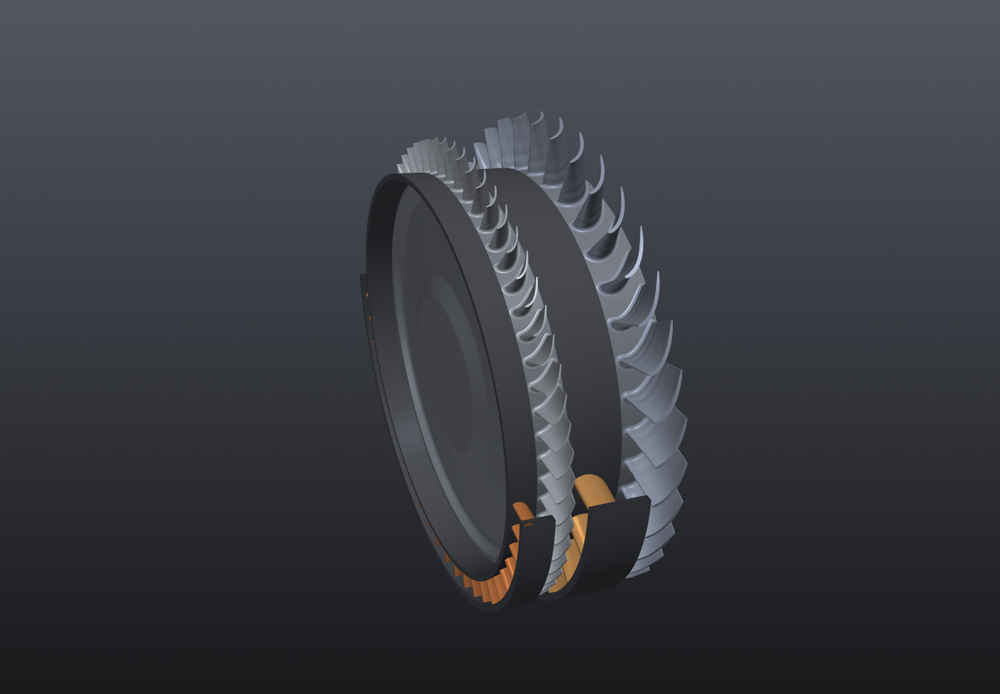

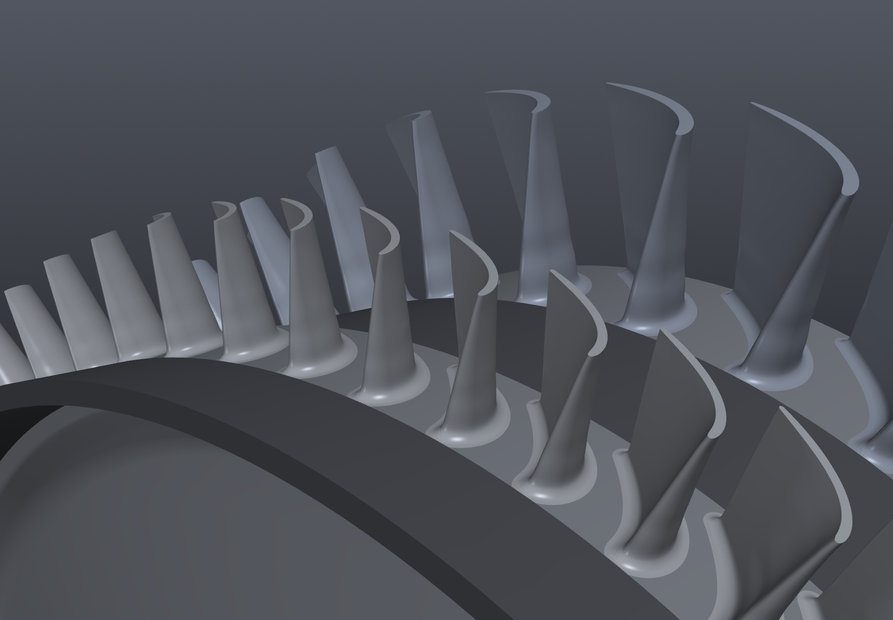

### ۱۲٫۱ هندسهٔ نهایی ردیف‌ها (`cad/engine/a1000_turbine.py`، نتایج: `sim/a1000_turbine_design.json`)

| ردیف | تعداد | x LE–TE [mm] | شعاع هاب–نوک [mm] | وتر / ضخامت بیشینه | زاویهٔ جریان ورود / خروج | Zweifel | ماخ خروج |
|---|---|---|---|---|---|---|---|
| NGV1 (ثابت) | **48** | 0–22 | 218–246 | 33.8 / 6.8 mm | 0° / 68°→66° | 0.89–1.10 | 0.75–0.67 |
| R1 (blisk 1) | **59** | 30–56 | 214–249 | 31→30 / **7.5→1.8 mm** | 35°→2° / −64°→−66° | 0.94–1.09 | 0.59–0.67 |
| NGV2 (ثابت) | **24** | 65–114 | 210–254 | **72 / 14.4 mm** | −9° / 69°→65° | 0.80–1.11 | 0.83–0.69 |
| R2 (blisk 2) | **36** | 125–167 | 203–260 | 50→55 / **9.9→3.4 mm** | 43°→−9° / −63°→−67° | 0.96–1.02 | 0.60–0.75 |

- **سینماتیک:**
  - مرحلهٔ تکرارشونده در شعاع میانی: α1 = α3 = −8.5°، Cθ3 = −0.075 U، ψ = 1.25، درجهٔ واکنش 0.45، φ = 0.5.
  - گردابهٔ آزاد برای Cθ2 و Cθ3.
  - درجهٔ واکنش از هاب تا نوک: R1 از 0.36 تا 0.52، R2 از 0.28 تا 0.56.
- **گلوگاه‌ها:**
  - حل gauging با انحراف Ainley–Mathieson: با قانون کسینوس شروع می‌شود و بین ماخ 0.5 و 1 به آن نزدیک می‌شود.
  - ارتفاع خروجی NGV در لبهٔ فرار.
  - **NGV1:** ۱۷۴ cm² (meanline ۱۷۷)، ماخ گلوگاه **0.75**.
  - **NGV2:** ۲۷۸ cm² (۲۸۲)، ماخ **0.81**. هر دو با فاصلهٔ زیاد از خفگی.
- **لبهٔ فرار** همهٔ ردیف‌ها ۱٫۰ mm است، قابل ریخته‌گری.
- **جرم‌ها (MAR-M247، ۸٫۵۴ g/cc):**
  - پرهٔ R1 ۳۴٫۶ g و پرهٔ R2 ۱۳۹ g.
  - blisk 1: **۴۴٫۴ kg** و blisk 2: **۵۲٫۵ kg**.
  - NGV1: ۴۸ × ۴۱ g + حلقه‌ها ۵٫۳ kg = **۷٫۲ kg**.
  - NGV2: ۲۴ × ۲۹۰ g + حلقه‌ها ۱۰٫۱ kg = **۱۷٫۱ kg**.
- **طول مسیر گاز** از لبهٔ حملهٔ NGV1 تا لبهٔ فرار R2: **۱۶۷ mm**. نسبت به rev 4، ۱۹ mm بلندتر است: NGV1 ۴ mm کوتاه‌تر و NGV2 ۲۳ mm بلندتر.
- **اثر وترها روی بازده (ضریب نسبت ابعادی تلفات ثانویهٔ Kacker–Okapuu):**
  - NGV1 با ۴۸ پرهٔ کوتاه‌تر: h/c از 0.69 به 0.83، ضریب ×۰٫۸۵، حدود **+۰٫۳** واحد درصد بازده توربین.
  - NGV2 با ۲۴ پرهٔ بلند: h/c از 1.19 به 0.62، ضریب ×۱٫۷۵، حدود **−۰٫۸** واحد.
  - جمع: حدود **−۰٫۵ واحد درصد** بازده توربین، یعنی ~۰٫۳ واحد از راندمان برق. این مقدار به‌صورت گرمای بیشتر به CCHP می‌رسد.

### ۱۲٫۲ بازبینی مستقل rev 3 و اصلاح‌ها (فهرست کامل: `docs/a1000_review_rev3.json`)

| یافته‌ها | مشکل | اصلاح |
|---|---|---|
| 1 | ردیف‌ها چرخش خروجی روتور meanline را نداشتند: ψ واقعی 1.175 و درجهٔ واکنش 0.41 بود | سینماتیک مرحلهٔ تکرارشونده (α1 = α3 = −8.5°) ← ψ 1.25، R 0.45 |
| 2، 31 | گلوگاه‌ها ۵–۷٪ کوچک بودند (انحراف Carter) و NGVها نزدیک خفگی کار می‌کردند | انحراف Ainley–Mathieson و ارتفاع خروجی در لبهٔ فرار ← ماخ گلوگاه 0.75 / 0.81 |
| 3، 35 | لبهٔ فرار روتور ۰٫۷۵–۰٫۹۴ mm بود | لبهٔ فرار ثابت ۱٫۰ mm |
| 4، 19، 20، 28، 29 | مرتبهٔ ۲×NGV2 بالای همهٔ مودهای محاسبه‌شده بود («قبول» بدون چک)؛ روی R1 هم چک نمی‌شد | مرتبه‌های ضعیف در برابر همهٔ مودهای کوپل زیر ۱٫۰۵× مود ۶ پره، با شرط پوشش. میدان پتانسیل ۲×N2 روی R1 وقتی exp(−4πg/s) ≥ 0.05 است شمرده می‌شود (۲۴ پره: 0.16) |
| 5، 22 | حاشیه فقط در ۱۵٬۰۰۰ rpm چک می‌شد | حاشیه در کل باند شبکه، ۱۴٬۷۰۰ تا ۱۵٬۳۰۰ rpm |
| 6 | تنش مقطع خالص میانگین سادهٔ گره‌ها بود | P/A از سطح مقطع واقعی؛ بیشینهٔ دو عدد FE و P/A ملاک است |
| 7 | FE پرهٔ R2 روی CAD قدیمی اجرا شده بود | همهٔ FEها روی CAD rev 4. در rev 5 روتورها فقط محوری جابه‌جا شدند (جرم‌ها یکسان؛ تنش و فرکانس مستقل از جابه‌جایی) |
| 8، 10، 16، 21، 32 | شیار rim روی R1: سوراخ ته شیار چک نشده بود و خزش با تنش حرارتی فشاری حساب شده بود | **شیارها حذف شدند**. تنش حرارتی محیطی سکو به‌صورت LCF کرنش‌کنترل با Kt 1.3 چک می‌شود. خزش دیسک فقط با تنش مکانیکی (اولیه) |
| 9، 18 | تنش ترکیدن میانگین سادهٔ گره‌ها بود | میانگین سطحی تنش محیطی روی مقطع باربر |
| 11 | نامیزانی API نصف مقدار لازم بود | U = 6350 W/N در هر صفحه؛ برای مود اول، جمع بار دو یاتاقان |
| 12 | میرایی SFD خوش‌بینانه بود | حالت میرایی کم (۱٫۲×۱۰⁴ N·s/m) هم حل شد و قبول است |
| 13، 26، 30، 33، 34 | عددهای کهنه یا هاب صلب در گزارش؛ فهرست «کم‌حاشیه‌ترین‌ها» ناقص بود | گزارش بازنویسی شد. معیار ارتعاش مدل کامل پره و دیسک است |
| 14 | LCF بدون اثر تنش میانگین بود | Manson با تصحیح Morrow (ضریب ۲ روی کرنش و ۲۰ روی عمر)، مقایسه با حد پایین داده‌های Grainex |
| 15، 27 | برازش خزش خوش‌بینانه بود و ضریب ۱٫۵ بی‌صدا ۱٫۲۵ شده بود | منحنی master Larson–Miller و **منحنی حداقل** (۰٫۸× تنش، با ۱۰٪ کاهش بیشتر در P بالا). R1 باریک‌تر شد ← ۱۰۰ MPa در برابر مجاز ۱۲۴ MPa |
| 17 | Goodman با UTS در ۸۷۰ °C | نقطهٔ تقاطع = استحکام گسیختگی ۱۰⁵ ساعت (منحنی حداقل) |
| 23، 24 | تعداد خانواده‌ها چک نمی‌شد؛ ND حل‌نشده ۱۰۰٪ حاشیه می‌گرفت | پوشش فرکانسی چک می‌شود؛ ND حل‌نشده «نامعلوم» است |
| 25 | توضیح کد دربارهٔ EO86 غلط بود | اصلاح شد (rev 5 تعداد را عوض کرد) |
| 36 | سگمنت کردن NGV با تعداد اول پره‌ها نمی‌خواند | NGVها حلقهٔ کامل ریخته می‌شوند |

### ۱۲٫۳ تست ۱: تنش و خزش پره‌ها (`sim/engine/a1000_blade_fea.py`، CalculiX، C3D10)

مدل: پره روی سکوی صلب، NLGEOM گریز از مرکز، MAR-M247 در دمای نسبی گاز. ملاک خزش، تنش مقطع خالص ریشه در دمای T0 نسبی هاب است.

| در ۱۵٬۰۰۰ rpm | R1 | R2 |
|---|---|---|
| دمای فلز در ریشه (T0 نسبی هاب) | ۸۶۵ °C | ۷۲۳ °C |
| تنش مقطع خالص (P/A؛ FE باند بالای فیلت) | **100 MPa** (FE 94) | **188 MPa** (FE 181) |
| مجاز ۱۰⁵ ساعت (منحنی حداقل) | 124 MPa | 376 MPa |
| عمر گسیختگی خزشی (منحنی حداقل / تیپیک) | **2.6×10⁵ h** / 1.7×10⁶ h | 2.7×10⁷ h / 1.4×10⁸ h |
| von Mises بیشینه (موضعی، فیلت یا لبهٔ فرار) | 188 MPa ← حاشیهٔ تسلیم **3.6** | 362 MPa ← **2.1** |
| تنش ارتعاشی مجاز در ریشه (Goodman، HCF) | **32 MPa** | 85 MPa |
| خمش گازی (تخمین) | ~5 MPa | ~5 MPa |

- R1 در ریشه ۸۱٪ از ظرفیت خزشی ۱۰⁵ ساعت را مصرف می‌کند. برای همین تنش ارتعاشی مجازش فقط ۳۲ MPa است، و **دوری از تشدید روی R1 الزامی است**.
- **دادهٔ خزش MAR-M247:**
  - منحنی master از داده‌های منتشرشده بازسازی شده است. دسترسی شبکه به منابع اصلی (NASA، TMS، OSTI، DTIC) از این محیط بسته بود.
  - قبل از سفارش، باید **دادهٔ تأییدشدهٔ ریخته‌گر** گرفته شود: تست گسیختگی روی میله‌های هم‌ذوب HIP‌شده و روی نمونه‌های بریده از blisk.

### ۱۲٫۴ تست ۲: ارتعاش، مدل کامل پره و دیسک (`sim/engine/a1000_blisk_cyclic.py`) و انتخاب تعداد پرهٔ NGV

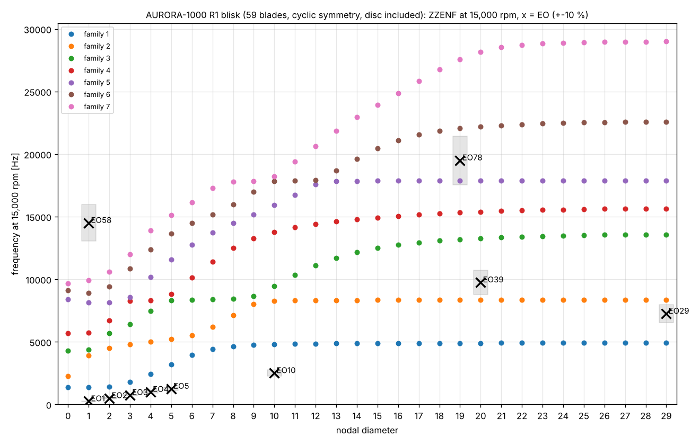

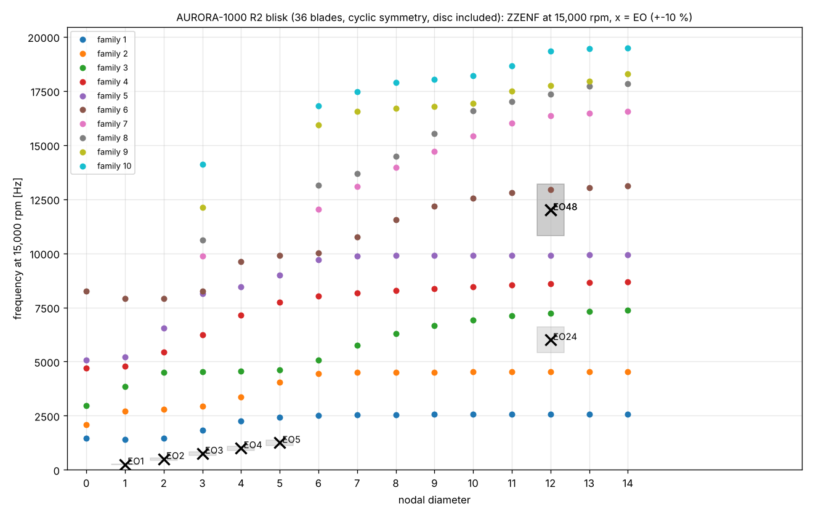

**مدل:**
- یک sector به اندازهٔ ۱/Z از دیسک (از r = 60 mm تا rim) همراه با سکو و پره.
- مش متناوب روی دو صفحهٔ برش و `*CYCLIC SYMMETRY MODEL`.
- پیش‌تنش NLGEOM در ۱۵٬۰۰۰ rpm، و E(T) برای میدان دمای دیسک و پره.
- **R1:** همهٔ قطرهای گرهی ND 0–29، هر کدام ۷ خانوادهٔ مود (ND1 با ۱۴ خانواده).
- **R2:** ND 0–14 با ۱۰ خانواده (ND 0–2 و ۴–۵ با ۶ خانواده).
- R1 در ND1 با ۱۴ و R2 در ND3 با ۱۰ خانواده دوباره حل شدند، تا مودهای پره‌ای ND پایین هم دیده شوند.
- اعتبارسنجی: مود flap با مدل تیر چک شد.
- دیسک فرکانس‌های ND پایین را تا ~۳ برابر کمتر از مدل هاب صلب می‌دهد. مدل هاب صلب (Campbell در `docs/img/a1000_R*_campbell.png`) فقط برای مقایسه نگه داشته شده است.

**معیارها** (حاشیه در کل باند شبکه، ۱۴٬۷۰۰ تا ۱۵٬۳۰۰ rpm؛ مرتبهٔ k در قطر گرهی n = k mod Z تحریک می‌کند):

| رده | مرتبه‌ها | حاشیهٔ لازم |
|---|---|---|
| قوی (۱×NPF ردیف کناری) | R1: N1 (دنباله)، N2 (میدان پتانسیل، فاصلهٔ ۹ mm)؛ R2: N2 | **۱۰٪ از همهٔ مودها** |
| ضعیف | ۲×NPF، دنبالهٔ N1 روی R2 (از دو ردیف گذشته)، ۲×N2 روی R1 (میدان پتانسیل ۲۴ پرهٔ بزرگ) | **۵٪** از مودهای زیر ۱٫۰۵× مود ۶ پره |
| برهم‌کنش دو ردیف ثابت | \|N1 − N2\| (دنبالهٔ N1 که پره‌های N2 خردش کرده‌اند) | بدون عبور در باند + تخمین پاسخ اجباری |
| EO 1–5 | محفظهٔ can، ورودی، ۵ پایهٔ اگزوز | ۱۰٪ |

**چرا تعداد پره‌ها عوض شد:** طرح ۴۳ / ۴۷ روی مدل کامل چهار تداخل داشت:
- R1 در EO47 فقط **−3.5%** با ND12 خانوادهٔ ۳ فاصله داشت.
- R1 در EO86 فقط **2.9%** با ND27 خانوادهٔ ۶ فاصله داشت.
- R2 در EO47 فقط **6.7%** با ND11 خانوادهٔ ۶ فاصله داشت.
- R2 در EO43 **0.0%**، یعنی تشدید، روی ND7 خانوادهٔ ۶.

ابزار `sim/engine/a1000_vane_count.py` همهٔ ترکیب‌های N1 و N2 از ۲۰ تا ۵۵ را بررسی کرد. در هر ترکیب وتر محوری طوری تنظیم شد که Zweifel ≤ 1.12 بماند. یافته‌ها:
- **NGV2 بین ۴۰ تا ۵۵ پره روی R2 ممکن نیست.** خانواده‌های ۵، ۶ و ۷ در ND 7–18 (۹٫۹، ۱۰٫۷–۱۳٫۲ و ۱۶–۱۷٫۵ kHz) پنجرهٔ ۱۰٪ برای EO 40–55 باقی نمی‌گذارند.
- **R2 یک خانوادهٔ مود پره‌ای تقریباً تخت در ۹٬۸۷ تا ۹٬۹۲ kHz در همهٔ ND ≥ 3 دارد** (ND3 خانوادهٔ ۷، ND5 خانوادهٔ ۶، ND7–14 خانوادهٔ ۵):
  - دنبالهٔ NGV1 که از دو ردیف گذشته به R2 می‌رسد، با ۳۷ تا ۴۲ پره در فاصلهٔ ۵٪ این خانواده می‌افتد (۳۹ پره: تشدید در ND3؛ ۴۰: −1.9%؛ ۴۲: −2.7%).
  - NGV1 با ۴۳ تا ۴۷ پره روی R1 رد می‌شود.
- **دو اصلاح روش در همین مرحله:**
  1. چک «ضعیف» اول روی ۶ خانوادهٔ اول هر ND انجام می‌شد. در ND پایین مودهای دیسک لابه‌لای مودهای پره می‌آیند، پس این روش مود پرهٔ R2 در ND3 (۹٬۸۷۳ Hz، خانوادهٔ ۷) و R1 در ND1 (۱۴٬۸۱۴ Hz، خانوادهٔ ۹) را نمی‌دید. حالا همهٔ مودهای زیر ۱٫۰۵× مود ۶ پره چک می‌شوند.
  2. مرتبهٔ برهم‌کنش |N1 − N2| اضافه شد.
  - با این اصلاح‌ها ترکیب میانی ۳۹ / ۲۹ (commit قبلی) رد شد: EO39 روی R2 در ND3 تشدید دارد و ۲×۲۹ = EO58 روی R1 در ND1 فقط ۰٫۲٪ فاصله دارد.
- **انتخاب: NGV1 = ۴۸ (وتر محوری ۲۲ mm) و NGV2 = ۲۴ (وتر محوری ۴۹ mm).** حاشیه‌ها در جدول زیر است.
  - ۴۸ = ۲×۲۴: هر کانال NGV2 دقیقاً دو دنبالهٔ NGV1 می‌گیرد، پس جای نسبی دو ردیف (clocking) را می‌شود برای بازده و کمترین تحریک تنظیم کرد.
  - مرتبهٔ برهم‌کنش |48 − 24| = 24 همان NPF ردیف دوم است و مرتبهٔ تازه‌ای نمی‌سازد.
- **تنها نقطهٔ مرزی:** ۲×N1 = EO96 روی R1، با خانوادهٔ ۶ در ND22 (۲۲٬۳۷۳ Hz).
  - حاشیه در لبهٔ باند **−4.9٪** و در ۱۵٬۰۰۰ rpm حدود ۶٫۸٪ است، در برابر ۵٪ لازم.
  - **با تحلیل پاسخ اجباری بسته شد (بخش ۱۲٫۴٫۱):** حتی در خود تشدید تنش ریشه ۱۰ MPa است، در برابر حد ۱۵٫۸ MPa. معیار این مرتبه حالا پاسخ اجباری است، نه حاشیهٔ فرکانسی.
  - همین تحلیل یک مشکل تازه نشان داد: **EO24 روی مود flap اول R1 در راه‌اندازی** (بخش ۱۲٫۴٫۱).
- **گزینه‌های دیگر:**
  - **۲۸ / ۲۴:** همهٔ چک‌های معلوم را قبول می‌کند، ولی NGV1 وتر محوری ۳۷ mm (h/c ~0.5) می‌خواهد و حدود ۰٫۶ واحد درصد بازده توربین بیشتر از دست می‌رود. چک ۲×N1 روی R1 در ND3 هم هنوز حل نشده است.
  - **۴۹ / ۲۴:** روی R2 در EO49 فقط ۴٫۴٪ و روی R1 در مرتبهٔ قوی ۱۰٫۳٪ حاشیه دارد. R1 به‌خاطر تنش ارتعاشی مجاز کمش (۳۲ MPa) ردیف حساس‌تر است.
- چون تعداد پره‌های NGV روی blisk‌ها اثری ندارد، اگر tip-timing نیاز نشان دهد، تغییر آن بعداً **فقط با ریختن دوبارهٔ NGVها** ممکن است. **blisk‌ها را می‌شود سفارش داد.**
  - استثنا: اگر برای EO24 روی R1 راه‌حل میرایی (شیار damper) انتخاب شود، نقشهٔ blisk R1 عوض می‌شود (بخش ۱۲٫۴٫۱).

**حاشیه‌های نهایی** (مدل کامل، باند ۱۴٬۷۰۰ تا ۱۵٬۳۰۰ rpm):

| ردیف | تحریک | EO | ND | نزدیک‌ترین مود | حاشیه | لازم |
|---|---|---|---|---|---|---|
| R1 | دنبالهٔ NGV1 (قوی) | 48 | 11 | خانوادهٔ ۳، ۱۰٬۳۴۲ Hz | −12.1% | 10% |
| R1 | میدان پتانسیل NGV2 (قوی) | 24 | 24 | خانوادهٔ ۱، ۴٬۹۰۸ Hz | −16.5% | 10% |
| R1 | ۲×NGV1 (ضعیف) | 96 | 22 | خانوادهٔ ۶، ۲۲٬۳۷۳ Hz | −4.9% (فقط برای مقایسه) | پاسخ اجباری: قبول |
| R1 | ۲×NGV2، میدان پتانسیل (ضعیف) | 48 | 11 | خانوادهٔ ۳ | −12.1% | 5% |
| R1 | EO 1–5 | 3 | 3 | خانوادهٔ ۱، ۱٬۷۷۹ Hz | 133% | 10% |
| R2 | دنبالهٔ NGV2 (قوی) | 24 | 12 | خانوادهٔ ۳، ۷٬۲۳۳ Hz (خانوادهٔ ۲: −23%) | +18.2% | 10% |
| R2 | دنبالهٔ NGV1 از دو ردیف + ۲×NGV2 (ضعیف) | 48 | 12 | خانوادهٔ ۶، ۱۲٬۹۴۴ Hz | +5.8% | 5% |
| R2 | EO 1–5 | 5 | 5 | خانوادهٔ ۱، ۲٬۴۳۵ Hz | 91% | 10% |

#### ۱۲٫۴٫۱ پاسخ اجباری R1 در EO24، EO48 و EO96 (۲۰۲۶-۱۰-۳۰)

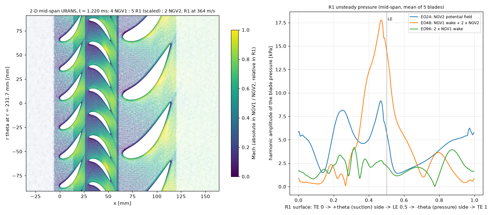

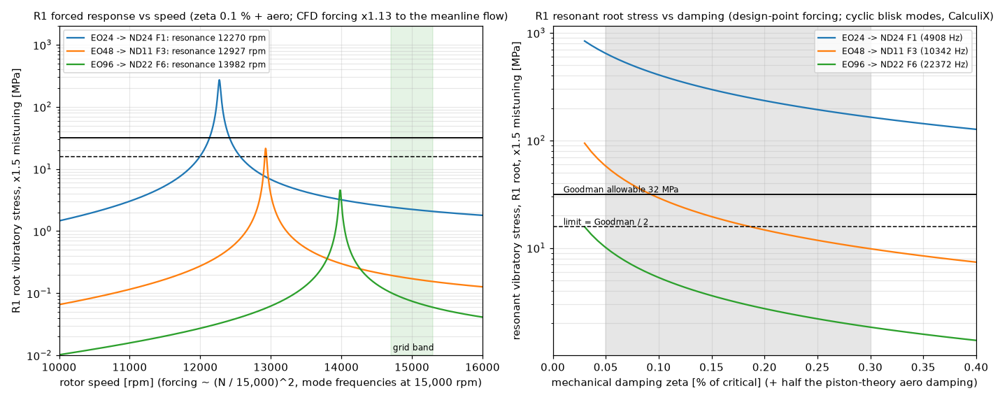

**روش، قدم ۱: نیروی ناپایا با CFD** (`sim/cfd/a1000_r1_forcing/make_case.py`):
- OpenFOAM v2606، `rhoPimpleFoam` (URANS تراکم‌پذیر، kOmegaSST).
- صفحهٔ پره‌به‌پره در شعاع میانی (۲۳۱٫۷ mm)، با سه ردیف NGV1، R1 و NGV2.
- سکتور ۳۰°: ۴ پرهٔ NGV1، ۵ پرهٔ R1 و ۲ پرهٔ NGV2.
  - گام R1 مقیاس شده است (۶۰ به‌جای ۵۹ پره، ۱٫۷٪ کوچک‌تر).
  - گام NGVها دقیق است، پس فرکانس‌های ۲۴، ۴۸ و ۹۶ برابر دور دقیق‌اند.
- R1 با ۳۶۴ m/s بین دو سطح لغزان (`cyclicPeriodicAMI`) حرکت می‌کند.
- شبه‌سه‌بعدی: ضخامت لایه به نسبت ارتفاع annulus بزرگ می‌شود، تا سرعت محوری مثل meanline بماند.
- ورودی 3.55 bar و 950 °C. فشار خروجی از meanline.
- مش ۲۲۹ هزار سلول شش‌وجهی. گام زمانی ۰٫۵ µs، یعنی ۸۳ گام در هر دورهٔ EO96.
- ۰٫۹۲ ms راه‌اندازی، بعد دو دورهٔ کامل EO24 (۰٫۳۴ ms) نمونه‌برداری. فشار سطح پره هر ۱ µs ثبت شد.
- نقطهٔ کار با طراحی می‌خواند:
  - ماخ خروج NGV1: 0.70 (طراحی 0.71).
  - زاویهٔ ورود نسبی R1: 22° (زاویهٔ فلز 19°).
  - زاویهٔ خروج نسبی R1: −65.6° (طراحی −65.1°).
- دبی معادل ۶٫۰۳ kg/s است، ۶٪ کمتر از meanline. نیرو با (۶٫۴۳ / ۶٫۰۳)² = ۱٫۱۳ بزرگ شد (محافظه‌کارانه).

**قدم ۲: مودها** (`sim/engine/a1000_r1_forced_response.py`):
- همان سکتور cyclic بخش ۱۲٫۴، با شکل مود و تنش برای ND24، ND11 و ND22.
- از هر جفت cos/sin، مود موج‌رونده با جهت درست ساخته شد. رابطهٔ cyclic جفت‌ها چک شد (خطا < ۱۰⁻⁴).
- جرم مودال با ماتریس جرم C3D10 خودمان حساب شد، مستقل از نرمال‌سازی CalculiX.

**قدم ۳: تصویر نیرو روی مود:**
- هارمونیک فشار مقطع میانی، روی همهٔ ارتفاع پره و هم‌فاز گذاشته شد. این برآورد بالاست.
- تنش ارتعاشی ریشه در تشدید = تنش مود × |Uᴴf| / (m · 2ζω²).

**قدم ۴: میرایی و معیار:**
- میرایی مکانیکی ۰٫۰۵ تا ۰٫۳٪ critical (blisk ریختگی، بدون اتصال اصطکاکی).
- به آن نصف میرایی آیرودینامیک piston theory اضافه شد (۰٫۰۱ تا ۰٫۰۷٪).
- ضریب mistuning ۱٫۵.
- حد: تنش ریشه ≤ Goodman / 2 = ۱۵٫۸ MPa (Goodman ریشه ۳۲ MPa، بخش ۱۲٫۳).
- **قبول** یعنی با کمترین میرایی هم زیر حد است. **رد** یعنی با بیشترین میرایی هم بالای حد است. بقیه **مرزی** است.

**نتیجه‌ها** (تنش ریشه با mistuning ×۱٫۵ و نیروی نقطهٔ طراحی):

| تحریک | دامنهٔ فشار روی پره (CFD) | مود | دور تشدید | در باند شبکه | در تشدید، ζ = ۰٫۰۵ / ۰٫۱ / ۰٫۳٪ | حکم |
|---|---|---|---|---|---|---|
| EO96: ۲×دنبالهٔ NGV1 | 2.2 kPa | ND22 F6، ۲۲٬۳۷۲ Hz | ۱۳٬۹۸۲ rpm | 0.11 MPa | **10** / 5.3 / 1.8 MPa | **قبول** |
| EO48: دنبالهٔ NGV1 + ۲×NGV2 | 6.4 kPa | ND11 F3، ۱۰٬۳۴۲ Hz | ۱۲٬۹۲۷ rpm | 0.20 MPa | 58 / 29 / 9.8 MPa | مرزی |
| EO24: میدان پتانسیل NGV2 | 4.9 kPa | ND24 F1 (flap)، ۴٬۹۰۸ Hz | ۱۲٬۲۷۰ rpm | 2.5 MPa | **644 / 407 / 165** MPa | **رد** |

- نیروی مماسی ناپایا نسبت به نیروی پایا: EO24 ۱۰٪، EO48 ۶٪، EO96 ۰٫۲٪. فشار EO96 در طول پره تغییر فاز می‌دهد و جمعش تقریباً صفر است.
- اختلاف دو دورهٔ نمونه‌برداری ۱۰ تا ۱۶٪ است. اختلاف بین ۵ پره ≤ ۳٪ است.
- بیشترین تنش EO96 در ۶۴٪ ارتفاع است (۱۴٫۵ MPa). آنجا تنش میانگین کمتر و تنش مجاز بیشتر است.
- هر سه تشدید پایین‌تر از باند شبکه‌اند و فقط در راه‌اندازی و توقف رد می‌شوند. در باند شبکه همهٔ تنش‌ها ≤ ۲٫۵ MPa است.

**تفسیر:**
- **EO96 بسته شد.** حتی در خود تشدید، با کمترین میرایی و نیروی نقطهٔ طراحی، تنش ۱۰ MPa است. پس حاشیهٔ ۴٫۹٪ مهم نیست.
  - تشدید در ۱۳٬۹۸۲ rpm است (شبکهٔ ۴۶٫۶ Hz). کار طولانی در فرکانس پایین شبکه هم مشکلی ندارد.
  - در برگهٔ چک، معیار EO96 از «حاشیهٔ ۵٪» به «پاسخ اجباری» عوض شد.
- **EO48 مرزی است.** با ζ ≥ ۰٫۱۸٪ قبول است. با نیروی کمتر هنگام راه‌اندازی (~(N/15000)² = ۰٫۷۴) با ζ ≥ ۰٫۱۴٪.
- **EO24 یک یافتهٔ تازه است.** مود flap اول R1 (ND24) در هر راه‌اندازی با ۱×NPF ردیف NGV2 تشدید دارد.
  - ۲۴ پرهٔ بزرگ NGV2 (گام ۶۱ mm، فاصله تا R1 از ۹ تا ۱۷ mm) میدان فشار قوی روی لبهٔ فرار R1 می‌سازند.
  - با نیروی راه‌اندازی (×۰٫۶۷) هم تنش 431 / 272 / 110 MPa است.
  - عبور سریع کمکی نمی‌کند. با میرایی ۰٫۱٪، دامنه در ~۲۵ ms ساخته می‌شود. با راه‌اندازی ۶۰ ثانیه‌ای بیش از ۹۵٪ تشدید پایا می‌رسد.
  - هر عبور ~۶۰۰ سیکل دارد. در ۱۰⁴ راه‌اندازی یعنی ~۱۰⁷ سیکل، که در محدودهٔ HCF است.
  - این مشکل به تعداد NGV1 ربطی ندارد. معیار قبلی (حاشیهٔ فرکانسی فقط در باند شبکه) عبورهای پایین‌تر از باند را چک نمی‌کرد.

**توصیه:**
1. **NGV1 = ۴۸ و NGV2 = ۲۴ از نظر EO96 بمانند.** تغییر تعداد NGV1 لازم نیست، و EO24 را هم حل نمی‌کند.
2. **EO24 روی R1 باید قبل از سفارش حلقهٔ NGV2 و فاصله‌انداز روتور بسته شود.** گزینه‌ها:
   - **فاصلهٔ محوری R1 تا NGV2 بیشتر:** میدان پتانسیل با exp(−2πg/s) کم می‌شود، یعنی هر ۱۰ mm ×۰٫۳۶. حدود ۲۰ تا ۳۰ mm بیشتر لازم است. طول روتور و دینامیک روتور (بخش ۱۳) عوض می‌شوند.
   - **میرایی اصطکاکی** (مثلاً damper ring زیر سکوی R1): میرایی کل ۱ تا ۲٫۵٪ لازم است. روی مود flap با ND بالا اثرش محدود است، و شیار آن باید در نقشهٔ blisk R1 باشد.
   - **تحلیل دقیق‌تر قبل از تصمیم:** CFD سه‌بعدی ناپایا (تغییر شعاعی و فاز)، میرایی آیرودینامیک واقعی مود F1 (معمولاً بیشتر از piston theory)، و شرایط واقعی راه‌اندازی.
3. **tip-timing در اولین راه‌اندازی** روی R1، با جاروی ۱۲٬۰۰۰ تا ۱۴٬۵۰۰ rpm.

### ۱۲٫۵ تست ۳: دیسک‌ها (`sim/engine/a1000_disc_fea.py`، تقارن محوری CAX6)

مدل:
- نیروی گریز از مرکز + کشش پره‌ها + میدان دمای شعاعی (R1: ۴۵۰ ← ۸۰۰ °C؛ R2: ۴۲۰ ← ۶۹۰ °C).
- دو حل جدا: کل (با تنش حرارتی) و فقط مکانیکی (برای خزش).
- بدون شیار rim.

| | R1 | R2 |
|---|---|---|
| von Mises بیشینه در ۱۵k / trip ۱۶٫۵k | 460 / 521 MPa (۴۵۰ °C) | 466 / 524 MPa (۶۲۷ °C) |
| حاشیهٔ تسلیم در trip | **1.51** | **1.46** |
| ترکیدن (میانگین سطحی تنش محیطی، ۸۵٪ UTS) | **1.81×** دور کار | **1.74×** (لازم ≥ ۱٫۳۴×) |
| خزش (تنش مکانیکی، منحنی حداقل) | 173 MPa @ 800 °C ← **5.1×10⁵ h** | 240 MPa @ 690 °C ← 3.7×10⁷ h |
| LCF روشن‌وخاموش (Manson–Morrow، ضریب ۲ / ۲۰) | 1.7×10⁴ سیکل؛ سکو (Kt 1.3) 3.0×10⁴ | 1.5×10⁴؛ سکو 8.7×10⁵ (لازم ۱۰⁴) |
| رشد شعاعی rim (کل) | 1.94 mm | 1.63 mm |

### ۱۲٫۶ تست ۴: دینامیک روتور (`sim/engine/a1000_rotordynamics.py`)

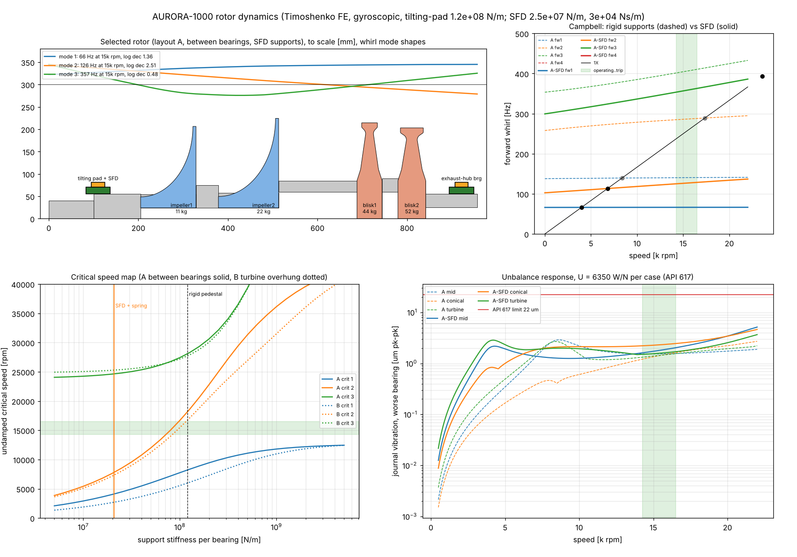

مدل:
- تیر Timoshenko با اثر ژیروسکوپی، در مختصات مختلط.
- روتور کامل **۱۹۶ kg**: کوپلینگ، collar کف‌گرد، دو پروانه، درام، دو blisk و پیچ مرکزی.
- دو یاتاقان tilting-pad Ø110×55 mm.
- در rev 5 فاصلهٔ دو blisk ۲۳ mm بیشتر شد (R1 ۴ mm جلوتر، R2 ۱۹ mm عقب‌تر).

| | A + SFD (**انتخاب**) | A + SFD با میرایی کم | A با تکیه‌گاه صلب | B: توربین آویزان |
|---|---|---|---|---|
| مودهای صلب [rpm] | 3,964 و 6,780 (AF 2.3 و 1.2) | 3,988 و 7,057 (AF 5.4 و 3.0) | 8,308 و **17,317** (فقط ۹٫۹٪ بالای MCS) | 5,902 و **17,124** (۸٫۷٪) |
| اولین مود خمشی | **23,191 rpm**، حاشیهٔ **۴۷٫۲٪** (API 617: ۲۳٫۹٪) | 22,846، ۴۵٫۱٪ (لازم ۲۵٫۷٪) | > 26,000 | 25,411 |
| ارتعاش نامیزانی API (۹۵٪ تا trip) | **2.5 µm** (حد ۲۲ µm) | 2.6 µm | 1.6 µm | 3.3 µm |

نتیجه: روتور نسبت به دو مود صلب **فوق‌بحرانی** است و هر دو را با میرایی زیاد هنگام راه‌اندازی رد می‌کند. نسبت به مود خمشی **زیربحرانی** است و فاصلهٔ زیادی دارد. مشخصات SFD: Ø150، طول ۳۰ mm، لقی ۰٫۱۵ mm، با فنر قفسه‌ای ۲٫۵×۱۰⁷ N/m.

### ۱۲٫۷ تست ۵: لقی نوک پره در کار

| | R1 | R2 |
|---|---|---|
| رشد rim دیسک (FEA، کل) | 1.94 mm | 1.63 mm |
| کشیدگی پره (FEA) + انبساط حرارتی پره | 0.02 + 0.44 mm | 0.07 + 0.58 mm |
| **رشد کل روتور** | **2.40 mm** | **2.28 mm** |
| لقی سرد / هدف در کار | 0.50 / 0.45 mm | 0.60 / 0.55 mm |
| دمای لازم حلقهٔ نگه‌دارندهٔ shroud (فولاد 1.4828) | **~۵۴۷ °C** | **~۴۹۷ °C** (حد ۶۰۰ °C) |

الزام: حلقهٔ shroud با هوای خروجی کمپرسور تا همین دماها گرم و کنترل شود. shroud از honeycomb سایشی (Hastelloy X) باشد تا برخورد سبک در گذرا بی‌خطر بماند.

### ۱۲٫۸ جمع‌بندی تست‌ها (`sim/engine/a1000_turbine_checks.py`)

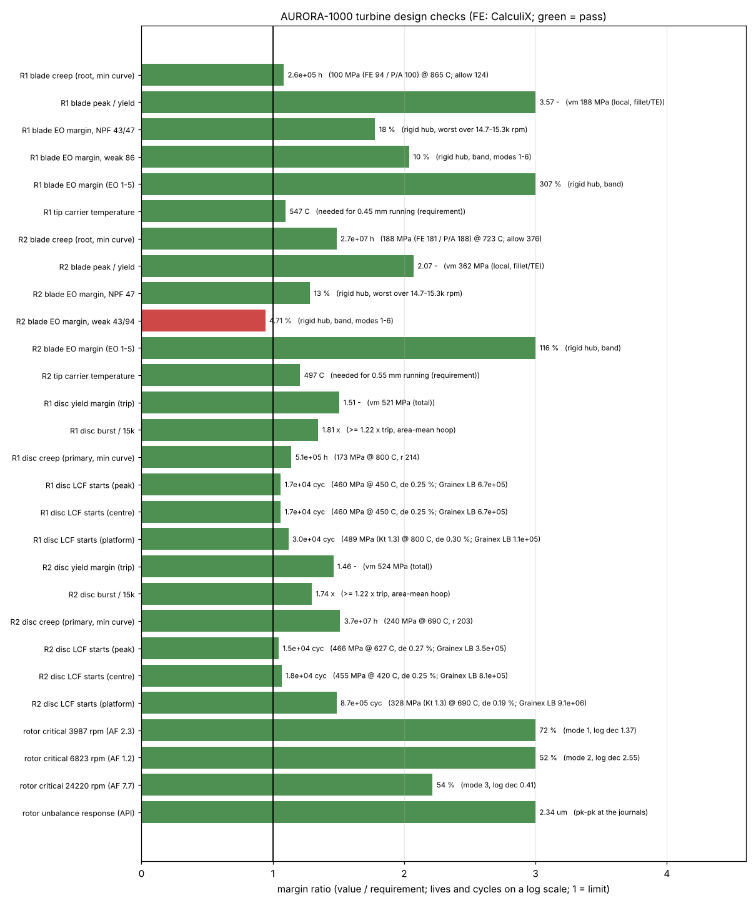

**۲۹ از ۳۰ معیار قبول شدند** (۲۰۲۶-۱۰-۳۰، بعد از تحلیل پاسخ اجباری). ۸ ردیف خاکستری فقط برای مقایسه‌اند: حاشیه‌های مدل هاب صلب، حاشیهٔ فرکانسی EO96، و EO48 مرزی.

- **EO96 روی R1 بسته شد.** معیارش حالا پاسخ اجباری است: ۱۰ MPa در برابر حد ۱۵٫۸ MPa، حتی در تشدید (بخش ۱۲٫۴٫۱).
- **مورد رد تازه:** EO24 (میدان پتانسیل NGV2) روی مود flap اول R1، هنگام عبور از ۱۲٬۲۷۰ rpm در راه‌اندازی. حتی با بیشترین میرایی ۱۶۵ MPa است (بخش ۱۲٫۴٫۱).
- **مرزی:** EO48 روی R1 در ۱۲٬۹۲۷ rpm: ۵۸ تا ۱۰ MPa بسته به میرایی. tip-timing تصمیم می‌گیرد.

کم‌حاشیه‌ترین‌ها:
1. R1 در EO24، عبور راه‌اندازی: رد (بالا).
2. R1 در EO48، عبور راه‌اندازی: مرزی.
3. R2 در EO48: ۵٫۸٪ در برابر ۵٪ (پاسخ اجباری R2 هنوز حساب نشده).
4. مرتبه‌های قوی: R1 ۱۲٫۱٪ و R2 ۱۸٫۲٪، در برابر ۱۰٪.
5. تنش ارتعاشی مجاز ریشهٔ R1 فقط ۳۲ MPa است، چون خزش ۸۱٪ ظرفیت را مصرف می‌کند.
6. عمر خزشی ریشهٔ R1: ۲٫۶×۱۰⁵ h در برابر هدف ۱۰⁵ (حساس به دادهٔ ماده).
7. LCF دیسک‌ها: R2 ۱٫۵×۱۰⁴ و R1 ۱٫۷×۱۰⁴ سیکل، در برابر ۱۰⁴ روشن‌وخاموش لازم.
8. حاشیهٔ تسلیم دیسک R2 در trip: ۱٫۴۶.

### ۱۲٫۹ الزامات ساخت و طراحی جزئی که از تست‌ها درآمد

1. **ریخته‌گری blisk‌ها:**
   - هر دو blisk از MAR-M247 equiaxed دانه‌ریز، ریخته‌گری دقیق در خلأ، از یک ذوب.
   - **HIP** برای بستن تخلخل.
   - بازرسی پرتونگاری و FPI ۱۰۰٪.
   - لبهٔ فرار ≥ ۱٫۰ mm و فیلت ریشهٔ ۳ / ۳٫۵ mm.
   - **دادهٔ تأییدشدهٔ خزش و LCF** از ریخته‌گر: میله‌های هم‌ذوب و نمونهٔ بریده از قطعه. عمر R1 (۲٫۶×۱۰⁵ h روی منحنی حداقل) به این داده حساس است.
2. **NGVها:**
   - **حلقهٔ کامل ریختگی:** NGV1 با ۴۸ پره (MAR-M247 + پوشش آلومینایدی + TBC) و NGV2 با ۲۴ پره.
   - اگر ریخته‌گر حلقهٔ کامل را نپذیرد، هر دو قابل سگمنت‌اند، مثلاً NGV1 در ۸ سگمنت ۶‌پره‌ای و NGV2 در ۸ سگمنت ۳‌پره‌ای. در این حالت درزهای سگمنت مسیر نشتی‌اند و آب‌بندی (strip seal) لازم دارند.
   - پره‌های NGV2 ضخیم‌اند (۱۴ mm). ترک خستگی حرارتی لبهٔ فرار در گذرا باید با تحلیل حرارتی گذرا چک شود.
3. **ماشین‌کاری:**
   - کوپلینگ‌های Curvic.
   - سنگ‌زنی نوک پره‌ها تا قطر نهایی.
   - بالانس دینامیکی هر blisk و بعد روتور کامل (G2.5).
   - **شیار rim لازم نیست.**
4. **هوای ثانویه:**
   - حلقهٔ shroud در ~۵۵۰ / ۵۰۰ °C نگه داشته شود.
   - دمای سکوی R1 ≤ ۸۰۰ °C (فرض FEA دیسک).
   - این دماها باید با تحلیل حرارتی مزدوج (CHT) تأیید شوند.
5. **یاتاقان‌ها:**
   - tilting-pad Ø110 با preload ~۰٫۳، روی SFD + فنر قفسه‌ای.
   - یاتاقان عقب در هاب دیفیوزر اگزوز با ۵ پایه.
6. **پایش و تست:**
   - دو پراب مجاورتی در هر یاتاقان؛ هشدار ~۲۵ µm و trip ~۴۰ µm (API 670).
   - در اولین تست موتور: **tip-timing روی هر دو blisk** (EO24، 48، 96 و EO 1–5) و جاروی دور ۱۴٬۵۰۰ تا ۱۵٬۵۰۰ rpm.
   - روی R1، tip-timing در راه‌اندازی هم لازم است: عبور EO24 در ~۱۲٬۲۷۰، EO48 در ~۱۲٬۹۳۰ و EO96 در ~۱۳٬۹۸۰ rpm (بخش ۱۲٫۴٫۱).
   - تست ضربه (ping test) هر blisk بعد از ماشین‌کاری، برای مقایسه با فرکانس‌های این گزارش. هر دو blisk باید از نظر mistuning یکسان و کنترل‌شده باشند.

### ۱۲٫۱۰ محدودیت‌ها و قدم بعدی

- **داده‌های ماده:** تیپیک‌اند و منحنی خزش از داده‌های منتشرشده بازسازی شده است (بخش ۱۲٫۳). داده‌های تأییدشدهٔ ریخته‌گر جای آن را می‌گیرند.
- **میدان دما فرضی است:** پره در دمای نسبی گاز، دیسک با قانون توانی. CFD ردیف‌ها و CHT دیسک و shroud قدم بعدی است.
- **پاسخ اجباری R1 (بخش ۱۲٫۴٫۱)** با CFD دوبعدی مقطع میانی حساب شده است. محدودیت‌ها:
  - نیرو روی همهٔ ارتفاع پره یکسان و هم‌فاز فرض شده (برآورد بالا).
  - گام R1 در CFD ۱٫۷٪ کوچک‌تر است. اختلاف دو دورهٔ نمونه‌برداری ۱۰ تا ۱۶٪ است.
  - میرایی آیرودینامیک فقط با piston theory است (برای مود F1 احتمالاً کمتر از واقعی).
  - مودها بدون بازوهای فلنج rev 1 روتور (بخش ۱۳) حل شده‌اند. اثرشان روی ND 11، 22 و 24 کم است.
  - شرایط راه‌اندازی با نیروی ∝ (N/15000)² تقریب زده شده است.
  - پاسخ اجباری R2 (EO24، EO48) هنوز حساب نشده است.
- **قدم بعد برای EO24 روی R1:** CFD سه‌بعدی ناپایای R1–NGV2، میرایی آیرودینامیک مود F1، و مقایسهٔ گزینه‌ها (فاصلهٔ محوری بیشتر یا میرایی اصطکاکی). باید قبل از سفارش حلقهٔ NGV2، فاصله‌انداز روتور و (اگر damper انتخاب شود) blisk R1 انجام شود.
- **مودهای حل‌نشده:**
  - مودهای بالای R2 در ND 15–18 حل نشده‌اند، چون هیچ مرتبه‌ای از طرح فعلی به آن‌ها نمی‌رسد.
  - هارمونیک سوم NGV2 (۳×۲۴ = ۷۲ = ۲×۳۶) روی R2 قطر گرهی صفر را در ۱۸ kHz تحریک می‌کند. این بالای محدودهٔ چک ضعیف است و مودهای ND0 در این فرکانس حل نشده‌اند.
- **قدم بعد:**
  - CFD سه‌بعدی دو پله (راندمان، زاویه‌ها، گلوگاه، نیروی ناپایا).
  - CHT هوای ثانویه.
  - تحویل قطعات به فیوژن برای نقشه‌های ساخت (`fusion/A1000`، `fusion/HANDOFF.md`).

## ۱۳. روتور و یاتاقان‌ها، rev 1 (۲۰۲۶-۱۰-۳۰)

هندسه: `cad/engine/a1000_rotor.py` · محاسبه: `sim/engine/a1000_rotor_stack.py` (نتایج: `sim/engine/fea/a1000_rotor_stack.json`) · فیوژن: «AURORA-1000 Rotor and Bearings rev1» (کامل و نیم‌برش)

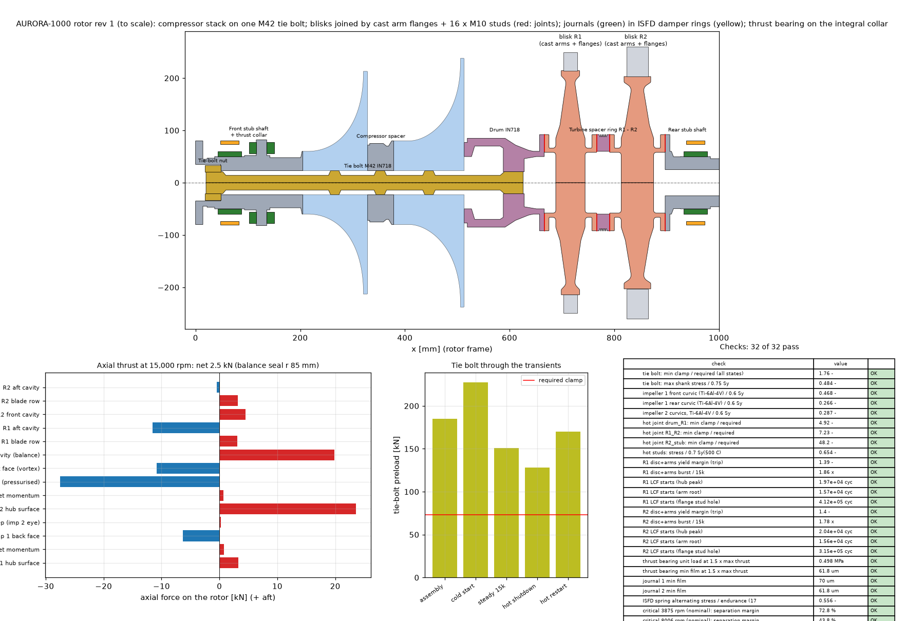

### ۱۳٫۱ مشکل اتصال blisk‌ها و راه‌حل

دیسک‌های rev 5 سوراخ وسط ندارند (bore-less). پس پیچ مرکزی نمی‌تواند از توربین رد شود. سوراخ‌دار کردن دیسک با FEA تست شد و رد شد:

| دیسک (۱۵٬۰۰۰ rpm) | تنش بیشینه | حاشیهٔ تسلیم در trip | عمر LCF |
|---|---|---|---|
| بدون سوراخ (rev 5) | ۴۵۸ / ۴۶۶ MPa | ۱٫۵۱ / ۱٫۴۶ | ۱٫۸×۱۰⁴ / ۱٫۵×۱۰⁴ |
| سوراخ Ø50 | ۹۱۹ / ۹۱۴ MPa | ۰٫۷۵ | ~۲۰۰ |
| سوراخ Ø50 + توپی ۳۰ mm پهن‌تر | ۷۷۱ / ۷۸۰ MPa | ۰٫۹۰ | ~۷۰۰ |

**راه‌حل:**
- هر blisk دو طرف هاب یک **بازوی کوتاه ریختگی** دارد (r 58–66) که به یک **فلنج** (r 58–92، ضخامت ۹ mm) می‌رسد.
- فلنج‌ها با **کوپلینگ Curvic پیچی** (۴۸ دندانه، r 62–90) و **۱۶ استاد M10 از IN718** به هم بسته می‌شوند: درام ← R1 ← R2 ← شفت عقب.
- مهره‌ها در فضای ۱۳ mm پشت هر فلنج‌اند و از بین ردیف پره‌ها شعاعی در دسترس‌اند. پس روتور بیرون از موتور مونتاژ و بالانس می‌شود.
- **نتیجه برای بقیهٔ طرح:** بدنهٔ توربین باید **افقی دوتکه** باشد و هر دو حلقهٔ NGV **دو نیمه** شوند. بخش ۱۲٫۹ اجازهٔ سگمنت را داده بود.
- جرم هر blisk حدود ۳٫۲ kg بیشتر می‌شود (R1 ۴۵٫۶، R2 ۵۰٫۷ kg برای دیسک با بازو).

FEA محوری دیسک با بازوها (CalculiX):

| | R1 | R2 | معیار |
|---|---|---|---|
| حاشیهٔ تسلیم در trip | ۱٫۳۹ | ۱٫۴۰ | ≥ ۱٫۰ |
| ترکیدن / ۱۵k | ۱٫۸۶ | ۱٫۷۸ | ≥ ۱٫۳۴ |
| LCF مرکز هاب | ۲٫۰×۱۰⁴ | ۲٫۰×۱۰⁴ | ≥ ۱۰⁴ |
| LCF ریشهٔ بازو (فیلت ۸ mm) | ۱٫۶×۱۰⁴ | ۱٫۶×۱۰⁴ | ≥ ۱۰⁴ |
| LCF سوراخ استاد (hoop ۱۲۲ MPa × Kt 2.6) | ۴×۱۰⁵ | ۳×۱۰⁵ | ≥ ۱۰⁴ |

### ۱۳٫۲ بخش کمپرسور: پیچ مرکزی

- **پیچ M42×3 از IN718** با ساق باریک‌شدهٔ Ø28 (برای انعطاف). از مهرهٔ جلوی شفت تا یک دیوارهٔ رزوه‌دار داخل درام می‌رود.
- **ترتیب قطعات:** شفت جلو (یاتاقان ۱ + فلنج کف‌گرد یکپارچه)، پروانهٔ ۱، فاصله‌انداز، پروانهٔ ۲، درام IN718.
- همهٔ اتصال‌ها **Curvic با ۳۶ دندانه** هستند. Curvic مرکزیت و گشتاور را منتقل می‌کند. سوراخ Ø46 پروانه‌ها چیزی را مرکز نمی‌کند.

| حالت | نیروی پیش‌بار |
|---|---|
| مونتاژ | ۱۸۵ kN |
| شروع سرد (پیچ هنوز سرد) | ۲۲۷ kN |
| کار دائم ۱۵k (با کوتاه‌شدن پواسونی هاب‌ها) | ۱۵۱ kN |
| خاموشی داغ | ۱۲۸ kN (کمترین) |
| **لازم** (گشتاور اتصال کوتاه ژنراتور ۵×، خمش ۳g، بار محوری) | **۷۱ kN** → ضریب ۱٫۸ |

- **تنها مورد رد:** Curvic جلوی **پروانهٔ ۱ اگر آلومینیومی بماند**: فشار دندانه ۲۳۲ MPa در برابر ۱۸۳ مجاز. با **Ti-6Al-4V** حاشیه کافی است (۰٫۴۷). پیشنهاد: پروانهٔ ۱ تیتانیوم، یا کوپلینگ محدودکنندهٔ گشتاور سمت ژنراتور. تصمیم با طراحی کمپرسور است.
- اندازهٔ Curvic‌ها با طراحی جزئی پروانه‌ها هماهنگ شد (هاب ورودی r 60 / 80).

### ۱۳٫۳ نیروی محوری و تعادل

- بدون تعادل، نیروی خالص **۱۲٫۵ kN** به عقب بود و یاتاقان کف‌گرد ۵۴ kW تلف می‌کرد.
- **راه‌حل:** پشت پروانهٔ ۲ یک لابیرنت در r 200 گذاشته شد. هوای خروجی کمپرسور در r 120 به حفرهٔ پشت پروانه دمیده می‌شود. همین هوا از آب‌بند درام (r 85) به حفرهٔ جلوی توربین می‌رود و purge لازم آن را هم می‌دهد.
- نیروی خالص: **۴٫۱ kN** در بار کامل، ۲٫۴ kN در ۶۰٪ و ۰٫۶ kN در بی‌باری.

### ۱۳٫۴ یاتاقان‌ها

| | مشخصه | نتیجه |
|---|---|---|
| ژورنال ۱ و ۲ | tilting-pad، ۵ پد، بار بین پدها، D100 × 45، preload 0.3، لقی ۷۰ µm | بار ۰٫۲۱ / ۰٫۳۵ MPa، فیلم ≥ ۶۴ µm، تلفات ۶٫۷ kW هر کدام، روغن ۱۲ l/min |
| دمپر | **ISFD** (حلقهٔ یکپارچهٔ واير‌کات با ۸ فنر S)، D160 × 35، لقی ۰٫۱۳ mm | سختی 3.1e7 N/m، میرایی 4.7e4 (فیلم کامل) / 2.4e4 Ns/m (π-film)، تنش فنر ۱۳۹ MPa متناوب |
| کف‌گرد | ۲ × ۸ پد، r 56–78، فلنج یکپارچه روی شفت جلو | ۰٫۸۲ MPa در ۱٫۵ × بار بیشینه، فیلم ۴۸ µm، تلفات ۱۳٫۴ kW |

- ژورنال ۱ پانزده mm جلوتر رفت (x 95) تا کف‌گرد پشتش جا شود.
- یاتاقان ۲ در هاب اگزوز است. محفظه‌اش باید عایق حرارتی و هوای بافر داشته باشد (طراحی بدنهٔ اگزوز).

### ۱۳٫۵ دینامیک روتور با هندسهٔ جزئی

روتور ۱۸۳ kg است. سختی پدها از مدل یاتاقان آمده و ISFD سری با آن است.

| حالت | سرعت‌های بحرانی | ارتعاش API |
|---|---|---|
| اسمی | ۴٬۱۰۰ (AF 2.3)، ۸٬۳۰۰، ۲۳٬۴۰۰ rpm (حاشیه ۴۹٪ / لازم ۲۴٪) | ۳٫۱ µm (حد ۲۲) |
| دمپر π-film | ۴٬۰۴۰، ۷٬۸۰۰، ۲۲٬۹۰۰ rpm (حاشیه ۴۵٪ / لازم ۲۵٪) | ۳٫۱ µm |

### ۱۳٫۶ تلفات و اثر بر راندمان

- تلفات یاتاقان‌ها و آب‌بندها **~۲۹ kW** است. اندازه‌های اولیه (یاتاقان‌های D110 و کف‌گرد بزرگ بدون تعادل) ۷۶ kW می‌دادند.
- محاسبهٔ سیکل (`eta_mech` = 0.994) فقط ~۶ kW در نظر گرفته بود. فرق آن حدود **۰٫۸ واحد درصد راندمان برق** است و باید در meanline اصلاح شود.
- روغن لازم برای یاتاقان‌ها ~۴۷ l/min است (بدون گیربکس).

### ۱۳٫۷ وضعیت و قدم بعد

- **۳۲ از ۳۳ چک قبول.** تنها رد: Curvic پروانهٔ ۱ با آلومینیوم (بخش ۱۳٫۲).
- **باز:**
  1. هندسهٔ CAD توربین (`cad/engine/a1000_turbine.py`) هنوز بازوها را ندارد. بازوها در `a1000_rotor.py` اضافه شده‌اند. تحلیل cyclic blisk‌ها با بازوها باید دوباره اجرا شود (اثر کم روی مودهای پره، اثر روی ND 0–1).
  2. بدنهٔ افقی دوتکه و NGVهای دونیمه.
  3. FEA سه‌بعدی Curvic‌ها و حلقهٔ ISFD.
  4. تحلیل حرارتی گذرا برای دمای پیچ مرکزی.
  5. بعد از آمدن هندسهٔ نهایی پروانه‌ها: دوباره اجرای نیروی محوری و دینامیک روتور.

## ۱۴. بخش داغ توربین، rev 1 (۲۰۲۶-۱۰-۳۰)

هندسه: `cad/engine/a1000_hot_section.py` · محاسبه: `sim/engine/a1000_hot_section_calc.py` (نتایج: `sim/engine/fea/a1000_hot_section.json`) · فیوژن: داخل «AURORA-1000 Package rev5»

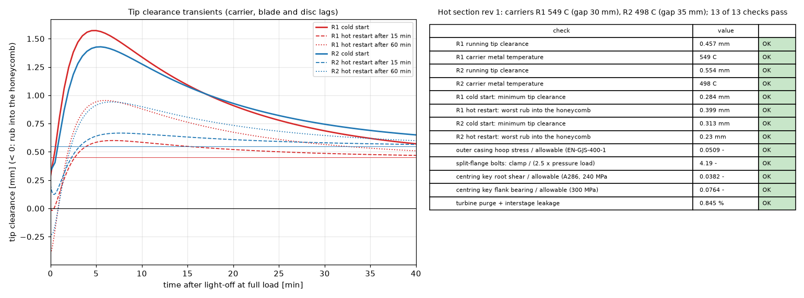

**چرا این شکل:** روتور rev 1 یکجا بیرون موتور مونتاژ و بالانس می‌شود (بخش ۱۳). پس بخش ثابت باید دورش باز شود.

| قطعه | جنس | کار |
|---|---|---|
| بدنهٔ بیرونی، **افقی دوتکه** (۲ × ۵۳ kg) | چدن نشکن EN-GJS-400-18LT | فشار، گشتاور NGVها و نیروی محوری را می‌گیرد. داخلش هوای خروجی کمپرسور (۳٫۸ bar، ۱۷۵ °C) در راه recuperator جریان دارد، پس بدنه سرد می‌ماند. |
| حلقه‌های نگه‌دارنده C1 و C2 (۱۲ و ۲۳ kg)، دونیمه | 1.4828 | NGV1 و shroud پلهٔ ۱ / NGV2 و shroud پلهٔ ۲. داغ کار می‌کنند و روی **۸ پین شعاعی** شناورند. |
| shroud لانه‌زنبوری ۴ mm روی پشت‌بند ۳ mm | Hastelloy X | سایش‌پذیر؛ در تماس پره‌ها خورده می‌شود و پره آسیب نمی‌بیند. |
| دیافراگم جلو و میانی، دونیمه | Hastelloy X | آب‌بند لانه‌زنبوری در r 93–96 روی فلنج‌های روتور |
| حلقه‌های NGV | | با وایرکات به دو نیمه بریده می‌شوند. درز با strip seal بسته می‌شود. |

**لقی نوک پره:**
- لقی کاری فقط وقتی به هدف (۰٫۴۵ / ۰٫۵۵ mm) می‌رسد که حلقه‌ها در **۵۴۷ و ۴۹۷ °C** کار کنند.
- بیرون حلقه‌ها کانالی است که هوای کمپرسور از آن رد می‌شود. پهنای کانال طوری انتخاب شد که این دماها دقیقاً حاصل شود: **۳۰ mm برای C1 و ۳۵ mm برای C2**.
- نتیجه: C1 در ۵۴۹ °C و لقی ۰٫۴۶ mm؛ C2 در ۴۹۸ °C و لقی ۰٫۵۵ mm. افت فشار هوای کمپرسور ۰٫۰۲–۰٫۰۴ ٪ است.

**گذرا:**
- **شروع سرد:** حلقه‌ها (ثابت زمانی ~۱۰۰ s) زودتر از دیسک (~۹۰۰ s) گرم می‌شوند. کمترین لقی ۰٫۲۸ mm است، پس تماسی نیست.
- **روشن کردن دوباره در حالت داغ:** اگر بین ۱۵ دقیقه تا ۲ ساعت بعد از خاموشی روشن شود، دیسک هنوز داغ است ولی حلقه سرد شده. پره حداکثر **۰٫۴ mm** در لانه‌زنبوری می‌ساید.
- **پیشنهاد:** در کنترل یک **مهلت قفل روشن‌شدن** گذاشته شود: بین ۱۵ دقیقه تا ۲ ساعت بعد از توقف، فقط بعد از چرخاندن خنک‌کننده با استارتر روشن شود. هر سایش، لقی کاری را دائم بیشتر می‌کند و راندمان را کم می‌کند.

**سایر چک‌ها (همه قبول، ۱۲ از ۱۲):**
- تنش حلقوی بدنهٔ بیرونی ۴ MPa.
- پیچ‌های درز افقی: ۳ × M16 در هر طرف (ضریب ۴٫۷).
- تنش برشی پین‌ها ۷ MPa.
- حلقه‌ها در حالت داغ ۲٫۲ mm روی پین‌ها شعاعی جابه‌جا می‌شوند.
- نیروی محوری هر NGV ۳٫۴ kN و گشتاورشان ۶۵۰ / ۶۷۰ Nm است.

**هوای ثانویه (لابیرنت با لقی ۰٫۳ mm):**
- آب‌بند تعادل درام: ۰٫۵۸ ٪ هوا. همین هوا purge حفرهٔ جلوی توربین است.
- آب‌بند میانی: ۰٫۲۷ ٪.
- آب‌بند پشت پروانهٔ ۲: ۱٫۳۷ ٪. این هوا به خروجی پروانه برمی‌گردد و اتلافش کم است (~۲ kW).

**باز:**
1. منیفولد هوا در انتهای بدنه که هوای کمپرسور را به recuperator می‌برد (همراه طراحی اگزوز).
2. شکل نهایی اسکرول ورودی NGV1 و اتصالش به C1.
3. تحلیل حرارتی دقیق (CHT) حلقه‌ها و دیافراگم‌ها.
4. strip seal درز NGVها.

## ۱۵. طراحی جزئی کمپرسور: دو پروانه با پرهٔ خط‌کشی‌شده، دیفیوزر و کانال برگشت (rev 1، ۲۰۲۶-۱۰-۳۰)

درخواست: کمپرسور از «پوستهٔ meanline» به طرح قابل ساخت برسد؛ قطعات ساده و مناسب CNC باشند و نتیجه در فیوژن دیده شود.

- **طراحی آیرودینامیکی:** `cad/engine/a1000_impeller.py` (نتایج: `sim/a1000_impeller_design.json`).
- **CAD در FreeCAD:** همان فایل با `--cad` و `--sector`.
- **تست‌ها با CalculiX:** `sim/engine/a1000_impeller_fea.py`.
- **دینامیک روتور:** `sim/engine/a1000_rotordynamics.py`.
- **فیوژن:** «AURORA-1000 Compressor rev1» و «AURORA-1000 Package rev5».
- رابط‌ها با پشتهٔ روتور بخش ۱۳ یکی است:
  - سوراخ Ø46 برای پیچ M42؛
  - Curvic پروانهٔ ۱: جلو r 44–58، عقب r 50–70؛
  - Curvic پروانهٔ ۲: جلو r 52–72، عقب r 55–75؛
  - سطوح x = 205.0 / 328.76 / 378.76 / 513.27.

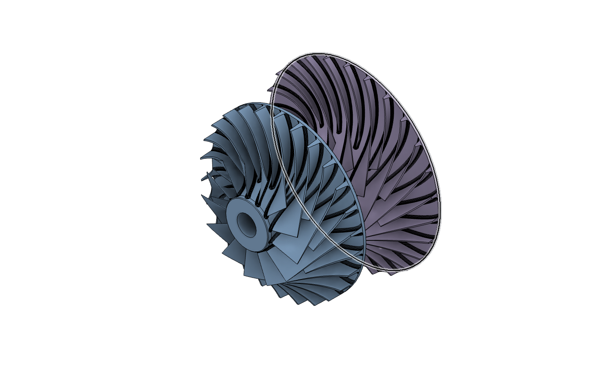

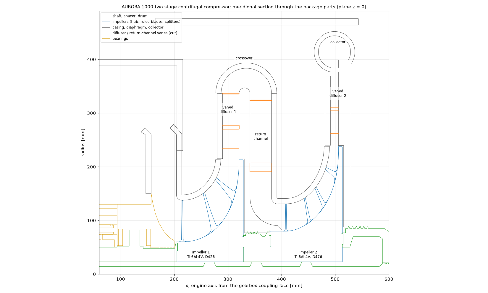

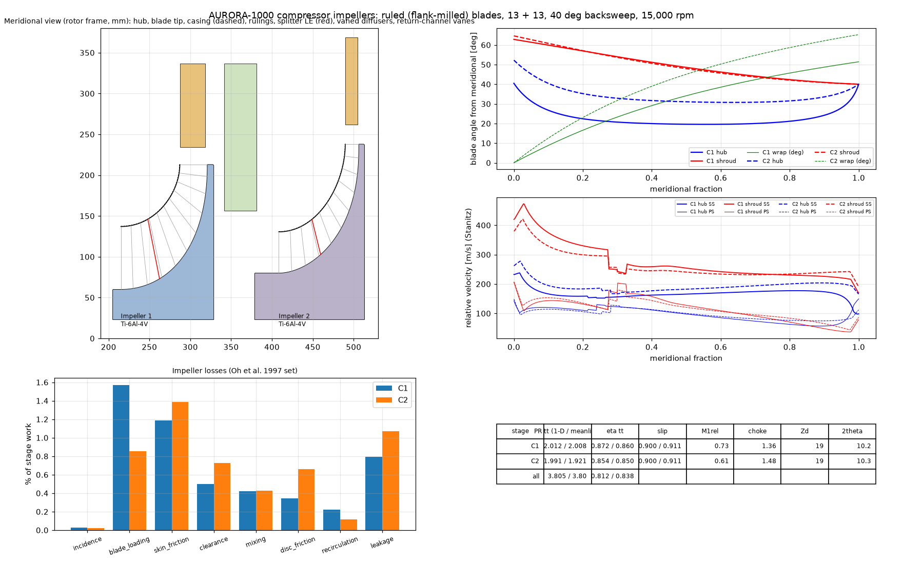

### ۱۵٫۱ یافتهٔ اصلی ۱: با D2 مقدار meanline، نسبت فشار نمی‌رسد

- meanline کار پروانه را با `σ·(1 − φ2·tanβ2)` حساب کرده است.
- ضریب لغزش Wiesner این‌طور تعریف شده: `σ = 1 − c_slip/U2`، یعنی `c_θ2 = σ·U2 − c_m2·tanβ2`. در φ2 = 0.28 این حدود **۳٪ کار کمتر** می‌دهد.
- دو اثر دیگر:
  - splitterها از ۳۰٪ طول شروع می‌شوند، پس تعداد مؤثر پره ۲۲٫۱ است نه ۲۶ (σ = 0.900 به جای 0.911).
  - انسداد واقعی خروجی پره‌ها (ضخامت ۲٫۲ تا ۶ mm) حدود ۱۵٪ است نه ۸٪.
- نتیجه با D2 = 413 / 448 mm: نسبت فشار ۱٫۸۷ / ۱٫۸۳ و کل **۳٫۲۹ به جای ۳٫۸**.
- **تصمیم:** backsweep ۴۰°، ۱۳ + ۱۳ پره و ۱۵٬۰۰۰ rpm ثابت ماند. D2 آن‌قدر بزرگ شد که:
  - پلهٔ ۱ در خروج دیفیوزر به PR 2.008 برسد؛
  - فلنج کلکتور پلهٔ ۲ به ۳٫۸ برابر فشار ورودی برسد.
  - b2 از φ2 = c_m2/U2 = 0.30 به دست آمد.

| | meanline | طرح جزئی rev 1 |
|---|---|---|
| پلهٔ ۱ | D2 413، U2 324 m/s، b2 35.4 | **D2 426 mm، U2 334 m/s، b2 33.5 mm** |
| پلهٔ ۲ | D2 448، U2 352 m/s، b2 19.4 | **D2 476 mm، U2 374 m/s، b2 16.5 mm** |

بخش ۳٫۱ در مفهوم اولیه برای پلهٔ ۱ هم Ø422 mm و U2 ≈ 332 m/s داشت.

### ۱۵٫۲ یافتهٔ اصلی ۲: پروانهٔ ۱ از Ti-6Al-4V (به جای Al 2618-T61)

- در U2 = 334 m/s، سوراخ پیچ مرکزی در Al 2618 به تنش مماسی **۲۱۶ تا ۲۳۶ MPa** می‌رسد.
  - عمر روشن‌وخاموش (Manson–Morrow، ضریب ۲ روی کرنش و ۲۰ روی عمر) **۶٬۳۰۰ تا ۹٬۲۰۰ سیکل** است، در برابر ۱۰٬۰۰۰ لازم (بخش ۱۲).
  - Curvic جلوی پروانهٔ ۱ با آلومینیوم هم رد می‌شود (بخش ۱۳٫۲).
- یک گودی تراشکاری در سطح پشتی امتحان شد:
  - تنش سوراخ به ۱۶۶ MPa رسید؛
  - اما دیسک هاب نازک شد و خم شد: ۱٫۴ mm جابه‌جایی محوری نوک پره، ۲۶۶ MPa در کف گودی و حاشیهٔ تسلیم trip ۰٫۹۷.
  - کنار گذاشته شد.
- **با Ti-6Al-4V و همان هندسه:**
  - همهٔ چک‌های تنش با حاشیهٔ زیاد قبول‌اند (بخش ۱۵٫۷).
  - Curvic جلو ۰٫۴۷ مجاز است.
  - هزینه: جرم ۲۲٫۲ kg به جای ۱۳٫۸ و مادهٔ گران‌تر.
  - پره‌های تیتانیومی در ورودی در برابر ضربهٔ ذرات و سایش (غبار برازجان) هم مقاوم‌ترند.
- اگر تعداد روشن‌وخاموش واقعی سایت کمتر از ~۶٬۰۰۰ در عمر باشد (کار ۲۴/۷ با توقف کم)، آلومینیوم دوباره ممکن است. فقط پارامتر `mat` در `a1000_impeller.py` عوض می‌شود، ولی Curvic جلو باید جداگانه حل شود.

### ۱۵٫۳ هندسهٔ پروانه‌ها

- فضای هر دو پروانه همان قبلی است. پرهٔ پروانهٔ ۲ فقط ۱۰۰ mm طول محوری لازم دارد. بقیه یک دماغهٔ چرخان ۲۹٫۵ mm است که خم ۹۰° کانال برگشت روی آن قرار می‌گیرد.

| | پروانهٔ ۱ | پروانهٔ ۲ |
|---|---|---|
| جنس و ساخت | Ti-6Al-4V فورج، فرز ۵ محوره | Ti-6Al-4V فورج، فرز ۵ محوره |
| D2 / b2 | 426 / 33.5 mm | 476 / 16.5 mm |
| ورودی: شعاع هاب / نوک | 60 / 137 mm (meanline 48.6 / 128) | 80 / 130.5 mm (meanline 49.5 / 110) |
| طول محوری پره / D2 | 0.248 | 0.206 |
| زاویهٔ پیچش پره (wrap) | 51° | 65° |
| ضخامت پره هاب: LE / بیشینه / TE | 2.4 / 4.5 / 6.0 mm | 2.0 / 3.6 / 5.0 mm |
| ضخامت پره نوک: LE / بیشینه / TE | 1.4 / 2.4 / 2.2 mm | 1.2 / 2.0 / 1.8 mm |
| فیلت ریشه (= شعاع ساچمهٔ ابزار) | R5 | R4 |
| لقی سرد: ورودی شعاعی / خروجی محوری | 0.50 / 0.90 mm | 0.40 / 1.10 mm |
| جرم (هاب + ۱۳ پره + ۱۳ splitter) | **22.2 kg** | **28.4 kg** |

- **شعاع هاب ورودی:**
  - پروانهٔ ۱ پشت شفت جلو (r 60 در x 205) است.
  - پروانهٔ ۲ پشت خم کانال برگشت، روی فاصله‌انداز (r 80) است.
  - شعاع هاب meanline (48.6 / 49.5) با این‌ها جور نبود.
  - شعاع نوک دوباره برای کمترین ماخ نسبی بهینه شد: Mrel نوک ۰٫۷۳ / ۰٫۶۱ (meanline ۰٫۷۱ / ۰٫۵۵).
- **شکل پره، مناسب ساخت:**
  - هاب و shroud منحنی Bezier‌اند (هاب درجهٔ ۴ با یک قطب آزاد برای توزیع سطح مقطع). هر دو با یک پارامتر t پیش می‌روند.
  - **هر دو طرف پره خطوط راست از هاب به نوک‌اند** (ruled). کل سطح پره با پهلوی یک ابزار مخروطی ساچمه‌سر تراشیده می‌شود.
  - در القاگر خطوط پره شعاعی‌اند. پس نیروی گریز از مرکز ورودی پره را خم نمی‌کند، و زاویهٔ هاب مثل جریان با tanβ ∝ r عوض می‌شود.
  - در خروجی زاویهٔ هاب و نوک هر دو ۴۰° است، بدون rake.
  - پیچش نرمال‌ها در طول هر خط حداکثر ۳۴° / ۲۱° است. با ابزار R3 حدود ۰٫۱۳ / ۰٫۰۵ mm خطای flank milling می‌دهد، که CAM با تنظیم زاویهٔ ابزار کمتر می‌کند.
  - لبهٔ حمله بیضی ۲:۱ است.
  - لبهٔ فرار با استوانهٔ r2 بریده می‌شود: همان تراش قطر خارجی.
  - splitter همان خط میانی پرهٔ اصلی است، با نیم گام جابه‌جایی، و از ۳۰٪ طول نصف‌النهاری شروع می‌شود.
- **هاب قطعهٔ تراشکاری ساده است:**
  - دماغه (۱۰ / ۲۹٫۵ mm، هم‌سطح با شفت و فاصله‌انداز)؛
  - سطح جریان؛
  - نوار ۸ / ۷ mm در r2؛
  - سطح پشتی تخت؛
  - **دندانه‌های Curvic در دو سطح** (۳۶ دندانه، زاویهٔ فشار ۳۰°، هم‌جفت با قطعات روتور rev 1.1، نیم گام جابه‌جا). تداخل با شفت جلو، فاصله‌انداز و درام فقط ۴ تا ۹ mm³ تماس پهلوی دندانه است.

### ۱۵٫۴ القاگر، گلوگاه و بارگذاری پره

| | پروانهٔ ۱ | پروانهٔ ۲ |
|---|---|---|
| سرعت محوری ورودی c1 | 120 m/s | 106 m/s |
| زاویهٔ جریان / پره در هاب | 38.1° / 40.5° | 49.8° / 52.2° |
| زاویهٔ جریان / پره در نوک (incidence +2°) | 60.8° / 62.8° | 62.6° / 64.6° |
| ماخ نسبی نوک | 0.73 | 0.61 |
| سطح گلوگاه القاگر / سطح ورودی | 326 / 477 cm² | 205 / 334 cm² |
| گلوگاه / سطح capture (A1·cosβ1) | 1.17 | 1.16 |
| حاشیهٔ choke القاگر | **1.36** | **1.48** |
| حاشیهٔ choke گلوگاه دیفیوزر | 1.09 | 1.12 |
| Wss,max/W2 روی shroud (Stanitz، بعد از ۱۰٪ اول) | 2.38 | 1.91 |
| کمترین سرعت سمت فشار (هاب / shroud) | 57 / 37 m/s | 75 / 44 m/s |
| W1t/W2 | 1.60 | 1.34 |

- choke اول در گلوگاه دیفیوزر رخ می‌دهد. حاشیهٔ ۹ تا ۱۲٪ برای ماشین دور ثابت با ژنراتور شبکه کافی است.
- سطح مقطع نصف‌النهاری (با انسداد پره‌ها) بدون فرورفتگی کم می‌شود. کمینه در پلهٔ ۱ برابر ۰٫۸۷ است. در پلهٔ ۲ به ۰٫۷۱ می‌رسد، که همان نسبت سطح خروج به ورود است.

### ۱۵٫۵ عملکرد: لغزش و تلفات در برابر meanline (مدل یک‌بعدی)

**مدل‌ها:**
- لغزش: Wiesner با ۲۲٫۱ پرهٔ مؤثر.
- تلفات پروانه: مجموعهٔ Oh، Yoon و Chung (1997):
  - **داخلی:** برخورد، بارگذاری، اصطکاک (Haaland با Ra 1.6 µm)، لقی (Jansen)، اختلاط (Johnston–Dean).
  - **انگلی:** اصطکاک دیسک، بازگردش، نشتی (Aungier).
- فضای بدون پره: Stanitz با اصطکاک.
- دیفیوزر: کانال دوبعدی با بازده وابسته به 2θ.

| | پلهٔ ۱ | پلهٔ ۲ |
|---|---|---|
| ضریب لغزش σ (meanline) | 0.900 (0.911) | 0.900 (0.911) |
| کار اویلر / کل | 72.6 / 73.6 kJ/kg | 90.6 / 92.3 kJ/kg |
| بازده پروانه (tt) | 0.949 | 0.947 |
| ماخ / زاویهٔ خروج پروانه | 0.65 / 65.3° | 0.65 / 65.2° |
| **PR پله (tt، تا خروج دیفیوزر)** | **2.012** (meanline 2.008) | **1.991** (meanline 1.921؛ اضافه برای افت کلکتور) |
| **بازده پله (tt)** | **0.872** (meanline 0.860) | **0.854** (meanline 0.850) |
| دمای خروج | 87.7 °C | 178.4 °C |

**جمع کمپرسور تا فلنج کلکتور:**
- PR **3.805** (meanline ۳٫۸).
- بازده **0.812** در برابر ۰٫۸۳۸ meanline:
  - meanline فقط افت کانال برگشت (۱٫۵٪) را داشت؛ این‌جا ۲٫۰٪ است.
  - افت کلکتور ساده (۰٫۶ فشار دینامیکی خروج دیفیوزر) ۳٫۰٪ است و در meanline حساب نشده بود.
- **اثر روی چرخه:** راندمان برق از ۳۸٫۵٪ به **۳۷٫۴٪**، و توان خالص به ازای هر kg هوا ×0.97.
- **پیشنهاد:** یک ردیف پرهٔ deswirl پیش از کلکتور افت کلکتور را به حدود ۱٪ می‌رساند.
- بیشترین تلفات پروانه:
  - پلهٔ ۱: بارگذاری پره (۱٫۶٪ کار) و اصطکاک (۱٫۲٪).
  - پلهٔ ۲: اصطکاک (۱٫۴٪) و نشتی (۱٫۱٪)، چون b2 کوچک است.

### ۱۵٫۶ دیفیوزر پره‌دار، کانال برگشت و کلکتور

| | دیفیوزر ۱ | دیفیوزر ۲ |
|---|---|---|
| فضای بدون پره r3/r2، باریک‌شدن | 1.10، b3 = 0.92 b2 (30.8 mm) | 1.10، b3 = 15.2 mm |
| تعداد پره (بخش ۱۵٫۸) | **۱۹** | **۱۹** |
| پره: r3 → r4 | 234 → 337 mm | 262 → 369 mm |
| زاویهٔ پره ورود / خروج (از شعاع) | 67.6° / 53° | 66.7° / 53° |
| ماخ ورود / گلوگاه | 0.58 / 0.70 | 0.58 / 0.67 |
| AR، 2θ معادل، L/W1، solidity | 2.26، **10.2°**، 7.1، 2.6 | 2.11، **10.3°**، 6.2، 2.4 |
| Cp (ایده‌آل) | 0.62 (0.80) | 0.60 (0.78) |
| ساخت | پرهٔ ۲٫۵ محوره، یکپارچه با صفحهٔ دیفیوزر | همان |

**کانال برگشت (پلهٔ ۱ به ۲):**
- مسیر:
  - خم U (crossover) از r 337 با شعاع بیرونی ۴۷ mm؛
  - دیافراگم ۱۰ mm؛
  - کانال شعاعی ۴۰ mm (x 341 تا 381)؛
  - **۱۷ پرهٔ deswirl** از r ≈ 325 تا 157، با زاویهٔ ۶۲٫۵° تا صفر؛
  - خم ۹۰° (شعاع داخلی ۱۲ mm) به القاگر پلهٔ ۲.
- لبهٔ هاب ثابت دیافراگم با فاصلهٔ ۲ mm روی دماغهٔ چرخان پروانهٔ ۲ است. دیافراگم روی فاصله‌انداز (r 75) با لابیرنت آب‌بند می‌شود.
- افت فشار کل حدود **۲٫۰٪** است.

**کلکتور:** حلقوی دور خروج دیفیوزر ۲، با خروجی DN300 به recuperator.

**ورودی شعاعی پلهٔ ۱ (rev 1.1، با روتور rev 1.1):**
- یاتاقان‌های جلو جلوتر رفتند، و محفظهٔ کف‌گرد به یک **هاب ورودی** ختم می‌شود (`INLET_HUB` در `a1000_rotor.py`). این هاب از (x 157, r 150) تا (x 201, r 61.5) می‌رود و در x 205 به دماغهٔ پروانه (r 60) می‌رسد.
- **سمت shroud:**
  - دیوارهٔ شعاعی در x 204 با خم R10 به shroud القاگر (r 137.5) می‌رسد، پیش از لبهٔ حمله (x 215).
  - ورودی کانال در r 260 است، با لبهٔ گرد R12.
- **سمت هاب:** دیوارهٔ جلویی در x 157 از r 150 تا 260.
- plenum دور محفظه‌های یاتاقان جلو است و کانال بالای آن به فیلتر می‌رود.
- **سطح مقطع:**
  - در ورودی ۱٫۶۰ برابر سطح القاگر است.
  - در قسمت شیب‌دار هاب (r 95–130) به **۰٫۹۱** کم می‌شود و تا القاگر به ۱٫۰ برمی‌گردد. یعنی شتاب ۱۰٪ و بعد کندشدن ملایم، در c ≈ 120 m/s.
  - پیشنهاد به طراحی روتور: هاب ورودی در r 95–130 حدود ۵ mm پُرتر شود تا این فرورفتگی برداشته شود.

### ۱۵٫۷ تست سازه‌ای با CalculiX: تنش، ترکیدن، خزش و LCF (`sim/engine/a1000_impeller_fea.py`)

**مدل:**
- قطاع ۱/۱۳ شامل هاب، یک پرهٔ اصلی و یک splitter با فیلت ریشه، با المان C3D10.
- مش تنش: ۲۳۳ / ۲۸۷ هزار گره. مش مودال: ۱۰۱ / ۱۲۱ هزار گره.
- **مرز قطاع:** پره‌ها ۵۱° تا ۶۵° می‌پیچند، پس صفحهٔ شعاعی از وسط پره‌ها رد می‌شد. مرز قطاع دو سطح پیچیده است که روی هاب وسط کانال بین splitter و پرهٔ اصلی می‌گذرد و هیچ پره‌ای را نمی‌برد. با `*CYCLIC SYMMETRY MODEL` بسته شده‌اند.
- **تکیه‌گاه:** رینگ Curvic عقب (شعاع‌های بخش ۱۳) جابه‌جایی محوری و مماسی را می‌گیرد؛ رشد شعاعی آزاد است.
- **دمای فلز (طراحی، ورودی ۱۵ °C):**
  - پروانهٔ ۱: سوراخ ۶۰ °C، نوک ۹۵ °C؛ پره ۲۰ تا ۸۸ °C.
  - پروانهٔ ۲: ۱۵۰ / ۱۸۵ °C؛ پره ۹۵ تا ۱۷۸ °C.
  - روز گرم بدون خنک‌کاری ورودی (۴۶ °C): ۳۹ تا ۵۰ K بیشتر.
- **حالت‌ها:**
  - ۱۵٬۰۰۰ rpm با و بدون کرنش حرارتی؛
  - روز گرم؛
  - trip ۱۶٬۵۰۰ rpm؛
  - تست چرخش ۱۱۵٪ MCS (۱۸٬۱۱۲ rpm) در ۲۰ °C.
- **ماده:** Ti-6Al-4V فورج، حداقل UTS 895 / YS 825 MPa در ۲۰ °C (۷۸۰ / ۶۹۰ در ۱۵۰ °C). خزش زیر ~۳۰۰ °C ناچیز است. معیار cold dwell: تنش پایدار محلی ≤ ۰٫۸ YS.
- **منحنی خزش Al 2618** (برای مقایسه در بخش ۱۵٫۲): Larson–Miller با C = 17.25، برازش‌شده روی ماتریس تست EN AW-2618A T61 از Han و همکاران (Data in Brief 62، 2025).

| | پروانهٔ ۱ (Ti) | پروانهٔ ۲ (Ti) | معیار |
|---|---|---|---|
| von Mises بیشینه در ۱۵k (محلی) | 378 MPa، ریشهٔ لبهٔ فرار پره، ۸۸ °C | 388 MPa، لبهٔ سوراخ، ۱۵۰ °C (پره 210) | |
| حاشیهٔ تسلیم محلی ۱۵k / **trip** | 1.99 / **1.64** | 1.78 / **1.48** | ≥ 1.0 |
| تنش مماسی سوراخ / میانگین مماسی هاب | 360 / 102 MPa | 389 / 100 MPa | |
| **ترکیدن / trip** (میانگین مماسی، ۸۵٪ UTS) | **2.44** (40,200 rpm) | **2.34** (38,600 rpm) | ≥ 1.22 |
| تست چرخش: YS / تنش حجمی (صدک ۹۹٫۵) | **2.59** (پیک محلی 563 MPa: 1.47) | **2.47** (پیک 551 MPa: 1.50) | ≥ 1.0 |
| **LCF روشن‌وخاموش** (Manson–Morrow، ۲ / ۲۰) | **3.6×10⁴** | **2.0×10⁴** | ≥ 10⁴ |
| cold dwell: پیک پایدار / YS در روز گرم | 0.54 | 0.59 | ≤ 0.8 |
| رشد نوک لبهٔ فرار در کار: شعاعی / محوری (trip) | +0.33 / **−0.25** (−0.29) mm | +0.47 / **−0.57** (−0.67) mm | |
| رشد شعاعی نوک لبهٔ حمله | 0.06 mm | 0.15 mm | |

**نکته‌ها:**
- پیک لبهٔ سوراخ و سطح پشتی، گوشهٔ تیز مدل است. در نقشه شعاع R2 گذاشته می‌شود.
- مدل FEA سطوح تخت دارد. دندانه‌های Curvic اثر موضعی دارند و فشار دندانه در بخش ۱۳٫۲ چک شده است.
- پیک ریشهٔ لبهٔ فرار جایی است که سطح بریدهٔ r2 به فیلت می‌رسد. لبه‌ها با R0.5 پرداخت می‌شوند.
- **لقی خروجی:** خم‌شدن پره زیر نیروی گریز از مرکز، نوک لبهٔ فرار را به shroud نزدیک می‌کند. پس لقی سرد محوری خروجی بیشتر از لقی ورودی است: **۰٫۹ / ۱٫۱ mm**. لقی در کار حدود ۰٫۵ تا ۰٫۶ mm می‌شود.

### ۱۵٫۸ ارتعاش: مودهای cyclic، Campbell/ZZENF و تعداد پره‌های دیفیوزر

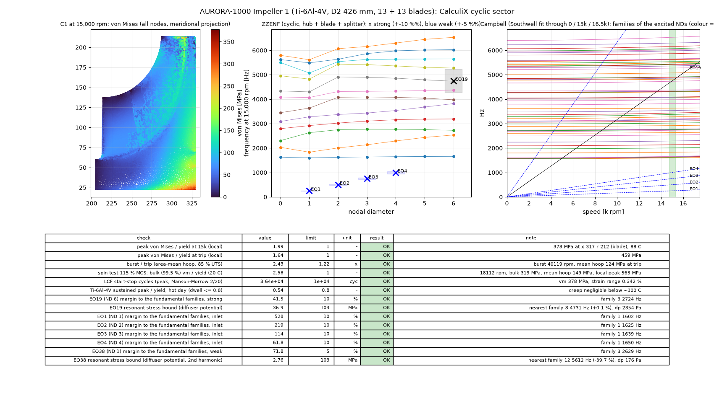

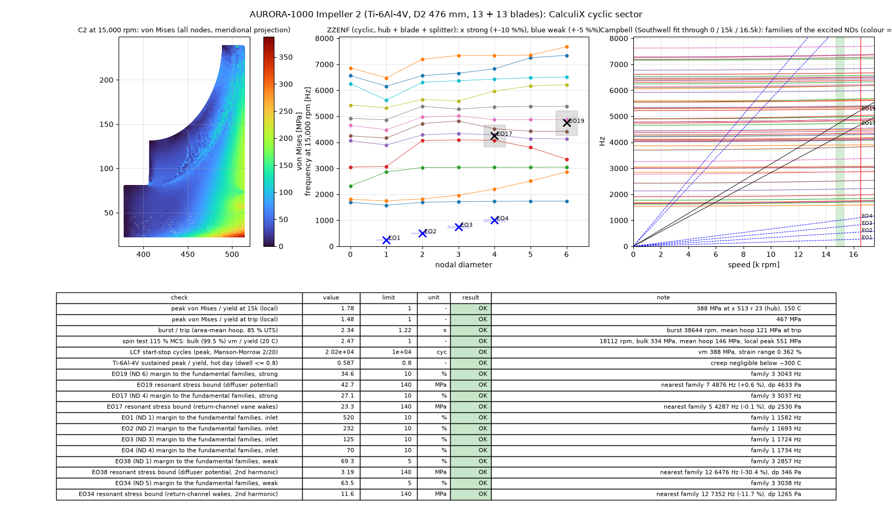

**مدل:**
- مودال با پیش‌تنش (NLGEOM)، ۱۲ خانواده برای هر قطر گرهی ND 0–6 (۱۳ قطاع)، در ۰ و ۱۵٬۰۰۰ rpm.
- Campbell بین این دو با Southwell رسم شده: `f² = f0² + S·N²`.
- پروانهٔ ۱:
  - ND 0 با Ti حل شد.
  - ND 1–6 از حل همان هندسه و مش با Al مقیاس شد: `√(E/ρ)`. جملهٔ سخت‌شدگی Southwell به ماده بستگی ندارد.
  - کنترل روی ND 0: اختلاف ۰ تا ۰٫۵٪.

**طیف:**
- خانوادهٔ اول (خمش اول پرهٔ اصلی) در همهٔ NDها **۱٫۶۰–۱٫۶۶ kHz** (پروانهٔ ۱) و **۱٫۵۸–۱٫۷۴ kHz** (پروانهٔ ۲) است.
- سخت‌شدگی دوران از ۰ تا ۱۵k حدود ۳ تا ۴٪ است.
- ۱۲ خانواده تا ۵٫۶–۶٫۵ / ۶٫۵–۷٫۴ kHz می‌رسند، یعنی حدود **۲٫۵ مود در هر kHz** در هر ND (پرهٔ اصلی، splitter و مودهای جفت‌شده با دیسک).
- **نتیجه:** هیچ تعداد پرهٔ دیفیوزر نیست که از همهٔ مودها ۱۰٪ فاصله بگیرد. در اسکن ۱۵ تا ۲۵ پره، بهترین فاصله تا نزدیک‌ترین مود ۰ تا ۸٪ است.

**معیارها** (هم‌روش برآورد پاسخ اجباری توربین، بخش ۱۲):
1. **فاصله از خانواده‌های پایه:** سه خانوادهٔ اول همان ND، یعنی خمش اول پره و splitter و اولین مود دیسک. لازم: ≥ ۱۰٪ برای مرتبه‌های قوی و ≥ ۵٪ برای ضعیف.
2. **کران بالای تنش ارتعاشی در تشدید با نزدیک‌ترین مود (هر خانواده‌ای)** ≤ نصف مجاز Goodman:
   - رابطه: `σ_vib = σ_TE × (Δp / q_cf) × 1/(2ζ) × 1.5`؛
   - σ_TE: تنش پایای ریشهٔ لبهٔ فرار از FEA؛
   - q_cf: بار گریز از مرکز صفحهٔ پره؛
   - Δp برای میدان پتانسیل دیفیوزر: `0.4 q3 exp(−k Z (r3/r2 − 1))`؛
   - Δp برای wake پره‌های بالادست: `0.05 q1`؛
   - میرایی ζ = 0.003، mistuning ×1.5، مشارکت مودی کامل.

**انتخاب:** **۱۹ پره برای هر دو دیفیوزر، ۱۷ پره برای کانال برگشت.**
- عدد اول‌اند.
- از ۱۲ تا ۱۴ و ۲۵ تا ۲۷ دور هستند، که ND 0–1 را تحریک می‌کنند (مودهای چتری و دیسک).
- از نظر آیرودینامیک بهینه‌اند (2θ ≈ ۱۰°).
- میدان پتانسیل در خروج پروانه به ۱۵٪ و هارمونیک دومش به ۲٪ کاهش می‌یابد.

| مرتبه (ND) | منبع | فاصله از خانواده‌های پایه (لازم) | نزدیک‌ترین مود در باند ±۲٪ | کران تنش ارتعاشی / مجاز |
|---|---|---|---|---|
| **پروانهٔ ۱** EO19 (6) | میدان پتانسیل دیفیوزر ۱ | 41 % (10 %) | خانوادهٔ ۸، 4,731 Hz (+0.1 %) | **37 / 103 MPa** |
| پروانهٔ ۱ EO38 (1) | هارمونیک دوم | 72 % (5 %) | خانوادهٔ ۱۲ (−40 %) | 2.8 / 103 MPa |
| پروانهٔ ۱ EO 1–4 | اعوجاج ورودی | ≥ 62 % (10 %) | زیر خانوادهٔ اول | — |
| **پروانهٔ ۲** EO19 (6) | میدان پتانسیل دیفیوزر ۲ (و wake دیفیوزر ۱) | 35 % (10 %) | خانوادهٔ ۷، 4,876 Hz (+0.6 %) | **43 / 140 MPa** |
| **پروانهٔ ۲** EO17 (4) | wake پره‌های کانال برگشت | 27 % (10 %) | خانوادهٔ ۵، 4,287 Hz (−0.1 %) | **23 / 140 MPa** |
| پروانهٔ ۲ EO34 (5) | هارمونیک دوم کانال برگشت | 64 % (5 %) | خانوادهٔ ۱۲ (−12 %) | 12 / 140 MPa |
| پروانهٔ ۲ EO38 (1) | هارمونیک دوم دیفیوزر ۲ | 69 % (5 %) | خانوادهٔ ۱۲ (−30 %) | 3 / 140 MPa |
| پروانهٔ ۲ EO 1–4 | اعوجاج ورودی | ≥ 70 % (10 %) | زیر خانوادهٔ اول | — |

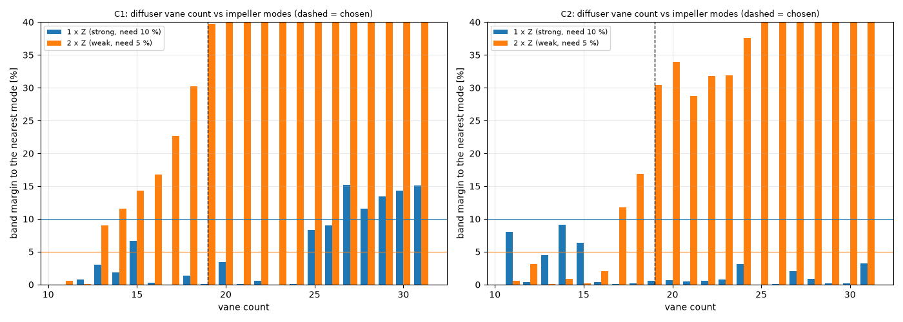

**راه‌اندازی:** مرتبه‌های EO17 و EO19 خانواده‌های پایه را در **۵٬۲۰۰ تا ۸٬۶۰۰ rpm** قطع می‌کنند. در این بازه توقف نشود (دو بحرانی روتور هم در ۳٬۹۰۰ / ۶٬۵۰۰ rpm است). استارتر با شیب پیوسته از آن عبور می‌کند.

**کران تنش، برآورد بالا است، نه پاسخ اجباری واقعی.** تست ضربه، strain gauge یا tip-timing در اولین تست لازم است (بخش ۱۵٫۱۱).

### ۱۵٫۹ دینامیک روتور با پروانه‌های واقعی (`sim/engine/a1000_rotordynamics.py`)

**ورودی‌های مدل:**
- جرم، مرکز جرم و اینرسی پروانه‌ها از CAD گرفته می‌شود (`fusion/A1000C/parts.json`).
- بدنهٔ پروانه در مدل تیر، استوانه‌ای با قطر دماغه (2·r1h) روی سوراخ Ø46 است.
- مدل جزئی پشتهٔ روتور (بخش ۱۳٫۵، `a1000_rotor_stack.py`) همین ورودی را از `RD.rotor()` می‌گیرد و باید دوباره اجرا شود.

| آرایش A-SFD | پروانهٔ مفهومی (پیش از این) | پروانه‌های rev 1 (Ti / Ti) |
|---|---|---|
| جرم پروانه‌ها | 11.5 / 21.8 kg | 22.2 / 28.4 kg |
| جرم روتور | 196 kg | 213 kg |
| بحرانی ۱ (حاشیه / لازم API) | 3,964 rpm (72 % / 0) | **3,896 rpm (73 % / 0)** |
| بحرانی ۲ | 6,780 rpm (52 %) | **6,525 rpm (54 %)** |
| بحرانی خمشی ۳ | 23,191 rpm | **بالای 26,000 rpm** (whirl 473 Hz در 15k) |
| بیشینهٔ ارتعاش نامیزانی (95 % تا trip) | 2.5 µm | **2.1 µm** (حد API 22 µm) |

- حالت حساسیت (دمپر π-film) هم قبول است: 3,934 / 6,762 rpm.

### ۱۵٫۱۰ فیوژن و فایل‌ها

- **پروانه‌ها:**
  - مسیر: `a1000_impeller.py --cad` ← `python3 fusion/export_a1000_impellers.py` ← `fusion/A1000C/` (۶ قطعهٔ STEP و `parts.json`).
  - اسکریپت فیوژن: `fusion/AURORA1000_Compressor` ← طرح «AURORA-1000 Compressor rev1» (Default Project).
- **پکیج:**
  - `A1000_STEP=1 … a1000_viewer_export.py` پروانه‌ها را از `fusion/A1000C` می‌خواند.
  - پوستهٔ کمپرسور را از مسیر واقعی جریان می‌سازد: دیواره‌های shroud، دیفیوزرها، crossover، دیافراگم، کانال برگشت و کلکتور.
  - پره‌های دیفیوزر و کانال برگشت در گروه «Diffuser and return vanes» هستند.
  - قطعات روتور rev 1 و بخش داغ مثل قبل جایگزین می‌شوند.
- **شکل‌ها:**
  - مقطع: `cad/engine/a1000_compressor_section.py`.
  - تست‌ها: `docs/img/a1000_impeller_C1_fea.png`، `a1000_impeller_C2_fea.png` و `a1000_impeller_vanes.png`.

### ۱۵٫۱۱ محدودیت‌ها و قدم بعدی

1. **بازده کل کمپرسور ۰٫۸۱۲ است در برابر ۰٫۸۳۸ meanline** (بخش ۱۵٫۵):
   - حدود ۱٫۱ واحد درصد راندمان برق.
   - پیشنهاد: پرهٔ deswirl پیش از کلکتور، و CFD سه‌بعدی دو پله برای بازده، زاویه‌ها و حاشیهٔ surge/choke.
2. **دادهٔ ماده:** Ti-6Al-4V، مقادیر حداقل منتشرشده است. باید با دادهٔ تأییدشدهٔ فورج‌کار جایگزین شود: کشش، LCF و خستگی در ۲۰ تا ۲۵۰ °C.
3. **ورودی هوای پلهٔ ۱:**
   - تداخل محفظهٔ کف‌گرد با ورودی در روتور rev 1.1 حل شد (بخش ۱۵٫۶).
   - فرورفتگی ۹٪ سطح روی هاب ورودی می‌ماند.
   - CFD ورودی و plenum (اعوجاج محیطی، EO 1–4) قدم بعد است.
4. **ارتعاش:** پاسخ اجباری فقط با یک کران بالای ساده تخمین زده شده (بخش ۱۵٫۸). لازم است:
   - تست ضربهٔ هر پروانه بعد از ماشین‌کاری؛
   - strain gauge یا tip-timing در اولین تست.
5. **ساخت:**
   - بالانس دینامیکی G2.5 و تست چرخش ۱۱۵٪ MCS (۱۸٬۱۱۲ rpm).
   - CMM پره (تلرانس پروفیل ±۰٫۰۵ mm).
   - FPI کامل.
   - شعاع R2 در لبهٔ سوراخ و سطح پشتی، و پرداخت R0.5 لبه‌های پره.

### ۱۳٫۸ به‌روزرسانی با پروانه‌های واقعی (۲۰۲۶-۱۰-۳۰، بعد از بخش ۱۵)

- **هر دو پروانه تیتانیوم شدند** (بخش ۱۵). Curvic جلوی پروانهٔ ۱ حالا قبول است (۰٫۴۷ حد مجاز). **۳۲ از ۳۲ چک قبول.**
- **نیروی محوری** با فشارهای واقعی پروانه‌ها: **۲٫۵ kN** به عقب. یاتاقان کف‌گرد در ۰٫۵ MPa کار می‌کند، با تلفات ۱۳ kW.
- **تداخل ورودی هوا حل شد:**
  - یاتاقان ۱ از x 95 به **x 65** و فلنج کف‌گرد از x 146 به **x 116–136** جلو رفتند.
  - پشت محفظهٔ کف‌گرد حالا **دماغهٔ هاب ورودی** است. از دیوارهٔ شعاعی در x 157 تا هاب القاگر (r 60) در x 201 خم می‌شود (`INLET_HUB` در `cad/engine/a1000_rotor.py`).
  - فاصلهٔ x 157–205 برای چرخش ورودی شعاعی به القاگر آزاد است. سمت بیرونی (bellmouth) بخش طراحی کمپرسور است.
- **دینامیک روتور** با پروانه‌های واقعی و یاتاقان جلوتر:
  - بحرانی‌ها **۳٬۹۱۰، ۸٬۱۱۰ و ۲۱٬۶۲۰ rpm**. حاشیهٔ مود سوم ۳۷٪ است، در برابر ۲۱٪ لازم.
  - ارتعاش API **۳٫۸ µm** است (حد ۲۲).
  - با دمپر π-film: ۳٬۸۵۰، ۷٬۶۰۰ و ۲۱٬۰۲۰ rpm، و ۴٫۰ µm.
