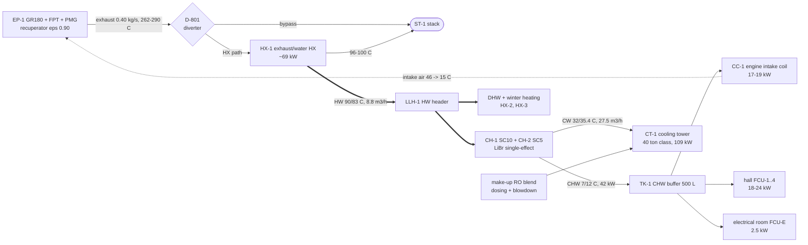
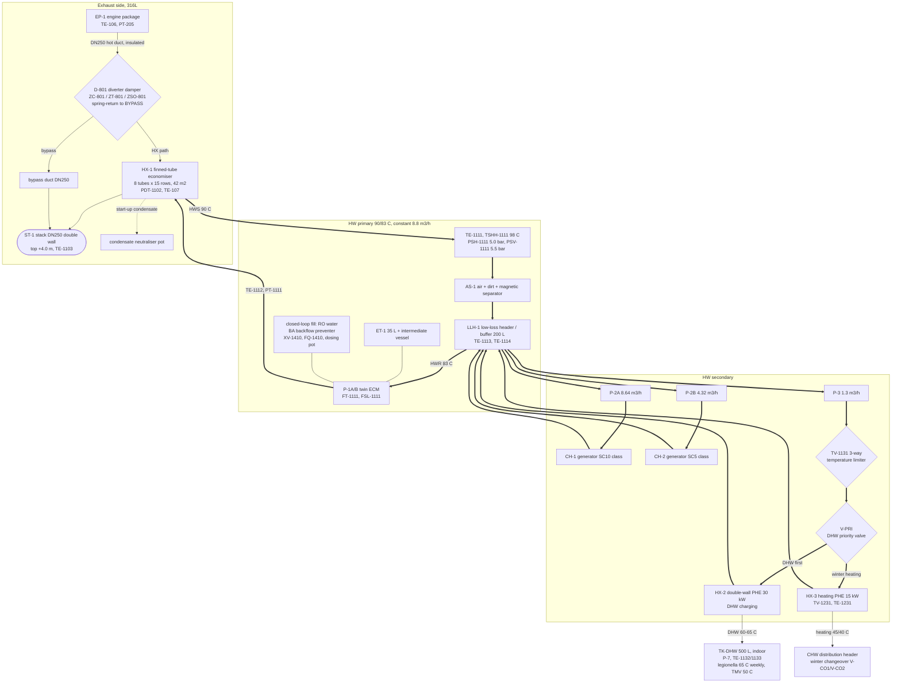
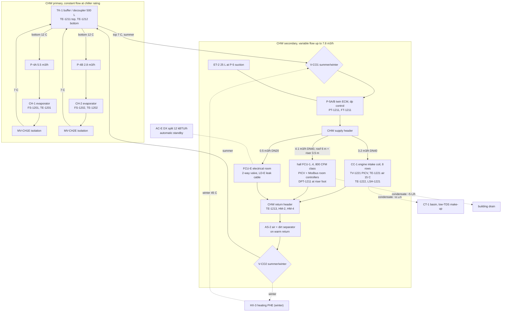
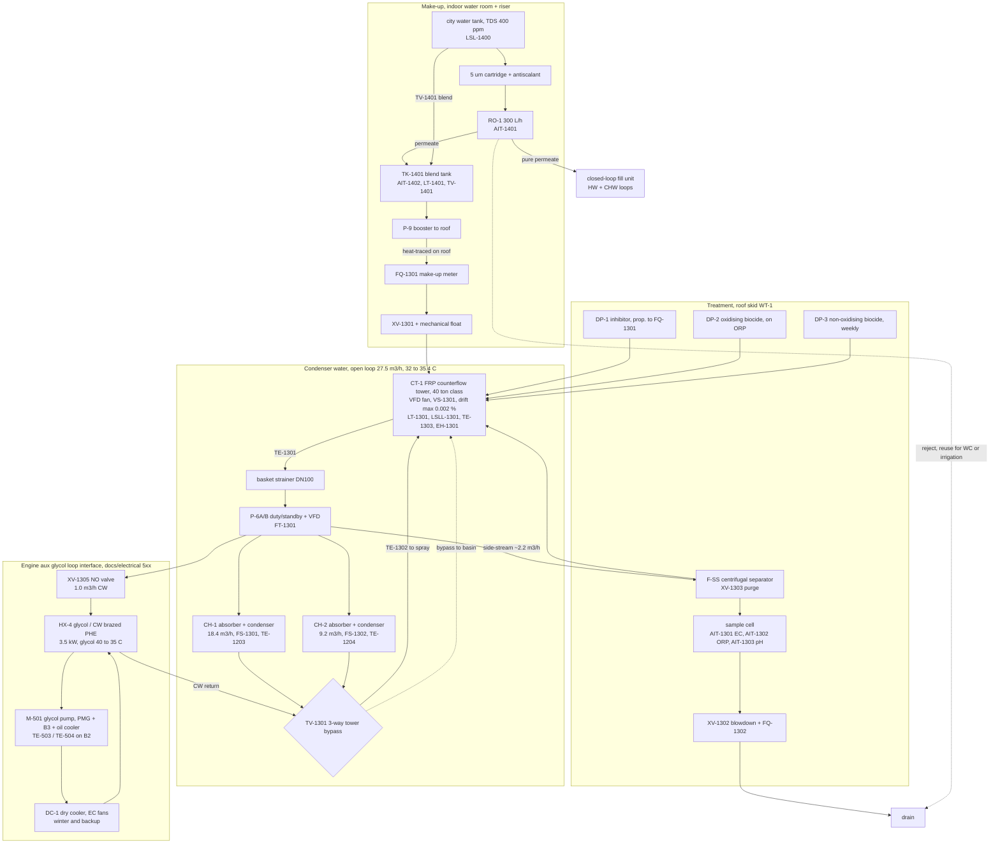

# GR180-CCHP — P&ID و دیاگرام جریان مدارهای آب (HVAC / Balance of Plant)

تاریخ: ۲۰۲۶-۱۰-۲۱ · مبنای اعداد: `sim/hvac/hvac_design.py` (خروجی در `sim/hvac/hvac_results.json`) · شمارهٔ تگ‌ها با `docs/hvac/io_list.csv` یکی است.

> این سند P&ID مفهومی (conceptual) است، برای طراحی پایه و استعلام. نقشهٔ P&ID اجرایی (ISA 5.1، با سایز تک‌تک شیرها و spec breaks) باید بعد از دریافت دیتاشیت قطعی چیلرها و برج تهیه شود.

## ۰. نمای کلی (block flow)

**منطق کلی:** گرمای اگزوز بعد از recuperator (۲۶۲ °C در طراحی تابستان، ۲۹۰ °C بدون کویل ورودی) در HX-1 به آب داغ ۹۰/۸۳ °C داده می‌شود. آب داغ از یک **low-loss header** (LLH-1) به دو چیلر جذبی و شاخهٔ DHW/گرمایش می‌رود. آب سرد ۷/۱۲ °C در مخزن بافر TK-1 جمع می‌شود و سه مصرف‌کننده دارد: کویل ورودی هوای موتور، فن‌کویل‌های سالن و فن‌کویل اتاق برق. گرمای دفع‌شدهٔ چیلرها (~۱۰۹ kW) به برج خنک‌کن می‌رود. **damper دوراهی D-801** تضمین می‌کند موتور هیچ‌وقت به چیلر وابسته نباشد.

## ۱. اگزوز، مدار آب داغ، DHW و گرمایش زمستان

نکات کلیدی:

- **D-801** یک diverter تک‌تیغه است، یعنی هیچ‌وقت هر دو مسیر هم‌زمان بسته نمی‌شوند. actuator آن **spring-return به حالت BYPASS** است. فرمان مدوله از B4 می‌آید (ZC-801، مالک ECU؛ docs/electrical). تغذیهٔ 24 VAC آن یک زنجیرهٔ سخت‌افزاری است (خروجی ایمن SR1 در سری با کنتاکت‌های حفاظتی). با هر کدام از این موارد تغذیه قطع می‌شود و damper ظرف ۱۵ ثانیه به bypass برمی‌گردد:
  - TSHH-1111 (۹۸ °C)
  - PSH-1111
  - FSL-1111 (قطع جریان)
  - E-stop
  - trip موتور
- **HX-1** عمودی (up-flow) است و دودکش مستقیم روی آن نصب می‌شود. bypass بالای HX به همان دودکش می‌پیوندد. در کف ورودی یک تخلیهٔ کندانس با pot خنثی‌کننده (سنگ آهک/MgO) هست. کندانس فقط در start-up سرد پیش می‌آید، چون نقطهٔ شبنم آب اگزوز ~۲۸ °C است.
- **PSV-1111** (DN20، تنظیم ۵.۵ bar) روی خروجی HX-1 و قبل از هر شیر قطع نصب می‌شود. ظرفیت بخار آن باید ≥ ۱۲۰ kg/h باشد (حالت خشک‌شدن مبدل با ۷۲ kW)، با لولهٔ تخلیه به نقطهٔ امن.
- **LLH-1** مدار اولیه (دبی ثابت HX) را از مدار ثانویه (چیلرها با دبی نامی‌شان، و شاخهٔ DHW) جدا می‌کند:
  - دبی ثانویه (۱۳.۰ m³/h) از دبی اولیه (۸.۸ m³/h) بیشتر است، پس چیلرها آب ~۸۷.۹ °C می‌گیرند (≈ ۸۸ °C نامی).
  - HX-1 آب برگشت ۸۳ °C می‌گیرد. این برای approach سرد مبدل و فاصله از نقطهٔ شبنم اسیدی (۶۰–۷۸ °C) خوب است.
- **V-PRI** شیر سه‌راههٔ اولویت است:
  - وقتی TE-1132 < SP، کل جریان شاخه به DHW می‌رود.
  - در غیر این صورت، در زمستان به گرمایش می‌رود.
  - در تابستان، شاخه فقط وقتی فعال است که چیلرها گرما را کامل مصرف نکنند (TE-1111 > ۹۲ °C یا damper در حال bypass)، یا DHW زیر حداقل باشد.
- **HX-2** صفحه‌ای **دوجداره (double-wall، با درز نشت قابل‌مشاهده)** است، چون مدار آب داغ ماده بازدارنده دارد و آب مصرفی بهداشتی است.

## ۲. مدار آب سرد (۷/۱۲ °C) و changeover زمستان

نکات کلیدی:

- چیلرهای جذبی کوچک **دبی آب سرد ثابت** (نامی) می‌خواهند، پس مدار اولیه دبی ثابت دارد.
  - هر چیلر پمپ خودش را دارد (P-4A/B). وقتی یک چیلر خاموش است، از آن جریانی رد نمی‌شود.
  - TK-1 هم decoupler است و هم ذخیرهٔ سرما. ۵۰۰ L با ΔT ۵ K حدود ۲.۹ kWh ذخیره دارد، یعنی ~۱۰ دقیقه کویل ورودی بعد از trip یا در restart.
- مدار ثانویه **دبی متغیر** دارد. مصرف‌کننده‌ها شیر دوراههٔ PICV دارند و P-5 دورش را روی Δp انتهای رایزر سالن (DPT-1211) تنظیم می‌کند. حداقل دبی پمپ را خود ECM حفظ می‌کند، یا یک by-pass کوچک با شیر Δp در انتهای خط.
- **ترتیب changeover:**
  - در زمستان چیلرها خاموش‌اند و MV-CH1E/MV-CH2E بسته‌اند (end switch در اینترلاک).
  - V-CO1/V-CO2 مکش و برگشت P-5 را از TK-1 به HX-3 می‌برند.
  - **قاعدهٔ ایمنی:** تا وقتی end switch هر دو MV بسته را تأیید نکرده، V-CO به حالت زمستان نمی‌رود. این برای جلوگیری از ورود آب داغ به اواپراتور LiBr است.
- **کندانس کویل ورودی** (~۸ L/h در WB ۲۸ °C) تقریباً بدون املاح است و با شیب به حوضچهٔ برج می‌رود (make-up رایگان کم‌TDS). کندانس فن‌کویل‌های سالن به فاضلاب ساختمان می‌رود، با تله (P-trap).
- **اتاق برق:** FCU-E خنک‌کن اصلی است. یک اسپلیت DX 12 kBTU/h از نوع T3 پشتیبان خودکار است، برای زمستان (حالت گرمایش شبکه)، استارت، و خرابی چیلر.

## ۳. مدار آب خنک‌کن، برج، آب جبرانی، blowdown و تصفیه

نکات کلیدی:

- **برج:** counterflow، FRP گرد، فن VFD. حذف‌کنندهٔ قطره (drift eliminator) ≤ ۰.۰۰۲ ٪. حوضچه سرپوشیده و سایه‌دار، با کف شیب‌دار و تخلیهٔ کامل.
  - TV-1301 در start-up و زمستان آب را مستقیم به حوضچه برمی‌گرداند تا دمای آب خنک‌کن از حداقل مجاز چیلر (~۲۶ °C، طبق دیتاشیت) پایین‌تر نرود.
- **HX-4 (رابط مدار کمکی موتور):**
  - مدار گلیکول ژنراتور، یکسوساز و خنک‌کن روغن (پمپ M-501 و سنسورها در docs/electrical) باید ~۳۵–۴۰ °C بماند (آلارم بالای ۵۰ °C).
  - در هوای ۴۶ °C یک dry cooler به‌تنهایی این را نمی‌دهد. پس در تابستان ~۳.۵ kW از یک PHE کوچک (HX-4) به آب خنک‌کن داده می‌شود: ۱.۰ m³/h. با آن برج ۱۱۲ kW می‌شود و آب سرد برج ۳۱.۶ °C، پس انتخاب برج عوض نمی‌شود.
  - در زمستان (برج خاموش) و در خرابی برج، DC-1 کار را می‌کند.
  - XV-1305 از نوع normally-open است. با قطع برق یا ارتباط، باز می‌ماند و DC-1 روی ۱۰۰ ٪ می‌رود.
- **side-stream** (~۸ ٪ جریان) از جداکنندهٔ گریز از مرکز رد می‌شود. این برای گرد و خاک برازجان است. purge آن جزئی از blowdown حساب می‌شود.
  - سنسورهای کیفیت آب در همین مسیر نمونه نصب می‌شوند، که جریانشان پیوسته و تمیز است.
- **آب جبرانی:**
  - توصیه: **blend آب RO و آب شهری** تا هدایت آب جبرانی ~۲۳۰ µS/cm شود. با ۳.۵ سیکل، آب در گردش ≤ ۸۰۰ µS/cm می‌ماند (حد رایج سازندهٔ چیلر). جزئیات در `03_water_treatment.md`.
  - شیر شناور مکانیکی پشتیبان شیر برقی است.
- **پرکن مدارهای بسته** فقط با آب RO انجام می‌شود، از مسیر backflow preventer نوع BA. کنتور پرکن FQ-1410 نشتی مدار بسته را نشان می‌دهد (حد ۲۰ L/day).

## ۴. فهرست خطوط (line list) — نتیجهٔ `hvac_design.py`

معیار سایز: افت فشار R ≤ ۲۵۰ Pa/m (به‌خاطر کار ۲۴/۷). سرعت ≤ ۱.۲ m/s تا DN50 و ≤ ۱.۸ m/s بالاتر. لوله Sch40. ضریب ۱.۵ برای اتصالات.

| خط | سرویس | دبی m³/h | DN | v m/s | R Pa/m | طول یک‌طرفه m | جنس / عایق |
|---|---|---|---|---|---|---|---|
| L-HW-01 | آب داغ اولیه HX-1 ↔ LLH-1 | 8.8 | 50 | 1.13 | 244 | 6 | A106 Gr.B Sch40 جوشی، پشم سنگ ۵۰ mm + روکش آلومینیوم |
| L-HW-02 | هدر LLH-1 → چیلرها | 13.0 | 65 | 1.17 | 209 | 2 | همان |
| L-HW-03 | شاخهٔ CH-1 (P-2A) | 8.64 | 50 | 1.11 | 236 | 4 | همان |
| L-HW-04 | شاخهٔ CH-2 (P-2B) | 4.32 | 40 | 0.91 | 222 | 4 | همان |
| L-HW-05 | شاخهٔ DHW/گرمایش تا مخزن داخل ساختمان | 1.3 | 25 | 0.64 | 198 | 15 | همان |
| L-CH-01 | آب سرد اولیه CH-1 ↔ TK-1 | 5.47 | 50 | 0.70 | 122 | 5 | A53/A106 Sch40، الاستومری ۴۰ mm + روکش (بام) |
| L-CH-02 | آب سرد اولیه CH-2 ↔ TK-1 | 2.77 | 40 | 0.59 | 121 | 5 | همان |
| L-CH-03 | ثانویه TK-1 → هدر (P-5) | 7.8 | 50 | 1.00 | 233 | 3 | همان |
| L-CH-04 | شاخهٔ کویل ورودی CC-1 | 3.2 | 40 | 0.68 | 157 | 5 | همان |
| L-CH-05 | اصلی سالن: ۶ m روی بام + رایزر ۳.۵ m | 4.1 | 40 | 0.86 | 244 | 9.5 | همان؛ داخل رایزر ۲۵ mm |
| L-CH-06 | توزیع سالن، ۲ فن‌کویل | 2.0 | 32 | 0.59 | 147 | 9 | فولاد یا PP-R PN20، الاستومری ۱۹ mm |
| L-CH-07 | توزیع سالن، آخرین فن‌کویل | 1.0 | 25 | 0.51 | 163 | 7 | همان |
| L-CH-08 | شاخهٔ اتاق برق (طول فرضی) | 0.5 | 20 | 0.41 | 150 | 15 | همان؛ **از بالای تجهیزات برقی رد نشود** |
| L-CW-01 | آب خنک‌کن برج ↔ هدر چیلرها | 27.5 | 100 | 0.93 | 82 | 8 | 316L Sch10S (ترجیح) یا PE100 SDR11 مشکی UV-stable |
| L-CW-02 | شاخهٔ CH-1 | 18.4 | 80 | 1.07 | 149 | 3 | همان |
| L-CW-03 | شاخهٔ CH-2 | 9.2 | 65 | 0.83 | 120 | 3 | همان |
| L-CW-04 | side-stream | 2.2 | 32 | 0.63 | 152 | 3 | 316L / PP |
| L-MU-01 | آب جبرانی blend از داخل ساختمان | 0.5 | 20 | 0.40 | 136 | 20 | PP-R PN20، heat tracing + عایق ۲۵ mm روی بام |

## ۵. راهنمای تگ‌ها

| پیشوند | معنی |
|---|---|
| HX | مبدل حرارتی (HX-1 اگزوز/آب، HX-2 DHW دوجداره، HX-3 گرمایش) |
| CH / CT / CC / FCU | چیلر جذبی / برج خنک‌کن / کویل آب سرد ورودی موتور / فن‌کویل |
| P / ET / AS / LLH / TK | پمپ / منبع انبساط / جداکنندهٔ هوا و لجن / هدر کم‌افت / مخزن |
| D / TV / MV / V / XV / PSV | damper / شیر کنترلی / شیر قطع موتوری / شیر changeover یا priority / شیر برقی on-off / شیر اطمینان |
| TE, PT, PDT, DPT, FT, FS, LT, LS, AIT, FQ, ZT, ZS | دما، فشار، اختلاف فشار هوا/گاز، اختلاف فشار آب، دبی، فلوسوئیچ، سطح، سوئیچ سطح، آنالایزر (EC، ORP، pH)، کنتور حجمی، موقعیت، limit switch |
| HM | کنتور انرژی حرارتی (M-Bus) |
| H / HH / L / LL | حد آلارم بالا / trip بالا / پایین / trip پایین |

جدول کامل I/O با رنج و برد در `05_controls_io.md` و `io_list.csv` است.
