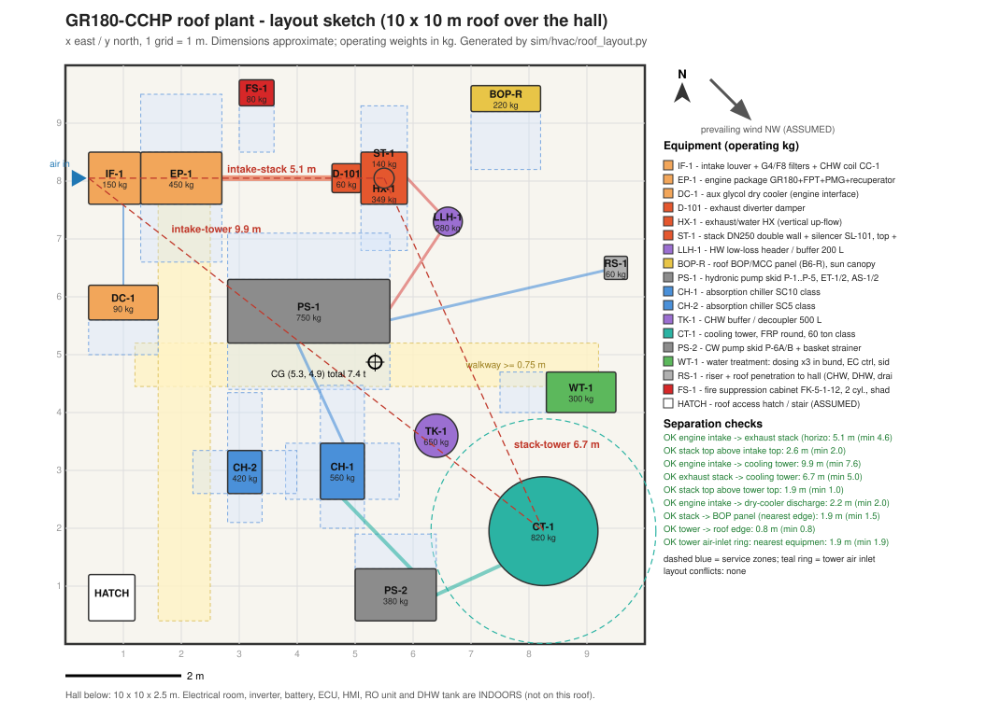

# GR180-CCHP — جانمایی روی بام، وزن‌ها و دسترسی سرویس

تاریخ: ۲۰۲۶-۱۰-۲۱ · تولید با `python3 sim/hvac/roof_layout.py`، که `roof_layout.svg` و `sim/hvac/roof_layout.json` را می‌سازد.

**فرض‌ها:**

- کل پلانت روی بام **۱۰ × ۱۰ m** بالای سالن جا می‌گیرد. محور x به شرق، محور y به شمال، مبدأ گوشهٔ جنوب‌غربی.
- باد غالب تابستان **از شمال‌غرب** فرض شده (شمال). باید در سایت تأیید شود.
- اتاق برق، اینورتر، باتری، ECU، HMI، RO و مخزن DHW داخل ساختمان‌اند.
- محل دریچهٔ دسترسی به بام (گوشهٔ جنوب‌غربی) فرضی است.

## ۱. منطق جانمایی

1. **ورودی هوای موتور (IF-1) در بالادست باد، گوشهٔ شمال‌غربی.** لوور رو به غرب و شمال است و هوای تازه و تمیز می‌گیرد.
2. **اگزوز در پایین‌دست، با فاصله:**
   - مسیر: پکیج موتور ← کانال داغ DN250 ~۲ m ← D-101 ← HX-1 عمودی ← دودکش.
   - دهانهٔ دودکش ۵.۱ m از لوور فاصله دارد و ۲.۶ m بالاتر از آن است.
3. **برج خنک‌کن در دورترین گوشه (جنوب‌شرقی):**
   - ۱۰.۲ m از لوور فاصله دارد، پس پلوم مرطوب و قطرات (Legionella) به ورودی موتور نمی‌رسد.
   - ۶.۹ m از دودکش فاصله دارد، پس اگزوز داغ وارد برج نمی‌شود.
   - دودکش ۲.۰ m بالاتر از برج است.
4. **چیلرها و پمپ‌ها در وسط:** لوله‌های آب داغ (از HX) و آب خنک‌کن (از برج) کوتاه می‌مانند. اسکید P-6 کنار برج است، با مکش غرقاب.
5. **dry cooler مدار کمکی موتور** جنوب پکیج است (پایین‌دست باد) و رو به بالا تخلیه می‌کند، ۲.۲ m از لوور.
6. **تابلوی BOP-R** کنار لبهٔ شمالی است (سایهٔ تجهیزات)، با سایه‌بان. ۱.۹ m با دودکش فاصله دارد.
7. **رایزر به سالن (RS-1)** در شرق است: ~۶ m لوله روی بام از هدر آب سرد تا رایزر (مطابق فرض docs/03).

## ۲. بررسی فاصله‌ها (خروجی اسکریپت)

| بررسی | مقدار | حداقل | مرجع | نتیجه |
|---|---|---|---|---|
| ورودی هوا ↔ دودکش (افقی) | 5.1 m | 4.6 m | ASHRAE 62.1 جدول 5-1 (اگزوز احتراقی، 15 ft) | OK |
| ارتفاع دهانهٔ دودکش از بالای لوور | 2.6 m | 2.0 m | پلوم از روی لوور رد شود | OK |
| ورودی هوا ↔ برج | 10.2 m | 7.6 m | ASHRAE 62.1 (خروجی برج، 25 ft) | OK |
| دودکش ↔ برج | 6.9 m | 5.0 m | اگزوز داغ به ورودی برج نرسد | OK |
| ارتفاع دودکش از بالای برج | 2.0 m | 1.0 m | | OK |
| ورودی هوا ↔ dry cooler | 2.2 m | 2.0 m | تخلیهٔ عمودی، پایین‌دست | OK |
| دودکش ↔ تابلوی BOP | 1.9 m | 1.5 m | گرمای تابشی | OK |
| برج ↔ لبهٔ بام | 0.8 m | 0.8 m | جان‌پناه، سرویس | OK (مرزی) |
| حلقهٔ آزاد ورودی هوای برج | 2.1 m | 1.8 m (شعاع + ۱ m) | ورود آزاد هوا | OK |

**پایش بازچرخش:**

- TE-104 (پشت لوور) با TT-OA (هوای بیرون) مقایسه می‌شود. اختلاف بیش از ۳ K آلارم می‌دهد.
- این آلارم بازچرخش اگزوز یا پلوم برج را در بادهای غیرعادی (مثلاً شرقی) نشان می‌دهد.

## ۳. وزن‌ها برای کنترل سازه

| تگ | تجهیز | وزن در حال کار kg | سطح اتکا m² | فشار موضعی kg/m² | مرکز (x, y) m |
|---|---|---|---|---|---|
| IF-1 | لوور + فیلتر G4/F8 + کویل CC-1 | 150 | 0.81 | 185 | (0.9, 8.0) |
| EP-1 | پکیج موتور (هسته + FPT + PMG + recuperator) | 450 | 1.26 | 357 | (2.0, 8.0) |
| DC-1 | dry cooler مدار کمکی | 90 | 0.72 | 125 | (1.0, 5.9) |
| D-101 | damper دوراهی | 60 | 0.25 | 240 | (4.8, 8.1) |
| HX-1 | مبدل اگزوز/آب | 350 | 0.72 | 485 | (5.5, 8.0) |
| ST-1 | دودکش (روی HX-1) | 80 | 0.10 | 832 | (5.5, 8.1) |
| LLH-1 | هدر/بافر آب داغ ۲۰۰ L | 280 | 0.20 | **1426** | (6.6, 7.3) |
| BOP-R | تابلوی BOP/MCC | 220 | 0.54 | 407 | (7.6, 9.4) |
| PS-1 | اسکید پمپ‌های هیدرونیک | 750 | 3.08 | 244 | (4.2, 5.8) |
| CH-1 | چیلر کلاس SC10 | 560 | 0.74 | 760 | (4.8, 3.0) |
| CH-2 | چیلر کلاس SC5 | 420 | 0.44 | 950 | (3.1, 3.0) |
| TK-1 | بافر آب سرد ۵۰۰ L | 650 | 0.44 | **1471** | (6.4, 3.6) |
| CT-1 | برج خنک‌کن کلاس ۴۰ تن | 600 | 2.01 | 298 | (8.4, 1.8) |
| PS-2 | اسکید پمپ P-6A/B | 380 | 1.26 | 302 | (5.7, 0.9) |
| WT-1 | اسکید تصفیهٔ آب + bund | 300 | 0.84 | 357 | (8.9, 4.3) |
| RS-1 | رایزر و عبور از سقف | 60 | 0.16 | 375 | (9.5, 6.5) |
| — | لوله‌کشی پر و ساپورت‌ها | 450 | گسترده | — | |
| — | شاسی/دانیج فولادی گالوانیزه | 900 | گسترده | — | |
| — | سینی کابل، عایق، روکش، راهرو | 250 | گسترده | — | |
| **جمع** | | **~۷.۰ t** (تجهیزات ۵.۴ t + گسترده ۱.۶ t) | | **میانگین ۷۰ kg/m²** روی ۱۰۰ m² | **CG (5.3, 4.9)**، تقریباً وسط بام |

**مقایسه با docs/03 §۹:**

- docs/03 فقط تجهیزات اصلی را حساب کرده بود (۲.۵–۳.۵ t).
- اینجا این موارد هم آمده: بافرها (۰.۹۳ t)، اسکیدهای پمپ (۱.۱۳ t)، تصفیهٔ آب، تابلو، لوله‌کشی و دانیج.
- **برای کنترل سازه عدد ~۷ t ملاک است.**

**راه‌های کم‌کردن وزن:**

- TK-1 به ۳۰۰ L: −۲۲۰ kg، ولی ذخیرهٔ سرمای restart کمتر می‌شود.
- LLH-1 به یک جداکنندهٔ هیدرولیکی DN65 بدون بافر: −۲۰۰ kg.
- لوله‌های CW از PE100 به‌جای استیل.

**الزامات سازه‌ای** (تأیید مهندس سازه الزامی است، docs/03):

- **بار متمرکز:** فشار موضعی TK-1، LLH-1 و چیلرها (۷۶۰–۱۴۷۰ kg/m²) از بار زندهٔ مجاز معمول بام بیشتر است. پس همهٔ تجهیزات روی **دانیج فولادی** (تیرهای IPE/UNP گالوانیزه) قرار می‌گیرند که بار را به تیرها و ستون‌های اصلی یا دیوارهای باربر منتقل می‌کند. آرایش دانیج بعد از دریافت نقشهٔ سازهٔ ساختمان تعیین می‌شود.
- **لرزه:** منطقه لرزه‌خیز است (استاندارد ۲۸۰۰؛ ضریب را مهندس سازه تعیین کند).
  - همهٔ تجهیزات به دانیج مهار می‌شوند.
  - لرزه‌گیرهای فنری **با محدودکنندهٔ لرزه‌ای** (seismic snubber).
  - اتصال‌های انعطاف‌پذیر در لوله‌ها کنار تجهیزات.
- **ارتعاش:**
  - پکیج موتور: لرزه‌گیر فنری با فرکانس طبیعی پایین (deflection ≥ ۲۵ mm).
  - پمپ‌ها و فن برج: پد یا فنر.
  - اتصال قابل‌انعطاف لاستیکی در مکش و رانش پمپ‌ها.
  - چیلرهای جذبی کمپرسور ندارند، پس پد لاستیکی کافی است.
- **آب‌بندی بام:**
  - پایه‌های دانیج روی **سکوهای بتنی با فلاشینگ** قرار می‌گیرند. عایق رطوبتی زیر تجهیزات قابل بازسازی باشد.
  - عبورهای لوله و کابل از سقف با sleeve، فلاشینگ و کلاهک.
- **زهکشی:** کف بام زیر برج و تصفیهٔ آب شیب به آبرو دارد. bund مواد شیمیایی به آبرو وصل نیست.

## ۴. دسترسی سرویس و نصب

| موضوع | ترتیب |
|---|---|
| راهرو | راهرو ≥ ۰.۷۵ m (ترجیحاً ۱ m) از دریچهٔ بام: یک مسیر شمالی-جنوبی کنار غرب پکیج، و یک مسیر شرقی-غربی بین چیلرها و اسکید پمپ (خط‌چین زرد در نقشه). سطح ضد لغزش و مقاوم UV. |
| فضای سرویس هر تجهیز | خط‌چین آبی در نقشه. پکیج موتور ۱ m از دو طرف (درهای دو طرف، docs/03 §۶). HX-1 ۰.۸ m از شمال و جنوب (درب بازدید). چیلرها ۱ m جلو و ۰.۶ m طرفین. برج حلقهٔ ۱ m. تابلو ۱ m جلو. |
| بلندکردن هسته و FPT | سقف پکیج برداشتنی است. **جرثقیل دستی davit یا گنتری پرتابل ۱ t** روی دانیج کنار EP-1، برای درآوردن هسته (بالانس و تعویض یاتاقان) بدون جرثقیل سنگین. |
| نصب چیلرها، برج، TK-1 | جرثقیل موبایل (کلاس ۲۵ t با شعاع ~۱۵–۲۰ m؛ بستگی به محل خیابان دارد). مسیر و محل استقرار جرثقیل از قبل مشخص شود. چیلرها با شاسی و نقاط بلندکردن کارخانه. |
| مواد شیمیایی | گالن‌های ۲۰–۲۵ L از راه پله یا بالابر به WT-1. bund ۱۱۰ ٪، دوش چشم نزدیک دریچهٔ بام. |
| تعویض فیلتر ورودی هوا | از سمت غرب IF-1. فیلترها کشویی. |
| روشنایی و برق سرویس | چراغ ضدآب LED، پریز ۲۳۰ V سرویس IP66 کنار هر گروه، مانیتور سرویس دوم روی بام (docs/03). |
| ایمنی | **حفاظ لبهٔ بام** (جان‌پناه ≥ ۱.۱ m یا نقطهٔ اتصال کمربند ایمنی)، E-stop روی بام، علامت‌گذاری سطوح داغ (دودکش، HX، کانال). |
| صاعقه و ارت | ترمینال هوایی روی دودکش و برج، هم‌بندی همهٔ اسکیدها به شبکهٔ ارت، SPD در تابلوی BOP-R. |

## ۵. ابعاد کلی

- **سطح اشغال‌شده:** حدود ۳۵ m² تجهیزات + فضای سرویس، از ۱۰۰ m² بام سالن. اگر بام بزرگ‌تر از سالن است، می‌توان برج را دورتر برد. فاصلهٔ بیشتر از ورودی هوا همیشه بهتر است.
- **بلندترین نقطه:** دودکش، +۴.۰ m از بام. بعد از آن برج (~۲.۰ m) و چیلر SC10 (~۱.۹ m).
