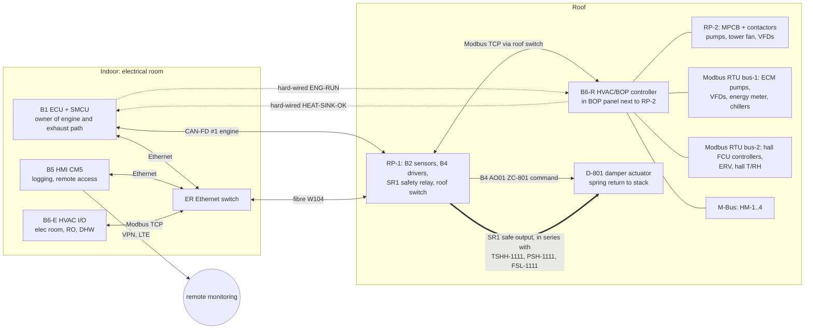

# GR180-CCHP — توالی‌های کنترلی و فهرست I/O کنترلر پلانت

تاریخ: ۲۰۲۶-۱۰-۲۱

- **تولید جدول I/O:** `python3 sim/hvac/io_list.py --md`. نسخهٔ Excel در `docs/hvac/io_list.csv` است.
- **تگ‌ها:** مطابق `01_pid.md`.

## ۱. معماری کنترل (هم‌تراز با `docs/electrical/00_electrical_control_architecture.md`)

**اصول:**

1. **مالک موتور و مسیر اگزوز B1 است** (مطابق docs/electrical). damper D-801 را B4 (خروجی AO01، تگ ZC-801) فرمان می‌دهد، و فیدبک و limit switchها روی B2 هستند (ZT-801، ZSO-801).
   - **تغذیهٔ 24 VAC actuator** یک زنجیرهٔ سخت‌افزاری است: خروجی ایمن SR1 (ESD و trip موتور) در سری با TSHH-1111 (۹۸ °C، manual reset)، PSH-1111 (۵.۰ bar) و FSL-1111 (از رلهٔ تأخیر ۱۰ s).
   - با باز شدن هر کدام، D-801 با فنر در ≤ ۱۵ s به دودکش (bypass) می‌رود. این حفاظت به هیچ نرم‌افزاری وابسته نیست.
   - افزودن K-EX و HS-604 به SR1 **پیشنهاد** است (SR1 طبق docs/electrical ۵ ورودی دوکانالهٔ خالی دارد).
2. **کنترلر HVAC (B6-R روی بام، B6-E داخل ساختمان)** همهٔ I/O آبی و تهویه را دارد: پمپ‌ها، چیلرها، برج، تصفیهٔ آب، فن‌کویل‌ها، RO و DHW.
   - با **Modbus TCP روی شبکهٔ Ethernet پلانت** (فیبر W104 و سوییچ بام) به B1 و B5 وصل است. این همان «کنترلر HVAC» در docs/electrical است، و placeholderهای `HV-*` آنجا به تگ‌های این سند نگاشت می‌شوند (جدول پایین).
   - **پیشنهاد:** کنترلر جدا از B1 و B5 باشد.
3. **damper در کار عادی:**
   - B6-R حلقهٔ PI روی TE-1111 (SP ۹۲ °C) را حساب می‌کند و «درخواست موقعیت» را با Modbus TCP به B1 می‌دهد. B1 آن را با محدودیت‌های موتور (purge، light-off، نرخ) به B4 می‌فرستد.
   - **با قطع ارتباط بیش از ۵ s، B1 damper را به bypass می‌برد.** موتور ادامه می‌دهد و فقط بازیافت گرما قطع می‌شود.
4. **سیگنال‌های سخت‌افزاری بین دو کنترلر:**
   - `ENG-RUN` (B1 → B6-R).
   - `HEAT-SINK-OK` (B6-R → B1) = `HV-XS-HWP` در docs/electrical: P-1 روشن، FSL-1111 سالم و TE-1111 < ۹۵ °C. نبود آن یعنی damper به دودکش.
5. **حالت محلی امن:** با قطع شبکه، B6-R چیلرها، پمپ‌ها و برج را با سنسورهای خودش ادامه می‌دهد.
   - TT-701 و MT-702 روی B2 هستند و از شبکه خوانده می‌شوند. اگر در دسترس نباشند، منطق یخ‌زدگی از TE-1303 (حوضچه) و TE-1222 استفاده می‌کند.
   - DC-1 روی ۱۰۰ ٪ و XV-1305 باز می‌ماند تا مدار کمکی موتور (ژنراتور، روغن، یکسوساز) همیشه خنک باشد.
6. **B5** همهٔ نقاط را هر ۱ دقیقه ثبت می‌کند و داشبورد، آلارم (SMS یا ایمیل) و VPN را فراهم می‌کند. کنترل حلقه‌بسته روی B5 نیست.

**نگاشت placeholderهای docs/electrical به تگ‌های این سند:**

| docs/electrical | این سند |
|---|---|
| HV-TE-HWS / HV-TE-HWR | TE-1111 / TE-1112 |
| HV-FT-HW | FT-1111 |
| HV-XS-HWP | HEAT-SINK-OK (سخت‌افزاری) + وضعیت P-1 |
| HV-XS-CH | CH-1/CH-2 RUN و ALM |
| HV-TE-CHWS | TE-1211 |
| HV-ZC-IC | TV-1221 (روی B6-R؛ SP دمای T1 از ECU: ۱۵ °C برای POWER و ۲۰ °C برای COMFORT) |
| HV-XS-CT | P-6 و CT-FAN |
| HV-XS-FCU | FCU-1..4 (bus-2) |

**سیگنال‌های مشترک** با همان تگ‌های docs/electrical استفاده می‌شوند و کنترلر HVAC آن‌ها را از شبکه می‌خواند: TE-106، TE-107، PT-205، ZT-801، ZSO-801، PDT-203، TT-701، MT-702، TE-703، TE-101 (T1)، TE-503/504 (گلیکول)، XS-SMK، TT-ER. همچنین EH-850، المنت برقی ۶ kW مخزن DHW برای مصرف برق مازاد (B1).

## ۲. حالت‌های کار

| حالت | شرط ورود | خلاصه |
|---|---|---|
| OFF | فرمان اپراتور یا نبود موتور | پمپ‌ها خاموش، D-801 در bypass. TK-1 در صورت سرد بودن به ساختمان سرما می‌دهد. |
| START-UP | فرمان start | بخش ۴-۱ |
| **SUMMER-CCHP** | میانگین ۷۲ ساعتهٔ TT-701 > ۲۰ °C، یا تقاضای سرمایش، یا دستی | چیلرها روشن، کویل ورودی فعال، برج روشن |
| WINTER-CHP | میانگین ۷۲ ساعتهٔ TT-701 < ۱۶ °C و تقاضای گرمایش سالن، یا دستی | چیلرها خاموش و ایزوله، changeover به HX-3، برج در lay-up |
| بین ۱۶ و ۲۰ °C | — | حالت فعلی حفظ می‌شود (هیسترزیس). حداقل ۴۸ ساعت در هر حالت. |
| FAULT-xx | بخش ۴-۵ تا ۴-۹ | |
| FREEZE | TT-701 < ۴ °C یا آب هر مدار < ۳ °C | بخش ۴-۷ |
| DUST | دستی، یا نرخ افزایش PDT-203 | بخش ۴-۹ |
| MAINT | کلید سرویس روی HMI | فرمان دستی با محدودیت‌های ایمنی؛ اینترلاک‌های سخت‌افزاری فعال می‌مانند |

**پارامتر PRIORITY** (از HMI): `POWER` (پیش‌فرض) یا `COMFORT`. تعیین می‌کند در کمبود آب سرد، کویل ورودی (برق) مقدم باشد یا سالن.

## ۳. setpointها (قابل تنظیم از HMI)

| حلقه | setpoint | محدوده / نکته |
|---|---|---|
| D-801 روی TE-1111 (رفت آب داغ) | تابستان ۹۲ °C، زمستان ۸۵ °C | باز شدن به سمت HX ≤ ۱۰ ٪ در دقیقه؛ بستن به bypass بی‌محدودیت |
| حداقل TE-1112 (برگشت به HX) | ۷۰ °C | بعد از ۳۰ دقیقهٔ اول گرم‌کردن فعال می‌شود |
| آب سرد خروجی چیلرها | ۷ °C | کنترل داخلی چیلر |
| فن برج روی TE-1301 | ۲۷ °C | حداقل ۲۶ °C با TV-1301 (حداقل مجاز سازنده تأیید شود)؛ حداقل دور فن ۲۵ ٪ |
| P-5 روی DPT-1211 | ≈ ۶۵ kPa | در commissioning تنظیم می‌شود |
| کویل ورودی TE-1221 | ۱۵ °C | در COMFORT تا ۲۵ °C بالا می‌رود |
| سالن (فن‌کویل‌ها) | سرمایش ۲۴ °C، گرمایش ۲۱ °C | باند ±۰.۵ K |
| اتاق برق | FCU-E ۲۵ °C؛ AC-E در ۲۸ °C | آلارم ۳۰ °C |
| DHW | ۶۰ °C | legionella هفتگی ۶۵ °C به مدت ۱ ساعت |
| رفت گرمایش HX-3 | ۴۵ °C | حداکثر ۵۵ °C |
| blowdown (AIT-1301) | ۸۰۰ µS/cm | گزینهٔ B |
| آب جبرانی blend (AIT-1402) | ۲۳۰ µS/cm | |
| ORP (AIT-1302) | ~۶۵۰–۷۰۰ mV | در سایت با تست DPD کالیبره شود |

## ۴. توالی‌ها

### ۴-۱. راه‌اندازی (START-UP) از حالت سرد

**پیش‌شرط‌ها:**

- هیچ trip فعال نباشد.
- PT-1111 و PT-1211 بین ۱.۰ و ۴.۵ bar باشند.
- LT-1301 نرمال باشد، یا تابستان نباشد.
- ZSO-801 = bypass.
- ارتباط Modbus TCP بین B6-R، B6-E و B1 سالم باشد.
- باس تغذیهٔ ضروری سالم باشد.

**مراحل:**

1. **P-1 روشن می‌شود.** FSL-1111 دبی را تأیید می‌کند و زنجیرهٔ تغذیهٔ actuator D-801 بسته می‌شود. B6-R سیگنال HEAT-SINK-OK را به B1 می‌دهد. بدون دبی آب، damper نمی‌تواند به HX باز شود.
2. **P-5 روشن می‌شود** و حلقهٔ آب سرد گردش دارد. اگر TK-1 هنوز سرد است (TE-1211 < ۱۲ °C)، سرمای ذخیره برای کویل ورودی آماده است.
3. **purge:**
   - B1 موتور را با استارتر می‌چرخاند. D-801 روی **۵۰ ٪** است تا هر دو مسیر (HX و bypass) پاک شوند.
   - حداقل **۵ برابر حجم سیستم اگزوز** (~۵ m³) هوا عبور کند. با دبی cranking اندازه‌گیری‌شده معمولاً ۶۰–۱۲۰ ثانیه.
   - سپس D-801 به bypass می‌رود. **light-off فقط با ZSO-801 = bypass مجاز است.**
4. **light-off و شتاب تا idle** (توالی ECU). اگزوز از bypass می‌رود.
5. **ورود گرما به HX:** وقتی موتور پایدار شد (N1 در idle و EGT پایدار)، D-801 با ≤ ۱۰ ٪ در دقیقه به سمت HX باز می‌شود. آب داغ گرم می‌شود: از ۳۵ به ۸۰ °C حدود ۱۶ دقیقه با ۶۹ kW و ۳۵۴ L.
   - در این ۳۰ دقیقهٔ اول، قاعدهٔ حداقل TE-1112 غیرفعال است. کندانس احتمالی به pot خنثی‌کننده می‌رود.
6. **آب خنک‌کن:** در TE-1113 ≥ ۷۰ °C، P-6 روشن می‌شود. TV-1301 روی bypass کامل است تا TE-1301 ≥ ۲۶ °C شود. فن برج روی کنترل خودکار.
7. **چیلر CH-1:** در TE-1113 ≥ ۸۰ °C به ترتیب:
   - P-4A ← تأیید FS-1201
   - تأیید FS-1301
   - P-2A
   - فرمان CH-1
   چیلر جذبی حدود ۱۰–۲۰ دقیقه بعد سرمای کامل می‌دهد.
8. **چیلر CH-2:** وقتی TE-1113 ≥ ۸۵ °C به مدت ۵ دقیقه، یا CH-1 بیش از ۱۰ دقیقه در کار است، همان ترتیب با P-4B و P-2B.
9. **کویل ورودی:** در TE-1211 < ۱۲ °C، TV-1221 با شیب ۱۰ ٪ در دقیقه باز می‌شود و TE-1221 را به ۱۵ °C می‌رساند. ECU سقف توان را با کاهش T1 بالا می‌برد. توان از ~۱۳ به ~۲۱ kW می‌رود و باتری فاصله را پر می‌کند.
10. **اتاق برق:** وقتی TE-1211 < ۱۴ °C به مدت ۱۰ دقیقه، FCU-E اصلی می‌شود و AC-E به حالت standby می‌رود.
11. **سالن:** فن‌کویل‌ها طبق برنامهٔ HMI فعال می‌شوند.

زمان تقریبی تا CCHP کامل از حالت سرد: **۳۰–۴۰ دقیقه**.

### ۴-۲. کار عادی تابستان (SUMMER-CCHP)

**damper:**

- PI روی TE-1111 با SP ۹۲ °C. محاسبه در B6-R؛ اجرا از B1 به B4 (ZC-801). معمولاً ۱۰۰ ٪ به سمت HX است.
- فقط وقتی چیلرها و DHW گرما را کامل مصرف نکنند، به bypass می‌رود.
- **پایش‌ها:**
  - FT-1111 < ۶ m³/h ← bypass + آلارم.
  - TE-106 > ۳۲۰ °C ← آلارم recuperator (به ECU).
  - روند PDT-1102 و TE-107 (> ۱۳۰ °C) ← آلارم رسوب.

**چیلرها:**

- هر دو روشن‌اند و آب سرد ۷ °C را با کنترل داخلی تأمین می‌کنند.
- **CH-2 خاموش می‌شود** وقتی TE-1113 < ۸۰ °C به مدت ۱۰ دقیقه (گرما کم است):
  - P-2B فوراً خاموش.
  - P-4B با run-on رقیق‌سازی ۱۵ دقیقه.
- **CH-1 خاموش می‌شود** در TE-1113 < ۷۵ °C به مدت ۱۰ دقیقه.
- راه‌اندازی دوباره با هیسترزیس ۵ K.

**برج:**

- **فن:** PI روی TE-1301 با SP ۲۷ °C. در تابستان معمولاً دور کامل است. هر ۱ K آب خنک‌کن سردتر ~۸ ٪ سرمایش بیشتر می‌دهد، در حالی که فن فقط ~۱ kW مصرف دارد.
- **حداقل دمای آب خنک‌کن:** TV-1301 دمای TE-1301 را ≥ ۲۶ °C نگه می‌دارد. این برای جلوگیری از کریستالیزاسیون است.
- **وابستگی‌ها:** P-6 تا زمانی روشن است که یک چیلر فعال یا در run-on باشد.

**آب سرد ثانویه:**

- P-5 روی Δp کار می‌کند.
- TV-1221 روی TE-1221 تنظیم می‌شود. **اگر موتور خاموش است، TV-1221 بسته است** (جریان هوا نیست؛ سرما برای restart ذخیره می‌ماند).
- فن‌کویل‌ها با کنترلر اتاق کار می‌کنند.
- **LSH-1221 (سینی کندانس پر):** TV-1221 بسته می‌شود و آلارم می‌دهد، چون قطره به کمپرسور می‌رسد.

**منطق کمبود آب سرد (اولویت):**

- **شرط کمبود:** TE-1211 > ۹ °C به مدت ۱۰ دقیقه، یا TE-1212 > ۱۱.۵ °C (بافر خالی شده).
- **POWER:**
  - کویل ورودی روی ۱۵ °C می‌ماند.
  - setpoint سالن هر ۱۵ دقیقه +۱ K بالا می‌رود (حداکثر ۲۷ °C)، یا حداکثر باز بودن PICVهای سالن به ۷۰ ٪ محدود می‌شود.
- **COMFORT:**
  - setpoint کویل ورودی هر ۱۰ دقیقه +۲.۵ K بالا می‌رود (حداکثر ۲۵ °C).
  - ECU سقف توان را مطابق آن پایین می‌آورد.
- **اتاق برق هرگز محدود نمی‌شود.** اگر کمبود بیش از ۳۰ دقیقه طول بکشد و FCU-E-RC > ۲۸ °C، AC-E روشن می‌شود.
- **بازگشت:** TE-1211 < ۸ °C به مدت ۲۰ دقیقه ← محدودیت‌ها پله‌پله برداشته می‌شوند.

**شاخهٔ DHW:**

- **فعال‌سازی** در تابستان: وقتی TE-1111 > ۹۲ °C یا damper بیش از ۵ ٪ به مدت ۵ دقیقه در bypass است (گرمای مازاد)، یا TE-1132 < ۵۰ °C (حداقل بهداشتی).
- **V-PRI روی DHW:**
  - وقتی TE-1132 < ۵۵ °C، تا وقتی TE-1133 > ۶۰ °C شود.
  - TV-1131 دمای رفت را ≤ ۷۵ °C نگه می‌دارد (رسوب در PHE).
- **legionella:** یکشنبه ۰۲:۰۰، SP به ۶۷ °C، تا TE-1133 ≥ ۶۵ °C به مدت ۱ ساعت.

### ۴-۳. زمستان (WINTER-CHP) و تعویض فصل

**کار عادی زمستان:**

- چیلرها خاموش‌اند.
- D-801 روی TE-1111 با SP ۸۵ °C کار می‌کند. بیشتر گرما bypass می‌شود، چون گرمایش سالن فقط ~۳–۸ kW است.
- V-PRI: اول DHW، بعد گرمایش.
- TV-1231 دمای TE-1231 را روی ۴۵ °C نگه می‌دارد.
- فن‌کویل‌ها با setpoint ۲۱ °C گرم می‌کنند.
- TV-1221 بسته است. اگر TT-701 < ۵ °C و RH > ۸۰ ٪، حداقل ۲۰ ٪ باز می‌ماند (آب گرم = anti-icing ورودی کمپرسور).
- اتاق برق: AC-E خنک‌کن اصلی است.

**تابستان ← زمستان:**

1. توقف عادی چیلرها، سپس run-on رقیق‌سازی ۱۵ دقیقهٔ P-4 و P-6.
2. بستن MV-CH1E و MV-CH2E و **تأیید end switchها**.
3. V-CO1 و V-CO2 به HX-3 می‌روند. **اینترلاک: تا MVها بسته نباشند، V-CO حرکت نمی‌کند.**
4. TV-1231 با شیب ۲ K در دقیقه باز می‌شود.
5. برج: اگر بیش از ۳ روز لازم نیست، تخلیه و خشک (lay-up).

**زمستان ← تابستان:**

1. برج پر، تمیز و ضدعفونی می‌شود و تصفیهٔ آب راه‌اندازی می‌شود (`03_water_treatment.md`).
2. TV-1231 بسته می‌شود و حلقه با فن‌کویل‌ها سرد می‌شود تا **TE-1213 ≤ ۳۰ °C** (حداکثر دمای ورودی اواپراتور طبق سازنده تأیید شود).
3. V-CO به TK-1 برمی‌گردد. MV-CHxE باز می‌شوند.
4. راه‌اندازی چیلرها طبق ۴-۱ از مرحلهٔ ۶.

### ۴-۴. توقف عادی

1. ECU بار را کم می‌کند و موتور را خاموش می‌کند. D-801 با فرمان stop به bypass می‌رود.
2. **P-1 به مدت ۱۵ دقیقه** روشن می‌ماند (گرمای باقیماندهٔ HX).
3. چیلرها تا TE-1113 < ۷۵ °C با گرمای ذخیره کار می‌کنند، بعد خاموش می‌شوند:
   - P-2 خاموش.
   - **P-4 و P-6 با run-on ۱۵ دقیقه** (رقیق‌سازی LiBr). فن برج دنبال TE-1301.
4. تا TE-1211 < ۱۴ °C، P-5 به ساختمان سرما می‌دهد. بعد، اتاق برق به AC-E می‌رود.

### ۴-۵. trip موتور

1. SR1 (یا B1 با فرمان ZC-801 = ۰) damper را به دودکش می‌برد: **D-801 با فنر در ≤ ۱۵ s به bypass** می‌رود. این از ورود سوخت نسوخته به HX هم جلوگیری می‌کند.
2. P-1 به مدت ۱۵ دقیقه روشن می‌ماند. چیلرها و run-on مثل ۴-۴.
3. TV-1221 بسته می‌شود. TK-1 سرد برای restart می‌ماند: ~۲.۹ kWh، یعنی ~۱۰ دقیقه کویل.
4. **restart خودکار** با تصمیم ECU (حداکثر ۳ بار در ساعت) و توالی ۴-۱. purge اجباری است.
5. آلارم به HMI و از راه دور.

### ۴-۶. خرابی چیلر و مدارهای آبی

| رخداد | تشخیص | اقدام |
|---|---|---|
| **خرابی یک چیلر** | CH-x-ALM | (۱) قطع فرمان CH-x و P-2x. (۲) P-4x و P-6 به مدت ۱۵ دقیقه روشن برای رقیق‌سازی، اگر خود چیلر اجازه دهد. (۳) چیلر دیگر ادامه می‌دهد. damper گرمای اضافه را bypass می‌کند، شاخهٔ DHW فعال می‌شود و منطق کمبود آب سرد اجرا می‌شود. (۴) برای آلارم‌های دبی/دما یک تلاش restart بعد از ۳۰ دقیقه، حداکثر ۳ بار در روز. خطای داخلی restart نمی‌شود. |
| **خرابی هر دو چیلر** | هر دو ALM | پمپ‌های چیلر بعد از run-on خاموش، P-6 و برج خاموش. D-801 روی ۹۲ °C (عمدتاً bypass). TK-1 تا خالی شدن کار می‌کند، بعد AC-E روشن می‌شود. **کولرهای گازی موجود سالن پشتیبان‌اند** (از طریق کنتاکت فرمان یا دستی). ECU سقف توان را به حالت بدون کویل می‌برد (~۱۳ kW در ۴۶ °C). |
| پمپ P-6 | خطای VFD، یا FT-1301 < ۷۰ ٪ به مدت ۱۰ s | پمپ standby در ≤ ۵ s. هر دو از کار افتاده، یا LSLL-1301 ← توقف چیلرها و آلارم. |
| فن برج | خطای VFD یا VS-1301 | فن متوقف. TE-1301 > ۳۴ °C به مدت ۱۰ دقیقه ← توقف CH-2. > ۳۶ °C ← توقف CH-1. |
| آب جبرانی | LT-1301 پایین و XV-1301 باز ولی FQ-1301 بدون پالس | آلارم. شناور مکانیکی پشتیبان. بررسی P-9 و RO و LSL-1400. |
| **دبی آب داغ** | FSL-1111 به مدت ۱۰ s (سخت‌افزاری) | زنجیرهٔ سخت‌افزاری تغذیهٔ actuator باز می‌شود و D-801 به bypass می‌رود. HEAT-SINK-OK می‌افتد. **موتور با توان کامل ادامه می‌دهد** و فقط بازیافت گرما قطع است. P-1 دوقلو خودش جابه‌جا می‌شود. |
| P-4x | P-4x-FLT | توقف CH-x (FS-1201/1202 هم اینترلاک داخلی دارند). |
| P-5 | P-5-FLT (هر دو هد) | آلارم. کویل ورودی و سالن بدون آب سرد. AC-E. ECU سقف توان را کم می‌کند. |
| نشتی | افت PT-1111 یا PT-1211 به < ۰.۸ bar، FQ-1410 > ۲۰ L/day، یا LD-E | آلارم. قفل پرکن خودکار. LD-E شیر FCU-E را می‌بندد. |

### ۴-۷. حفاظت یخ‌زدگی (حالت FREEZE)

برازجان به‌ندرت زیر صفر می‌رود، ولی بام بی‌پناه است.

- **TT-701 < ۴ °C:**
  - P-1 و P-5 پیوسته با حداقل دور گردش می‌کنند، حتی اگر پلانت خاموش باشد.
  - TV-1221 حداقل ۲۰ ٪ باز.
  - HT-1 روشن (< ۳ °C).
  - EH-1301 روشن، اگر TE-1303 < ۵ °C و سطح حوضچه کافی است.
  - اگر برج در lay-up است، تخلیهٔ کامل بررسی و تأیید می‌شود.
- **دمای آب هر مدار < ۳ °C** (TE-1222، TE-1213، TE-1112، TE-1303): آلارم، اجبار گردش. اگر موتور روشن است، HX-3 با SP پایین فعال می‌شود.
- **کویل ورودی:** اگر موتور با هوای < ۵ °C کار می‌کند و TV-1221 بسته است، هوای سرد می‌تواند آب کویل را منجمد کند. پس حداقل ۲۰ ٪ باز و آلارم TE-1222 < ۴ °C.

### ۴-۸. حفاظت دمای بالا (overheat)

| نقطه | سطح ۱ | سطح ۲ | سطح ۳ (سخت‌افزاری) |
|---|---|---|---|
| آب داغ TE-1111 | ۹۲ °C: damper مدوله | ۹۵ °C: آلارم، شاخهٔ DHW اجباری | **TSHH-1111 ۹۸ °C** ← قطع تغذیهٔ actuator ← bypass (manual reset)؛ PSH-1111 ۵.۰ bar؛ PSV-1111 ۵.۵ bar |
| گاز ورودی HX TE-106 | ۳۲۰ °C: آلارم و ECU | — | طراحی D-801 و دودکش ۶۵۰ °C |
| گاز خروجی HX TE-107 | ۱۳۰ °C: آلارم رسوب یا کمبود دبی | — | — |
| آب خنک‌کن TE-1301 | ۳۴ °C: توقف CH-2 | ۳۶ °C: توقف CH-1 | حفاظت داخلی چیلر |
| DHW TE-1132 | ۷۲ °C: بستن V-PRI به DHW | ۷۵ °C: آلارم | T&P، TMV |
| اتاق برق FCU-E-RC | ۲۸ °C: AC-E | ۳۰ °C: آلارم؛ ۳۵ °C: derate اینورتر | ۴۰ °C: shutdown کنترل‌شده |
| تابلوی BOP-R | ۵۰ °C: آلارم | ۶۰ °C: حذف بارهای غیرضروری | — |

### ۴-۹. قطع برق، گرد و خاک، بازچرخش

**قطع برق / black start:**

- همهٔ بارهای HVAC روی خروجی اینورتر (پشتیبان باتری) هستند.
- **باس ضروری:** B6، کنترل چیلرها، P-1، P-4A/B، P-6 و فن برج. این‌ها در فهرست load-shedding اولویت بالا دارند. AC-E، ERV و فن‌کویل‌ها غیرضروری‌اند.
- **انرژی run-on رقیق‌سازی:** ~۲.۹ kW × ۱۵ min ≈ ۰.۷ kWh از باتری.
- **با قطع کامل:**
  - D-801 با فنر به bypass می‌رود.
  - چیلرها بدون رقیق‌سازی خاموش می‌شوند و بعد از برگشت برق، روال بازیابی سازنده اجرا می‌شود.
  - B6 در حالت «post-blackout» است: اول P-1، بعد توالی ۴-۱.

**گرد و خاک (DUST):**

- PDT-203 بالا ← آلارم تعویض فیلتر. ECU در صورت لزوم derate می‌کند.
- purge جداکنندهٔ برج هر ۱ ساعت. گزارش برای تمیزکاری بعد از طوفان.

**بازچرخش:** TE-703 − TT-701 > ۳ K به مدت ۵ دقیقه ← آلارم «exhaust/plume recirculation». جهت باد بررسی شود. در تکرار، ارتفاع دودکش بیشتر شود.

### ۴-۱۰. گزارش‌دهی از راه دور (B5)

- **جریان‌های انرژی:** HM-1 (گرما به چیلرها)، HM-2 و HM-4 (سرمای ساختمان و کویل)، HM-3 (DHW/گرمایش)، EM-HVAC (برق داخلی)، توان موتور.
- **شاخص‌ها:** COP لحظه‌ای چیلرها، راندمان مفید کل.
- **آب:** سیکل تغلیظ، مصرف آب، EC/pH/ORP، سطح مواد شیمیایی، ساعت‌شمار پمپ‌ها و چیلرها.
- **یادآوری سرویس:** فیلترها، کوپن خوردگی، Legionella، تمیزکاری HX.

## ۵. خلاصهٔ I/O به تفکیک برد

| برد | RTD | TC | 4–20 mA | 0–10 V in | AO | DI | پالس | DO | Safety DI | Safety DO | دستگاه bus | جمع |
|---|---|---|---|---|---|---|---|---|---|---|---|---|
| B1 (ECU، داخل؛ docs/electrical) | — | — | — | — | — | 1 | — | — | — | — | — | 1 |
| B2 (I/O سنسور، RP-1؛ docs/electrical) | 1 | 2 | 4 | 1 | — | 1 | — | — | — | — | — | 9 |
| B4 (درایورها، RP-1؛ docs/electrical) | — | — | — | — | 1 | — | — | — | — | — | — | 1 |
| SR1 (رلهٔ ایمنی؛ پیشنهاد افزودن) | — | — | — | — | — | — | — | — | 1 | 1 | — | 2 |
| **B6-R (جدید، کنترلر HVAC بام)** | 18 | 1 | 12 | 1 | 5 | 38 | 2 | 27 | — | — | 12 | **116** |
| **B6-E (جدید، داخل ساختمان)** | 2 | — | 3 | — | 2 | 8 | 1 | 7 | — | — | 2 | **25** |

- ردیف‌های B1، B2، B4 و SR1 سیگنال‌های مشترک یا اینترفیس‌اند. بیشترشان از قبل در `docs/electrical/02_io_list.csv` هستند و فقط برای ارجاع اینجا آمده‌اند. «پیشنهاد افزودن» یعنی هنوز در docs/electrical نیست.
- شمارش به ازای ردیف جدول است. P-6-CMD و P-6-FLT (هر کدام ۲) و LSL-DP (۳) در اسکریپت ضرب شده‌اند.

**حداقل سخت‌افزار B6-R (با ۲۵ ٪ ذخیره):**

| نوع | تعداد / مشخصه |
|---|---|
| ورودی PT1000 | ۲۳، سه یا چهارسیمه، ADC ایزوله، دقت ±۰.۱ K |
| ترموکوپل K | ۲، با جبران سرد |
| AI 4–20 mA | ۱۵، تغذیهٔ حلقه 24 V با محافظ |
| AI 0–10 V | ۲ |
| AO 0–10 V | ۷ |
| DI 24 V | ۵۰ (۳ تا کانتر پالس) |
| DO | ۳۴ رله، 2 A / 250 VAC |
| ارتباط | RS-485 × ۲ (bus-1 پلانت، bus-2 سالن، ایزوله)، M-Bus master × ۱، **Ethernet (Modbus TCP) × ۱** |
| تغذیه | 24 VDC از باس اضطراری 48 V (docs/electrical) |

**B6-E:** RTD 3، AI 4، AO 3، DI 12، DO 9، RS-485، M-Bus و Ethernet.

**پیشنهاد:**

- با ~۱۴۰ نقطه، B6 را **ماژولار** طراحی کنید: برد پایه (MCU، ارتباطات، ۱۶ RTD، ۸ AI، ۴ AO، ۱۶ DI، ۱۶ DO) + برد توسعه (B6-X) روی همان باس.
- **گزینهٔ کم‌ریسک‌تر برای کار ۲۴/۷ بدون اپراتور:** BOP با PLC صنعتی conformal-coated (مثلاً Siemens SIPLUS S7-1200 یا WAGO 750 XTR) با Modbus TCP، و بردهای سفارشی برای موتور (B1–B4) بمانند. docs/electrical هم همین را پرسیده است (پرسش ۱۹ آن). **تصمیم با کاربر** (پرسش باز).

## ۶. فهرست کامل I/O

| tag | شرح | نوع سیگنال | رنج / سیگنال | محل | برد | عملکرد / setpoint |
|---|---|---|---|---|---|---|
| TE-106 | دمای گاز اگزوز ورودی HX-1 (بعد از recuperator) | AI-TC | 0-500 °C | duct before D-801 | B2 | TC07 (docs/electrical) ؛ H 320 °C = عیب recuperator |
| TE-107 | دمای گاز خروجی HX-1 (دودکش بعد از مبدل) | AI-TC | 0-400 °C | HX-1 outlet | B2 | TC08 (docs/electrical) ؛ H 130 °C = رسوب؛ L 85 °C = خطر میعان |
| TE-1103 | دمای دودکش مشترک | AI-TC | 0-600 °C | ST-1 | B6-R | تأیید موقعیت damper (bypass ⇒ > 200 °C) |
| PT-205 | فشار برگشتی اگزوز (بعد از recuperator و مبدل) | AI-mA | 0-100 mbar g | duct before D-801 | B2 | AI03 (docs/electrical) ؛ آلارم و trip در ECU |
| PDT-1102 | افت فشار سمت گاز HX-1 | AI-mA | 0-1 kPa | across HX-1 | B6-R | روند رسوب؛ H 0.25 kPa |
| ZC-801 | فرمان موقعیت diverter damper D-801 | AO-V | 0-10 V = 0 % bypass..100 % HX | D-801 | B4 | AO01 (docs/electrical) ؛ مالک ECU. درخواست موقعیت از PI روی TE-1111 در B6-R، از Modbus TCP؛ قطع ارتباط > 5 s → bypass |
| ZT-801 | فیدبک موقعیت D-801 | AI-V | 2-10 V = 0-100 % | D-801 | B2 | AI16 (docs/electrical) ؛ اختلاف > 10 % به مدت 30 s → آلارم |
| ZSO-801 | D-801 کاملاً در مسیر دودکش (BYPASS) | DI | dry contact | D-801 | B2 | DI22 (docs/electrical) ؛ مجوز light-off فقط در bypass (منطق B1) |
| ZSH-802 | D-801 کاملاً در مسیر HX (پیشنهاد افزودن) | DI | dry contact | D-801 | B6-R | وضعیت؛ «هر دو مسیر بسته» با ZSO-801 → آلارم |
| K-EX | تغذیهٔ 24 VAC actuator D-801 از خروجی ایمن SR1 (fail → bypass با فنر) | SAFE-DO | 24 VAC | RP-1 / BOP-R | SR1 | پیشنهاد افزودن به SR1: قطع با ESD و trip موتور؛ در سری با TSHH-1111 و PSH-1111 و رلهٔ تأخیر FSL-1111 |
| TE-703 | دمای هوای ورودی قبل از کویل (تشخیص recirculation) | AI-RTD | -10..+60 °C | IF-1 after filters | B2 | RTD11 (docs/electrical) ؛ TE-703 − TT-701 > 3 K → آلارم بازچرخش |
| TE-1111 | دمای رفت آب داغ (خروجی HX-1) | AI-RTD | 0-150 °C | HX-1 outlet | B6-R | SP کنترل damper 92 °C؛ H 95 °C |
| TSHH-1111 | ترموستات حد بالا آب داغ 98 °C (manual reset) | DI | NC contact x2 | HX-1 outlet | B6-R | کنتاکت ۱ سخت‌افزاری در سری با تغذیهٔ actuator D-801؛ کنتاکت ۲ وضعیت |
| PSH-1111 | سوئیچ فشار بالای مدار آب داغ 5.0 bar | DI | NC contact x2 | HX-1 outlet | B6-R | مثل TSHH-1111 (قبل از PSV 5.5 bar) |
| TE-1112 | دمای برگشت آب به HX-1 | AI-RTD | 0-150 °C | HX-1 inlet | B6-R | L 70 °C → bypass جزئی (میعان اسیدی) |
| PT-1111 | فشار استاتیک مدار آب داغ | AI-mA | 0-10 bar | P-1 suction | B6-R | L 0.8 bar نشتی؛ H 4.5 bar |
| FT-1111 | دبی مدار اولیه آب داغ (electromagnetic) | AI-mA | 0-15 m³/h | P-1 discharge | B6-R | L 6 m³/h |
| FSL-1111 | فلوسوئیچ مدار اولیه (paddle/thermal) | DI | NC contact x2 | HX-1 inlet | B6-R | کنتاکت ۱ از رلهٔ تأخیر 10 s در سری با تغذیهٔ D-801؛ کنتاکت ۲ وضعیت |
| P-1-CMD | فرمان پمپ دوقلوی P-1A/B | DO | relay | PS-1 | B6-R | همیشه روشن وقتی موتور روشن است + 15 min run-on |
| P-1-FLT | خطای پمپ P-1 (هر دو هد) | DI | dry contact | PS-1 | B6-R |  |
| P-1-BUS | P-1A/B ECM: دور، توان، آلارم، تعویض نوبتی | BUS | Modbus RTU bus-1 | PS-1 | B6-R | alternation 24 h |
| TE-1113 | دمای بالای LLH-1 | AI-RTD | 0-150 °C | LLH-1 | B6-R |  |
| TE-1114 | دمای برگشت مصرف‌کننده‌ها به LLH-1 | AI-RTD | 0-150 °C | LLH-1 | B6-R |  |
| P-2A-CMD | فرمان پمپ آب داغ چیلر CH-1 | DO | relay | PS-1 | B6-R | با CH-1 |
| P-2A-FLT | خطای P-2A | DI | dry contact | PS-1 | B6-R |  |
| P-2B-CMD | فرمان پمپ آب داغ چیلر CH-2 | DO | relay | PS-1 | B6-R | با CH-2 |
| P-2B-FLT | خطای P-2B | DI | dry contact | PS-1 | B6-R |  |
| HM-1 | کنتور انرژی گرمای ورودی چیلرها | BUS | M-Bus | HW header | B6-R | kWh، دبی، دماها |
| P-3-CMD | فرمان پمپ شاخهٔ DHW/گرمایش | DO | relay | PS-1 | B6-R |  |
| P-3-FLT | خطای P-3 | DI | dry contact | PS-1 | B6-R |  |
| V-PRI | شیر سه‌راههٔ اولویت DHW ↔ گرمایش (2 وضعیت) | DO | 230 VAC SPDT | PS-1 | B6-R | DHW اولویت دارد |
| V-PRI-ZS | end switch شیر V-PRI | DI | dry contact | PS-1 | B6-R |  |
| TV-1131 | شیر سه‌راههٔ محدودکنندهٔ دمای رفت شاخه | AO-V | 0-10 V | PS-1 | B6-R | DHW ≤ 75 °C، گرمایش ≤ 50 °C |
| TE-1131 | دمای رفت شاخهٔ DHW/گرمایش | AI-RTD | 0-150 °C | PS-1 | B6-R |  |
| TE-1132 | دمای بالای مخزن DHW | AI-RTD | 0-100 °C | DHW tank (indoor) | B6-E | SP 60 °C؛ legionella هفتگی ≥ 65 °C/1 h |
| TE-1133 | دمای پایین مخزن DHW | AI-RTD | 0-100 °C | DHW tank (indoor) | B6-E |  |
| P-7-CMD | پمپ شارژ/گردش DHW | DO | relay | DHW room | B6-E |  |
| P-7-FLT | خطای P-7 | DI | dry contact | DHW room | B6-E |  |
| HM-3 | کنتور انرژی DHW/گرمایش | BUS | M-Bus | DHW branch | B6-E |  |
| TV-1231 | شیر کنترل HX-3 (گرمایش زمستان، سمت آب داغ) | AO-V | 0-10 V | PS-1 | B6-R | SP رفت گرمایش 45 °C |
| TE-1231 | دمای رفت گرمایش (ثانویهٔ HX-3) | AI-RTD | 0-100 °C | PS-1 | B6-R | H 55 °C |
| CH-1-CMD | فرمان start/stop از راه دور CH-1 | DO | dry contact | CH-1 | B6-R |  |
| CH-1-RUN | وضعیت کار CH-1 | DI | dry contact | CH-1 | B6-R |  |
| CH-1-ALM | آلارم عمومی CH-1 | DI | dry contact | CH-1 | B6-R |  |
| CH-2-CMD | فرمان start/stop از راه دور CH-2 | DO | dry contact | CH-2 | B6-R |  |
| CH-2-RUN | وضعیت کار CH-2 | DI | dry contact | CH-2 | B6-R |  |
| CH-2-ALM | آلارم عمومی CH-2 | DI | dry contact | CH-2 | B6-R |  |
| CH-BUS | پورت ارتباطی چیلرها (در صورت وجود) | BUS | Modbus RTU bus-1 | CH-1/2 | B6-R | اختیاری؛ بستگی به سازنده |
| MV-CH1E | شیر قطع موتوری اواپراتور CH-1 | DO | 230 VAC | CH-1 CHW | B6-R | در زمستان بسته: آب داغ هرگز وارد اواپراتور نشود |
| MV-CH1E-ZS | end switch بسته MV-CH1E | DI | dry contact | CH-1 CHW | B6-R | اینترلاک changeover |
| MV-CH2E | شیر قطع موتوری اواپراتور CH-2 | DO | 230 VAC | CH-2 CHW | B6-R |  |
| MV-CH2E-ZS | end switch بسته MV-CH2E | DI | dry contact | CH-2 CHW | B6-R |  |
| TE-1201 | دمای خروجی آب سرد CH-1 | AI-RTD | -10..+60 °C | CH-1 | B6-R | عیب‌یابی عملکرد |
| TE-1202 | دمای خروجی آب سرد CH-2 | AI-RTD | -10..+60 °C | CH-2 | B6-R |  |
| TE-1203 | دمای خروجی آب خنک‌کن CH-1 | AI-RTD | 0-60 °C | CH-1 | B6-R |  |
| TE-1204 | دمای خروجی آب خنک‌کن CH-2 | AI-RTD | 0-60 °C | CH-2 | B6-R |  |
| FS-1201 | فلوسوئیچ آب سرد CH-1 | DI | dry contact | CH-1 | B6-R | کنتاکت اول به اینترلاک چیلر، دوم به B6-R |
| FS-1202 | فلوسوئیچ آب سرد CH-2 | DI | dry contact | CH-2 | B6-R |  |
| FS-1301 | فلوسوئیچ آب خنک‌کن CH-1 | DI | dry contact | CH-1 | B6-R |  |
| FS-1302 | فلوسوئیچ آب خنک‌کن CH-2 | DI | dry contact | CH-2 | B6-R |  |
| P-4A-CMD | فرمان پمپ آب سرد اولیهٔ CH-1 | DO | relay | PS-1 | B6-R | با CH-1 + run-on رقیق‌سازی 15 min |
| P-4A-FLT | خطای P-4A | DI | dry contact | PS-1 | B6-R |  |
| P-4B-CMD | فرمان پمپ آب سرد اولیهٔ CH-2 | DO | relay | PS-1 | B6-R |  |
| P-4B-FLT | خطای P-4B | DI | dry contact | PS-1 | B6-R |  |
| TE-1211 | دمای بالای مخزن TK-1 (رفت به مصرف) | AI-RTD | -10..+60 °C | TK-1 | B6-R | H 10 °C به مدت 10 min → منطق اولویت |
| TE-1212 | دمای پایین مخزن TK-1 | AI-RTD | -10..+60 °C | TK-1 | B6-R |  |
| TE-1213 | دمای برگشت آب سرد از مصرف‌کننده‌ها | AI-RTD | -10..+60 °C | header | B6-R |  |
| PT-1211 | فشار استاتیک مدار آب سرد | AI-mA | 0-10 bar | P-5 suction | B6-R | L 0.8 bar |
| DPT-1211 | اختلاف فشار index (پای رایزر سالن) | AI-mA | 0-2.5 bar | hall riser | B6-R | SP ≈ 65 kPa (تنظیم در commissioning) → دور P-5 |
| FT-1211 | دبی ثانویهٔ آب سرد (electromagnetic) | AI-mA | 0-12 m³/h | P-5 discharge | B6-R |  |
| P-5-CMD | فرمان پمپ دوقلوی P-5A/B | DO | relay | PS-1 | B6-R |  |
| P-5-FLT | خطای P-5 | DI | dry contact | PS-1 | B6-R |  |
| P-5-BUS | P-5A/B ECM: setpoint دور/Δp، توان، آلارم | BUS | Modbus RTU bus-1 | PS-1 | B6-R |  |
| HM-2 | کنتور انرژی سرمایش ساختمان (سالن + اتاق برق) | BUS | M-Bus | hall branch | B6-R |  |
| HM-4 | کنتور انرژی سرمایش کویل ورودی موتور | BUS | M-Bus | CC-1 branch | B6-R |  |
| TV-1221 | شیر PICV کویل ورودی موتور CC-1 | AO-V | 0-10 V | CC-1 | B6-R | PI روی TE-1221 (SP 15 °C) |
| ZT-1221 | فیدبک موقعیت TV-1221 | AI-V | 2-10 V | CC-1 | B6-R |  |
| TE-1221 | دمای هوای بعد از کویل CC-1 (سنسور محلی HVAC) | AI-RTD | -10..+70 °C | IF-1 after coil | B6-R | کنترل TV-1221؛ T1 اصلی = TE-101 روی B2 (از Modbus TCP) |
| TE-1222 | دمای آب خروجی کویل CC-1 | AI-RTD | -10..+60 °C | CC-1 | B6-R | حفاظت یخ‌زدگی < 4 °C |
| LSH-1221 | سطح بالای سینی کندانس CC-1 (float) | DI | dry contact | CC-1 | B6-R | تخلیهٔ مسدود → بستن TV-1221 + آلارم (حمل قطره به کمپرسور) |
| PDT-203 | افت فشار فیلترهای ورودی هوا (G4 + F7–F9) | AI-mA | 0-1000 Pa | IF-1 | B2 | AI13 (docs/electrical) ؛ آلارم 250 Pa |
| PDT-1223 | افت فشار سمت هوای کویل CC-1 | AI-mA | 0-500 Pa | IF-1 | B6-R | H 300 Pa = گرفتگی کویل/قطره‌گیر |
| TT-701 | دمای هوای بیرون (سایه، بام) | AI-mA | -10..+60 °C | roof | B2 | AI14 (docs/electrical) ؛ منطق یخ‌زدگی و changeover (از Modbus TCP) |
| MT-702 | رطوبت نسبی هوای بیرون | AI-mA | 0-100 % | roof | B2 | AI15 (docs/electrical) ؛ محاسبهٔ wet-bulb |
| V-CO1 | شیر changeover تابستان/زمستان (مکش P-5) | DO | 230 VAC SPDT | PS-1 | B6-R |  |
| V-CO1-ZS | end switch V-CO1 | DI | dry contact | PS-1 | B6-R |  |
| V-CO2 | شیر changeover تابستان/زمستان (برگشت) | DO | 230 VAC SPDT | PS-1 | B6-R |  |
| V-CO2-ZS | end switch V-CO2 | DI | dry contact | PS-1 | B6-R |  |
| FCU-1..4 | کنترلر اتاق فن‌کویل‌های سالن (دما، setpoint، سرعت فن EC، شیر، کندانس) | BUS | Modbus RTU bus-2 (4 devices) | hall | B6-R | SP 24 °C؛ bus از رایزر پایین می‌رود |
| ERV-1 | تهویهٔ بازیاب انرژی (اختیاری) | BUS | Modbus RTU bus-2 | hall | B6-R |  |
| TE-H1 | دما/رطوبت مرجع سالن | BUS | Modbus RTU bus-2 | hall | B6-R | ورودی منطق اولویت برق/آسایش |
| FCU-E-RC | کنترلر اتاق FCU-E (دما و رطوبت اتاق برق) | BUS | Modbus RTU | electrical room | B6-E | SP 25 °C؛ TT-ER روی B1 (docs/electrical) برای باتری |
| FCU-E-V | شیر آب سرد FCU-E | DO | 24 VAC on/off | electrical room | B6-E |  |
| FCU-E-F | فرمان دور فن EC فن‌کویل FCU-E | AO-V | 0-10 V | electrical room | B6-E |  |
| FCU-E-S | وضعیت/خطای FCU-E | DI | dry contact | electrical room | B6-E |  |
| AC-E-EN | فعال‌سازی اسپلیت DX پشتیبان | DO | dry contact (adapter) | electrical room | B6-E | روشن در 28 °C یا نبود آب سرد |
| AC-E-ST | وضعیت کار اسپلیت (current switch) | DI | dry contact | electrical room | B6-E |  |
| LD-E | کابل تشخیص نشت آب زیر FCU-E و لوله‌ها | DI | dry contact | electrical room | B6-E | بستن FCU-E-V + آلارم |
| EF-E | فن تخلیهٔ اتاق برق/باتری | DO | relay | electrical room | B6-E |  |
| XS-SMK | دتکتور دود اتاق برق/باتری | DI | dry contact | electrical room | B1 | DI15 (docs/electrical) ؛ HVAC: قطع فن‌ها و AC-E |
| TE-1301 | دمای آب خنک‌کن رفت به چیلرها (خروجی برج) | AI-RTD | 0-60 °C | PS-2 | B6-R | کنترل فن برج SP 27 °C (هرچه سردتر بهتر)؛ حداقل 26 °C با TV-1301 |
| TE-1302 | دمای برگشت آب خنک‌کن به برج | AI-RTD | 0-60 °C | CT-1 inlet | B6-R |  |
| TE-1303 | دمای حوضچهٔ برج | AI-RTD | -10..+60 °C | CT-1 basin | B6-R | < 5 °C → EH-1301 |
| P-6-CMD | فرمان VFD پمپ آب خنک‌کن P-6A/B | DO | relay (x2) | PS-2 | B6-R | duty/standby |
| P-6-FLT | خطای VFD پمپ‌های P-6 | DI | dry contact (x2) | PS-2 | B6-R |  |
| P-6-BUS | VFD پمپ‌های P-6: دور، توان، آلارم | BUS | Modbus RTU bus-1 | BOP-R | B6-R | دور ثابت روی دبی نامی |
| FT-1301 | دبی آب خنک‌کن (electromagnetic) | AI-mA | 0-40 m³/h | PS-2 | B6-R | نامی 27.5 m³/h ±10 % |
| CT-FAN-CMD | فرمان VFD فن برج | DO | relay | BOP-R | B6-R |  |
| CT-FAN-FLT | خطای VFD فن برج | DI | dry contact | BOP-R | B6-R |  |
| CT-FAN-BUS | VFD فن برج: setpoint دور، توان | BUS | Modbus RTU bus-1 | BOP-R | B6-R | حداقل 25 % |
| VS-1301 | سوئیچ ارتعاش فن برج | DI | dry contact | CT-1 | B6-R | توقف فن + آلارم |
| TV-1301 | شیر سه‌راههٔ bypass برج | AO-V | 0-10 V | PS-2 | B6-R | حداقل دمای آب خنک‌کن در start-up/زمستان |
| LT-1301 | سطح حوضچهٔ برج (hydrostatic) | AI-mA | 0-500 mm | CT-1 basin | B6-R | L/H آلارم؛ کنترل make-up |
| LSLL-1301 | سطح خیلی پایین حوضچه (float) | DI | dry contact | CT-1 basin | B6-R | اینترلاک سخت‌افزاری با استارتر P-6 + آلارم |
| XV-1301 | شیر برقی آب جبرانی برج | DO | 24 VAC | CT-1 | B6-R | شناور مکانیکی پشتیبان |
| FQ-1301 | کنتور آب جبرانی برج | PI | 1 L/pulse | make-up line | B6-R | دوز متناسب inhibitor؛ آلارم مصرف غیرعادی |
| AIT-1301 | هدایت الکتریکی آب برج (کنترلر) | AI-mA | 0-5000 µS/cm | side-stream | B6-R | blowdown SP 800 µS/cm (گزینهٔ RO) |
| XV-1302 | شیر موتوری blowdown | DO | 24 VAC | side-stream | B6-R |  |
| XV-1302-ZS | end switch شیر blowdown | DI | dry contact | side-stream | B6-R |  |
| FQ-1302 | کنتور blowdown | PI | 1 L/pulse | drain line | B6-R | محاسبهٔ cycles واقعی |
| AIT-1302 | ORP / کلر آزاد | AI-mA | 0-1000 mV | side-stream | B6-R | FRC 0.5-1.0 ppm |
| AIT-1303 | pH آب برج | AI-mA | 0-14 | side-stream | B6-R | آلارم خارج از 6.5-8.2 |
| DP-1 | پمپ دوزینگ inhibitor | DO | pulse relay | WT-1 | B6-R | متناسب با FQ-1301 |
| DP-2 | پمپ دوزینگ biocide اکسیدکننده | DO | relay | WT-1 | B6-R | روی AIT-1302 |
| DP-3 | پمپ دوزینگ biocide غیراکسیدکننده | DO | relay | WT-1 | B6-R | shock هفتگی + قفل blowdown |
| LSL-DP | سطح پایین مخازن مواد شیمیایی (x3) | DI | dry contact (x3) | WT-1 | B6-R |  |
| XV-1303 | شیر purge جداکنندهٔ side-stream | DO | 24 VAC | WT-1 | B6-R | جزئی از blowdown |
| EH-1301 | کنتاکتور هیتر حوضچهٔ برج | DO | relay | BOP-R | B6-R | فقط با سطح کافی |
| HT-1 | فعال‌سازی heat tracing و خطای آن | DO | relay | BOP-R | B6-R | TT-701 < 3 °C |
| HT-1-F | خطای کنترلر heat tracing | DI | dry contact | BOP-R | B6-R |  |
| RO-1-EN | فعال‌سازی RO | DO | dry contact | water room | B6-E |  |
| RO-1-RUN | وضعیت کار RO | DI | dry contact | water room | B6-E |  |
| RO-1-FLT | خطای RO | DI | dry contact | water room | B6-E |  |
| AIT-1401 | هدایت permeate | AI-mA | 0-200 µS/cm | RO-1 | B6-E | H 50 µS/cm → سرویس ممبران |
| AIT-1402 | هدایت آب جبرانی blend | AI-mA | 0-2000 µS/cm | blend tank | B6-E | SP 229 µS/cm |
| TV-1401 | شیر blend آب شهری | AO-V | 0-10 V | blend tank | B6-E | PI روی AIT-1402 |
| LT-1401 | سطح مخزن blend/permeate | AI-mA | 0-1.5 m | blend tank | B6-E |  |
| P-9-CMD | پمپ بوستر آب جبرانی به بام | DO | relay | water room | B6-E |  |
| P-9-FLT | خطای P-9 | DI | dry contact | water room | B6-E |  |
| LSL-1400 | سطح پایین مخزن آب شهری | DI | dry contact | city tank | B6-E |  |
| XV-1410 | شیر پرکن خودکار مدارهای بسته (آب RO) | DO | 24 VAC | water room | B6-E | حداکثر 20 L/day، بعد قفل + آلارم نشتی |
| FQ-1410 | کنتور پرکن مدارهای بسته | PI | 0.1 L/pulse | water room | B6-E |  |
| EM-HVAC | کنتور انرژی تابلوی HVAC | BUS | Modbus RTU bus-1 | BOP-R | B6-R | مصرف داخلی واقعی |
| PMR-1 | رلهٔ کنترل فاز تابلوی BOP | DI | dry contact | BOP-R | B6-R |  |
| HS-604 | E-stop کنار تابلوی BOP روی بام (پیشنهاد افزودن) | SAFE-DI | NC dual channel | BOP-R | SR1 | در سری با HS-601 (docs/electrical) |
| ENG-RUN | سیگنال سخت‌افزاری «موتور روشن» از B1 | DI | dry contact (B1 relay) | BOP-R | B6-R | پشتیبان Modbus TCP |
| HEAT-SINK-OK | سیگنال سخت‌افزاری «heat sink آماده» به B1 (P-1 روشن، FSL-1111 سالم، TE-1111 < 95 °C) | DO | dry contact | BOP-R | B6-R | = HV-XS-HWP در docs/electrical؛ نبود آن → damper به دودکش |
| XV-1305 | شیر on/off سمت آب خنک‌کن HX-4 (گلیکول/آب خنک‌کن) | DO | 24 VAC، normally open | PS-2 | B6-R | باز در تابستان؛ گلیکول از TE-503/504 روی B2 (docs/electrical) |
| DC-1-F | فرمان دور فن EC dry cooler مدار کمکی DC-1 | AO-V | 0-10 V | DC-1 | B6-R | زمستان و پشتیبان؛ قطع ارتباط → 100 % |
| DC-1-FLT | خطای فن DC-1 | DI | dry contact | DC-1 | B6-R |  |
