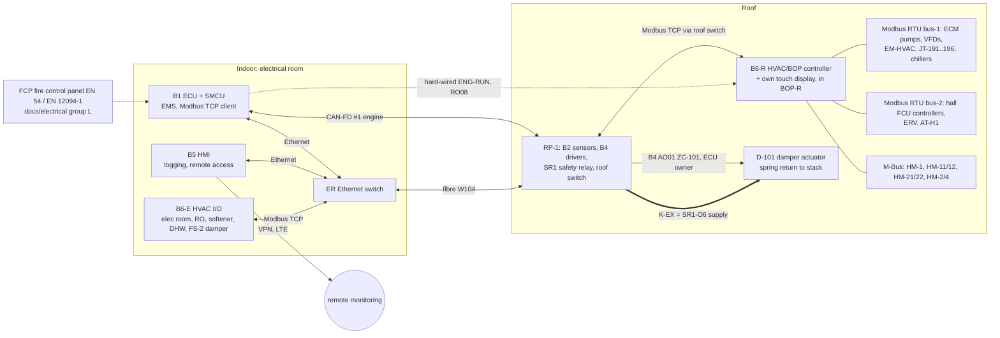

# GR180-CCHP — توالی‌های کنترلی و فهرست I/O کنترلر پلانت

تاریخ: ۲۰۲۶-۱۰-۲۱

- **تولید جدول I/O:** `python3 sim/hvac/io_list.py --md`. نسخهٔ Excel در `docs/hvac/io_list.csv` است.
- **تگ‌ها:** مطابق `01_pid.md`.

## ۱. معماری کنترل (طبق قرارداد نهایی docs/electrical، CONTRACT v3)

**اصول:**

1. **damper D-101 در مالکیت ECU است** و B4 (AO01، ZC-101) آن را فرمان می‌دهد.
   - B6-R حلقهٔ PI روی TE-111 (SP ۹۲ °C) را حساب می‌کند و فقط «موقعیت درخواستی» را با **Modbus TCP** به B1 می‌دهد.
   - **با قطع ارتباط بیش از ۵ s، ECU damper را به دودکش می‌برد.** موتور ادامه می‌دهد و فقط بازیافت گرما قطع است.
   - فیدبک ZT-101 روی B2 AI16 است. B6-R آن را از Modbus می‌خواند.
   - **تغذیهٔ 24 VAC actuator از K-EX = خروجی ایمن SR1-O6.**
   - ورودی‌های ایمنی HVAC در SR1 گروه D هستند و **موتور را متوقف نمی‌کنند**:
     - SI16: ZSO-101 (مجوز light-off فقط در bypass).
     - SI17: TSHH-111 و PSH-111.
     - SI18: FSL-111، با تأخیر ۱۰ s.
   - در purge، ECU خودش damper را روی ۵۰ ٪ می‌برد.
2. **B6-R (بام) و B6-E (اتاق برق) بردهای سفارشی خود پروژه‌اند، با نمایشگر لمسی خودشان.** طراحی سخت‌افزار با session برق است.
   - **PLC استفاده نمی‌شود** (تصمیم کاربر).
   - ارتباط با B1 **فقط Modbus TCP** است و B1 client است.
   - رجیسترهای EMS در `docs/electrical/06_energy_management.md` §۴ آمده‌اند (`07_power_modes.md`).
   - **B6-R مالک حفاظت چیلرهاست:** رقیق‌سازی، min-run و min-off، استارت‌ها، CW ≥ ۲۶ °C، آب داغ ≤ ۹۵ °C. EMS فقط درخواست می‌دهد.
3. **سیگنال سخت‌افزاری `ENG-RUN`** (B1 RO08 → B6-R) پشتیبان Modbus است.
4. **حالت محلی امن:** با قطع Modbus، B6-R به BALANCED برمی‌گردد. چیلرها، پمپ‌ها و برج را با سنسورهای خودش ادامه می‌دهد. damper را ECU به دودکش می‌برد.
5. **B5** همهٔ نقاط را ثبت می‌کند و داشبورد، آلارم و VPN را فراهم می‌کند. کنترل حلقه‌بسته روی B5 نیست.
6. **اطفای حریق** (`08_fire_suppression.md`): پنل FCP، آشکارسازها و منطق رهاسازی با docs/electrical است (گروه L). قطع EF-E، FCU-E و AC-E سخت‌افزاری با XS-874 است. HVAC فقط دمپر XV-497 (با ZSC-497) و پایش TE-499 را دارد.

**سیگنال‌های مشترک با docs/electrical** (همان تگ‌ها و کانال‌ها):

| تگ | برد / کانال |
|---|---|
| TE-101 | B2 TC07 |
| PT-101 | B2 AI03 |
| ZC-101 | B4 AO01 |
| ZT-101 | B2 AI16 |
| PDT-222 | B2 AI13–14 |
| PDT-223 | B2 AI15 |
| ZSO-101 | SR1 SI16 + B2 DI22 |
| TSHH-111، PSH-111 | SR1 SI17 |
| FSL-111 | SR1 SI18 |
| K-EX | SR1 O6 |
| ESD-R | SR1 SI01؛ می‌تواند دو شستی سری باشد |
| SD-E | B1 DI15 |
| ENG-RUN | B1 RO08 |
| TE-GLY | B2 RTD08 |
| DC-1-FAN | B4 FAN3 |
| EH-950 | B1 RO10 |
| MT-501 | B2 |
| JT-903، JT-904 | B1 |

TT-OA و MT-OA روی B6-R هستند و ECU آن‌ها را از Modbus می‌خواند. T1 موتور TE-501 است.

## ۲. حالت‌های کار

| حالت | شرط ورود | خلاصه |
|---|---|---|
| OFF | فرمان اپراتور یا نبود موتور | پمپ‌ها خاموش، D-101 در bypass. TK-1 در صورت سرد بودن به ساختمان سرما می‌دهد. |
| START-UP | فرمان start | بخش ۴-۱ |
| **SUMMER-CCHP** | میانگین ۷۲ ساعتهٔ TT-OA > ۲۰ °C، یا تقاضای سرمایش، یا دستی | چیلرها روشن، کویل ورودی فعال، برج روشن |
| WINTER-CHP | میانگین ۷۲ ساعتهٔ TT-OA < ۱۶ °C و تقاضای گرمایش سالن، یا دستی | چیلرها خاموش و ایزوله، changeover به HX-3، برج در lay-up |
| بین ۱۶ و ۲۰ °C | — | حالت فعلی حفظ می‌شود (هیسترزیس). حداقل ۴۸ ساعت در هر حالت. |
| FAULT-xx | بخش ۴-۵ تا ۴-۹ | |
| FREEZE | TT-OA < ۴ °C یا آب هر مدار < ۳ °C | بخش ۴-۷ |
| DUST | دستی، یا نرخ افزایش PDT-222 | بخش ۴-۹ |
| MAINT | کلید سرویس روی HMI | فرمان دستی با محدودیت‌های ایمنی؛ اینترلاک‌های سخت‌افزاری فعال می‌مانند |

**زیرحالت‌های SUMMER-CCHP:** `EMS_MODE` = MAX-COOLING، **BALANCED** (پیش‌فرض) یا MAX-POWER، به‌علاوهٔ اصلاح‌کننده‌های `CH_STAGE_MAX`، `T1_SP`، `Q_HALL_MAX_PCT`، `CW_SP_OFFSET` و `DEFER_EN` از مدیر انرژی ECU (`docs/electrical/06_energy_management.md`) یا دستی از HMI. تعریف، ترتیب حذف بار، تایمرها و جدول برق خالص در **`07_power_modes.md`**. اولویت سرما همیشه این است: اتاق برق، بعد کویل ورودی، بعد سالن. در MAX-COOLING سالن مقدم بر کویل است.

## ۳. setpointها (قابل تنظیم از HMI)

| حلقه | setpoint | محدوده / نکته |
|---|---|---|
| D-101 روی TE-111 (رفت آب داغ) | تابستان ۹۲ °C، زمستان ۸۵ °C | باز شدن به سمت HX ≤ ۱۰ ٪ در دقیقه؛ بستن به bypass بی‌محدودیت |
| حداقل TE-112 (برگشت به HX) | ۷۰ °C | بعد از ۳۰ دقیقهٔ اول گرم‌کردن فعال می‌شود |
| آب سرد خروجی چیلرها | ۷ °C | کنترل داخلی چیلر |
| فن برج روی TE-301 | BALANCED و MAX-POWER: ۳۲ °C؛ MAX-COOLING: ۲۶–۲۷ °C؛ MAX-POWER-HALL-OFF: ≤ ۳۳ °C | حداقل ۲۶ °C با TV-301 (حداقل مجاز سازنده تأیید شود)؛ دور فن ۲۵–۱۰۰ ٪ |
| دبی P-6 روی FT-301 | BALANCED ۸۵ ٪ نامی چیلرهای فعال؛ MAX-COOLING ۱۰۰ ٪ | حداقل طبق سازندهٔ چیلر |
| P-5 روی DPT-211 | ≈ ۵۰ kPa (rev B) با reset از موقعیت PICVها | در commissioning تنظیم می‌شود |
| کویل ورودی TE-221 | `T1_SP` از EMS: ۱۵ °C؛ در MAX-POWER تا ۱۲ °C | در MAX-COOLING تا ۲۰–۲۵ °C بالا می‌رود؛ با قطع ارتباط ۱۵ °C |
| سالن (فن‌کویل‌ها) | سرمایش ۲۴ °C، گرمایش ۲۱ °C | باند ±۰.۵ K |
| اتاق برق | FCU-E ۲۵ °C؛ AC-E در ۲۸ °C | آلارم ۳۰ °C |
| DHW | ۶۰ °C | legionella هفتگی ۶۵ °C به مدت ۱ ساعت |
| رفت گرمایش HX-3 | ۴۵ °C | حداکثر ۵۵ °C |
| blowdown (AIT-301) | ۸۰۰ µS/cm | گزینهٔ B |
| آب جبرانی blend (AIT-402) | ۲۳۰ µS/cm | |
| ORP (AIT-302) | ~۶۵۰–۷۰۰ mV | در سایت با تست DPD کالیبره شود |

## ۴. توالی‌ها

### ۴-۱. راه‌اندازی (START-UP) از حالت سرد

**پیش‌شرط‌ها:**

- هیچ trip فعال نباشد.
- PT-111 و PT-211 بین ۱.۰ و ۴.۵ bar باشند.
- LT-301 نرمال باشد، یا تابستان نباشد.
- ZSO-101 = bypass.
- ارتباط Modbus TCP بین B6-R، B6-E و B1 سالم باشد.
- باس تغذیهٔ ضروری سالم باشد.

**مراحل:**

1. **P-1 روشن می‌شود.** FSL-111 دبی را تأیید می‌کند و SR1 رلهٔ K-EX (O6) را وصل می‌کند (SI18). بدون دبی آب، damper نمی‌تواند به HX باز شود.
2. **P-5 روشن می‌شود** و حلقهٔ آب سرد گردش دارد. اگر TK-1 هنوز سرد است (TE-211 < ۱۲ °C)، سرمای ذخیره برای کویل ورودی آماده است.
3. **purge:**
   - B1 موتور را با استارتر BLDC (pin drive، ۱۵–۲۰k rpm) می‌چرخاند و خودش damper را از B4 روی ۵۰ ٪ می‌برد. D-101 روی **۵۰ ٪** است تا هر دو مسیر (HX و bypass) پاک شوند.
   - حداقل **۵ برابر حجم سیستم اگزوز** (~۵ m³) هوا عبور کند. با دبی cranking اندازه‌گیری‌شده معمولاً ۶۰–۱۲۰ ثانیه.
   - سپس D-101 به bypass می‌رود. **light-off فقط با ZSO-101 = bypass مجاز است.**
4. **light-off و شتاب تا idle** (توالی ECU). اگزوز از bypass می‌رود.
5. **ورود گرما به HX:** وقتی موتور پایدار شد (N1 در idle و EGT پایدار)، D-101 با ≤ ۱۰ ٪ در دقیقه به سمت HX باز می‌شود. آب داغ گرم می‌شود: از ۳۵ به ۸۰ °C حدود ۱۶ دقیقه با ۶۹ kW و ۳۵۴ L.
   - در این ۳۰ دقیقهٔ اول، قاعدهٔ حداقل TE-112 غیرفعال است. کندانس احتمالی به pot خنثی‌کننده می‌رود.
6. **آب خنک‌کن:** در TE-113 ≥ ۷۰ °C، P-6 روشن می‌شود. TV-301 روی bypass کامل است تا TE-301 ≥ ۲۶ °C شود. فن برج روی کنترل خودکار.
7. **چیلر CH-1:** در TE-113 ≥ ۸۰ °C به ترتیب:
   - P-4A ← تأیید FS-201
   - تأیید FS-301
   - P-2A
   - فرمان CH-1
   چیلر جذبی حدود ۱۰–۲۰ دقیقه بعد سرمای کامل می‌دهد.
8. **چیلر CH-2:** وقتی TE-113 ≥ ۸۵ °C به مدت ۵ دقیقه، یا CH-1 بیش از ۱۰ دقیقه در کار است، همان ترتیب با P-4B و P-2B.
9. **کویل ورودی:** در TE-211 < ۱۲ °C، TV-221 با شیب ۱۰ ٪ در دقیقه باز می‌شود و TE-221 را به ۱۵ °C می‌رساند. ECU سقف توان را با کاهش T1 بالا می‌برد. توان از ~۱۳ به ~۲۱ kW می‌رود و باتری فاصله را پر می‌کند.
10. **اتاق برق:** وقتی TE-211 < ۱۴ °C به مدت ۱۰ دقیقه، FCU-E اصلی می‌شود و AC-E به حالت standby می‌رود.
11. **سالن:** فن‌کویل‌ها طبق برنامهٔ HMI فعال می‌شوند.

زمان تقریبی تا CCHP کامل از حالت سرد: **۳۰–۴۰ دقیقه**.

### ۴-۲. کار عادی تابستان (SUMMER-CCHP)

**damper:**

- PI روی TE-111 با SP ۹۲ °C در B6-R؛ موقعیت درخواستی از Modbus TCP به ECU، اجرا با B4 (ZC-101). در BALANCED و MAX-COOLING معمولاً ~۱۰۰ ٪ به سمت HX است. در MAX-POWER گرمای مازاد را bypass می‌کند (`07_power_modes.md` §۱).
- فقط وقتی چیلرها و DHW گرما را کامل مصرف نکنند، به bypass می‌رود.
- **پایش‌ها:**
  - FT-111 < ۶ m³/h ← bypass + آلارم.
  - TE-101 > ۳۲۰ °C ← آلارم recuperator (به ECU).
  - روند PDT-102 و TE-102 (> ۱۳۰ °C) ← آلارم رسوب.

**چیلرها:**

- هر دو روشن‌اند و آب سرد ۷ °C را با کنترل داخلی تأمین می‌کنند.
- **CH-2 خاموش می‌شود** وقتی TE-113 < ۸۰ °C به مدت ۱۰ دقیقه (گرما کم است):
  - P-2B فوراً خاموش.
  - P-4B با run-on رقیق‌سازی ۱۵ دقیقه.
- **CH-1 خاموش می‌شود** در TE-113 < ۷۵ °C به مدت ۱۰ دقیقه.
- راه‌اندازی دوباره با هیسترزیس ۵ K.

**برج:**

- **فن:** PI روی TE-301 با SP وابسته به حالت (جدول ۳). در BALANCED، SP ۳۲ °C با کمترین دور (~۵۶ ٪، ۰.۲۷ kW). در MAX-COOLING دور کامل (۱.۵ kW) و آب خنک‌کن ~۳۰.۴ °C: هر ۱ K سردتر ~۸ ٪ سرمایش بیشتر.
- **حداقل دمای آب خنک‌کن:** TV-301 دمای TE-301 را ≥ ۲۶ °C نگه می‌دارد. این برای جلوگیری از کریستالیزاسیون است.
- **وابستگی‌ها:** P-6 تا زمانی روشن است که یک چیلر فعال یا در run-on باشد.

**آب سرد ثانویه:**

- P-5 روی Δp کار می‌کند.
- TV-221 روی TE-221 تنظیم می‌شود. **اگر موتور خاموش است، TV-221 بسته است** (جریان هوا نیست؛ سرما برای restart ذخیره می‌ماند).
- فن‌کویل‌ها با کنترلر اتاق کار می‌کنند.
- **LSH-221 (سینی کندانس پر):** TV-221 بسته می‌شود و آلارم می‌دهد، چون قطره به کمپرسور می‌رسد.

**منطق کمبود آب سرد (اولویت):**

- **شرط کمبود:** TE-211 > ۹ °C به مدت ۱۰ دقیقه، یا TE-214/TE-212 گرم (بافر خالی شده).
- **در BALANCED و MAX-POWER:** کویل ورودی روی SP خودش می‌ماند. setpoint سالن هر ۱۵ دقیقه +۱ K بالا می‌رود (حداکثر ۲۷ °C)، یا حداکثر باز بودن PICVهای سالن به ۷۰ ٪ محدود می‌شود.
- **در MAX-COOLING:** setpoint کویل ورودی هر ۱۰ دقیقه +۲.۵ K بالا می‌رود (حداکثر ۲۵ °C). ECU سقف توان را مطابق آن پایین می‌آورد.
- **اتاق برق هرگز محدود نمی‌شود.** اگر کمبود بیش از ۳۰ دقیقه طول بکشد و FCU-E-RC > ۲۸ °C، AC-E روشن می‌شود.
- **بازگشت:** TE-211 < ۸ °C به مدت ۲۰ دقیقه ← محدودیت‌ها پله‌پله برداشته می‌شوند.
- **تغییر حالت** (مثلاً BALANCED ← MAX-POWER): ترتیب حذف بار و قیود چیلر در `07_power_modes.md` §۴.

**شاخهٔ DHW:**

- **فعال‌سازی** در تابستان: وقتی TE-111 > ۹۲ °C یا damper بیش از ۵ ٪ به مدت ۵ دقیقه در bypass است (گرمای مازاد)، یا TE-132 < ۵۰ °C (حداقل بهداشتی).
- **V-PRI روی DHW:**
  - وقتی TE-132 < ۵۵ °C، تا وقتی TE-133 > ۶۰ °C شود.
  - TV-131 دمای رفت را ≤ ۷۵ °C نگه می‌دارد (رسوب در PHE).
- **legionella:** یکشنبه ۰۲:۰۰، SP به ۶۷ °C، تا TE-133 ≥ ۶۵ °C به مدت ۱ ساعت.

### ۴-۳. زمستان (WINTER-CHP) و تعویض فصل

**کار عادی زمستان:**

- چیلرها خاموش‌اند.
- D-101 روی TE-111 با SP ۸۵ °C کار می‌کند. بیشتر گرما bypass می‌شود، چون گرمایش سالن فقط ~۳–۸ kW است.
- V-PRI: اول DHW، بعد گرمایش.
- TV-231 دمای TE-231 را روی ۴۵ °C نگه می‌دارد.
- فن‌کویل‌ها با setpoint ۲۱ °C گرم می‌کنند.
- TV-221 بسته است. اگر TT-OA < ۵ °C و RH > ۸۰ ٪، حداقل ۲۰ ٪ باز می‌ماند (آب گرم = anti-icing ورودی کمپرسور).
- اتاق برق: AC-E خنک‌کن اصلی است.

**تابستان ← زمستان:**

1. توقف عادی چیلرها، سپس run-on رقیق‌سازی ۱۵ دقیقهٔ P-4 و P-6.
2. بستن MV-CH1E و MV-CH2E و **تأیید end switchها**.
3. V-CO1 و V-CO2 به HX-3 می‌روند. **اینترلاک: تا MVها بسته نباشند، V-CO حرکت نمی‌کند.**
4. TV-231 با شیب ۲ K در دقیقه باز می‌شود.
5. برج: اگر بیش از ۳ روز لازم نیست، تخلیه و خشک (lay-up).

**زمستان ← تابستان:**

1. برج پر، تمیز و ضدعفونی می‌شود و تصفیهٔ آب راه‌اندازی می‌شود (`03_water_treatment.md`).
2. TV-231 بسته می‌شود و حلقه با فن‌کویل‌ها سرد می‌شود تا **TE-213 ≤ ۳۰ °C** (حداکثر دمای ورودی اواپراتور طبق سازنده تأیید شود).
3. V-CO به TK-1 برمی‌گردد. MV-CHxE باز می‌شوند.
4. راه‌اندازی چیلرها طبق ۴-۱ از مرحلهٔ ۶.

### ۴-۴. توقف عادی

1. ECU بار را کم می‌کند و موتور را خاموش می‌کند. D-101 با فرمان stop به bypass می‌رود.
2. **P-1 به مدت ۱۵ دقیقه** روشن می‌ماند (گرمای باقیماندهٔ HX).
3. چیلرها تا TE-113 < ۷۵ °C با گرمای ذخیره کار می‌کنند، بعد خاموش می‌شوند:
   - P-2 خاموش.
   - **P-4 و P-6 با run-on ۱۵ دقیقه** (رقیق‌سازی LiBr). فن برج دنبال TE-301.
4. تا TE-211 < ۱۴ °C، P-5 به ساختمان سرما می‌دهد. بعد، اتاق برق به AC-E می‌رود.

### ۴-۵. trip موتور

1. SR1 رلهٔ K-EX (O6) را می‌اندازد، ECU فرمان ZC-101 را صفر می‌کند و damper به دودکش می‌رود: **D-101 با فنر در ≤ ۱۵ s به bypass** می‌رود. این از ورود سوخت نسوخته به HX هم جلوگیری می‌کند.
2. P-1 به مدت ۱۵ دقیقه روشن می‌ماند. چیلرها و run-on مثل ۴-۴.
3. TV-221 بسته می‌شود. TK-1 سرد برای restart می‌ماند: ~۲.۹ kWh، یعنی ~۱۰ دقیقه کویل.
4. **restart خودکار** با تصمیم ECU (حداکثر ۳ بار در ساعت) و توالی ۴-۱. purge اجباری است.
5. آلارم به HMI و از راه دور.

### ۴-۶. خرابی چیلر و مدارهای آبی

| رخداد | تشخیص | اقدام |
|---|---|---|
| **خرابی یک چیلر** | CH-x-ALM | (۱) قطع فرمان CH-x و P-2x. (۲) P-4x و P-6 به مدت ۱۵ دقیقه روشن برای رقیق‌سازی، اگر خود چیلر اجازه دهد. (۳) چیلر دیگر ادامه می‌دهد. damper گرمای اضافه را bypass می‌کند، شاخهٔ DHW فعال می‌شود و منطق کمبود آب سرد اجرا می‌شود. (۴) برای آلارم‌های دبی/دما یک تلاش restart بعد از ۳۰ دقیقه، حداکثر ۳ بار در روز. خطای داخلی restart نمی‌شود. |
| **خرابی هر دو چیلر** | هر دو ALM | پمپ‌های چیلر بعد از run-on خاموش، P-6 و برج خاموش. D-101 روی ۹۲ °C (عمدتاً bypass). TK-1 تا خالی شدن کار می‌کند، بعد AC-E روشن می‌شود. **کولرهای گازی موجود سالن پشتیبان‌اند** (از طریق کنتاکت فرمان یا دستی). ECU سقف توان را به حالت بدون کویل می‌برد (~۱۳ kW در ۴۶ °C). |
| پمپ P-6 | خطای VFD، یا FT-301 < ۷۰ ٪ به مدت ۱۰ s | پمپ standby در ≤ ۵ s. هر دو از کار افتاده، یا LSLL-301 ← توقف چیلرها و آلارم. |
| فن برج | خطای VFD یا VS-301 | فن متوقف. TE-301 > ۳۴ °C به مدت ۱۰ دقیقه ← توقف CH-2. > ۳۶ °C ← توقف CH-1. |
| آب جبرانی | LT-301 پایین و XV-301 باز ولی FQ-301 بدون پالس | آلارم. شناور مکانیکی پشتیبان. بررسی P-9 و RO و LSL-400. |
| **دبی آب داغ** | FSL-111 به مدت ۱۰ s (سخت‌افزاری) | SR1 (SI18، ۱۰ s) رلهٔ K-EX را می‌اندازد و D-101 به bypass می‌رود. **موتور با توان کامل ادامه می‌دهد** و فقط بازیافت گرما قطع است. P-1 دوقلو خودش جابه‌جا می‌شود. |
| P-4x | P-4x-FLT | توقف CH-x (FS-201/202 هم اینترلاک داخلی دارند). |
| P-5 | P-5-FLT (هر دو هد) | آلارم. کویل ورودی و سالن بدون آب سرد. AC-E. ECU سقف توان را کم می‌کند. |
| نشتی | افت PT-111 یا PT-211 به < ۰.۸ bar، FQ-410 > ۲۰ L/day، یا LD-E | آلارم. قفل پرکن خودکار. LD-E شیر FCU-E را می‌بندد. |

### ۴-۷. حفاظت یخ‌زدگی (حالت FREEZE)

برازجان به‌ندرت زیر صفر می‌رود، ولی بام بی‌پناه است.

- **TT-OA < ۴ °C:**
  - P-1 و P-5 پیوسته با حداقل دور گردش می‌کنند، حتی اگر پلانت خاموش باشد.
  - TV-221 حداقل ۲۰ ٪ باز.
  - HT-1 روشن (< ۳ °C).
  - EH-301 روشن، اگر TE-303 < ۵ °C و سطح حوضچه کافی است.
  - اگر برج در lay-up است، تخلیهٔ کامل بررسی و تأیید می‌شود.
- **دمای آب هر مدار < ۳ °C** (TE-222، TE-213، TE-112، TE-303): آلارم، اجبار گردش. اگر موتور روشن است، HX-3 با SP پایین فعال می‌شود.
- **کویل ورودی:** اگر موتور با هوای < ۵ °C کار می‌کند و TV-221 بسته است، هوای سرد می‌تواند آب کویل را منجمد کند. پس حداقل ۲۰ ٪ باز و آلارم TE-222 < ۴ °C.

### ۴-۸. حفاظت دمای بالا (overheat)

| نقطه | سطح ۱ | سطح ۲ | سطح ۳ (سخت‌افزاری) |
|---|---|---|---|
| آب داغ TE-111 | ۹۲ °C: damper مدوله | ۹۵ °C: آلارم، شاخهٔ DHW اجباری | **TSHH-111 ۹۸ °C** ← SR1 SI17 ← K-EX ← bypass (manual reset)؛ PSH-111 ۵.۰ bar؛ PSV-111 ۵.۵ bar |
| گاز ورودی HX TE-101 | ۳۲۰ °C: آلارم و ECU | — | طراحی D-101 و دودکش ۶۵۰ °C |
| گاز خروجی HX TE-102 | ۱۳۰ °C: آلارم رسوب یا کمبود دبی | — | — |
| آب خنک‌کن TE-301 | ۳۴ °C: توقف CH-2 | ۳۶ °C: توقف CH-1 | حفاظت داخلی چیلر |
| DHW TE-132 | ۷۲ °C: بستن V-PRI به DHW | ۷۵ °C: آلارم | T&P، TMV |
| اتاق برق FCU-E-RC | ۲۸ °C: AC-E | ۳۰ °C: آلارم؛ ۳۵ °C: derate اینورتر | ۴۰ °C: shutdown کنترل‌شده |
| تابلوی BOP-R | ۵۰ °C: آلارم | ۶۰ °C: حذف بارهای غیرضروری | — |

### ۴-۹. قطع برق، گرد و خاک، بازچرخش

**قطع برق / black start:**

- همهٔ بارهای HVAC روی خروجی اینورتر (پشتیبان باتری) هستند.
- **باس ضروری:** B6، کنترل چیلرها، P-1، P-4A/B، P-6 و فن برج. این‌ها در فهرست load-shedding اولویت بالا دارند. AC-E، ERV و فن‌کویل‌ها غیرضروری‌اند.
- **انرژی run-on رقیق‌سازی:** ~۲.۹ kW × ۱۵ min ≈ ۰.۷ kWh از باتری.
- **با قطع کامل:**
  - D-101 با فنر به bypass می‌رود.
  - چیلرها بدون رقیق‌سازی خاموش می‌شوند و بعد از برگشت برق، روال بازیابی سازنده اجرا می‌شود.
  - B6 در حالت «post-blackout» است: اول P-1، بعد توالی ۴-۱.

**گرد و خاک (DUST):**

- PDT-222 بالا ← آلارم تعویض فیلتر. ECU در صورت لزوم derate می‌کند.
- purge جداکنندهٔ برج هر ۱ ساعت. گزارش برای تمیزکاری بعد از طوفان.

**بازچرخش:** TE-104 − TT-OA > ۳ K به مدت ۵ دقیقه ← آلارم «exhaust/plume recirculation». جهت باد بررسی شود. در تکرار، ارتفاع دودکش بیشتر شود.

### ۴-۱۰. گزارش‌دهی از راه دور (B5)

- **جریان‌های انرژی:** HM-1 (گرما به چیلرها)، HM-2 و HM-4 (سرمای ساختمان و کویل)، HM-3 (DHW/گرمایش)، EM-HVAC (برق داخلی)، توان موتور.
- **شاخص‌ها:** COP لحظه‌ای چیلرها، راندمان مفید کل.
- **آب:** سیکل تغلیظ، مصرف آب، EC/pH/ORP، سطح مواد شیمیایی، ساعت‌شمار پمپ‌ها و چیلرها.
- **یادآوری سرویس:** فیلترها، کوپن خوردگی، Legionella، تمیزکاری HX.

## ۵. خلاصهٔ I/O به تفکیک برد (فهرست نهایی برای طراحی B6؛ تحویل به session برق)

| برد | RTD | TC | 4–20 mA | 0–10 V in | AO | DI | پالس | DO | Safety DI | Safety DO | دستگاه bus | جمع |
|---|---|---|---|---|---|---|---|---|---|---|---|---|
| B1 (ECU، داخل؛ docs/electrical) | — | — | — | — | — | 1 | — | 1 | — | — | 2 | 4 |
| B2 (I/O سنسور، RP-1؛ docs/electrical) | 1 | 1 | 5 | 1 | — | — | — | — | — | — | — | 8 |
| B4 (درایورها، RP-1؛ docs/electrical) | — | — | — | — | 2 | — | — | 1 | — | — | — | 3 |
| SR1 (رلهٔ ایمنی، RP-1؛ docs/electrical) | — | — | — | — | — | — | — | — | 5 | 1 | — | 6 |
| **B6-R (کنترلر HVAC بام)** | minimum | hardware | (+25 | % | spare): | RTD | 27, | TC | 3, | AI | 4-20 | mA | 19, | AI | 0-10 | V | 2, | AO | 5, | DI | 49 | (incl. | 3 | counters), | DO | 35, | RS-485 | x2 | (bus-1 | plant, | bus-2 | hall), | M-Bus | master | x1, | Ethernet | (Modbus | TCP | server) | **x1** |
| **B6-E (داخل ساختمان)** | 2 | — | 3 | — | 2 | 11 | 1 | 8 | — | — | 2 | **29** |

- **جمع:** ۱۷۸ ردیف.
- ردیف‌های B1، B2، B4 و SR1 سیگنال‌های مشترک با `docs/electrical/02_io_list.csv` هستند (CONTRACT v3).
- **اطفای حریق:** سیگنال‌های اعلام، رهاسازی، تأیید تخلیه، فشار پایین و lock-off در docs/electrical گروه L (پنل FCP، تگ‌های ۸۷x–۸۹x) هستند و اینجا تکرار نمی‌شوند. سمت HVAC: XV-497/ZSC-497 (B6-E) و TE-499 (B6-R). پیشنهاد به برق: XY-888C و PSL-890C برای سیلندر رزرو FS-1B (`08_fire_suppression.md` §۹).
- شمارش به ازای ردیف جدول است. PDT-222 (۲ کانال)، P-6-CMD و P-6-FLT (هر کدام ۲) و LSL-DP (۳) در اسکریپت ضرب شده‌اند.

**حداقل سخت‌افزار B6-R (با ۲۵ ٪ ذخیره):**

| نوع | تعداد / مشخصه |
|---|---|
| ورودی PT1000 | ۲۷، سه یا چهارسیمه، ADC ایزوله، دقت ±۰.۱ K |
| ترموکوپل K | ۳، با جبران سرد |
| AI 4–20 mA | ۱۹، تغذیهٔ حلقه 24 V با محافظ |
| AI 0–10 V | ۲ |
| AO 0–10 V | ۵ |
| DI 24 V | ۴۹ (۳ تا کانتر پالس) |
| DO | ۳۵ رله، 2 A / 250 VAC |
| ارتباط | RS-485 × ۲ (bus-1 پلانت با ~۲۰ دستگاه، bus-2 سالن؛ ایزوله)، M-Bus master × ۱ (۸ کنتور)، **Ethernet (Modbus TCP server) × ۱** |
| نمایشگر | **نمایشگر لمسی محلی** (طراحی session برق) در BOP-R، زیر سایه‌بان، IP65 |
| تغذیه | 24 VDC از باس اضطراری 48 V (docs/electrical) |

**B6-E (با ۲۵ ٪ ذخیره):** RTD ۳، AI 4–20 mA ۴، AO ۳، DI ۱۵ (شامل ۱ کانتر؛ softener و دمپر اطفا هم در آن است)، DO ۱۰، RS-485 × ۱، M-Bus × ۱ و Ethernet × ۱. همان برد پایهٔ B6 با جمعیت کمتر.

**تصمیم کاربر:** **بدون PLC.** B6 برد سفارشی (KiCad، ماژولار: برد پایه + برد توسعهٔ B6-X) با نمایشگر لمسی خودمان است. فهرست کامل I/O در `io_list.csv` (همین جدول) تحویل session برق شد.

## ۶. فهرست کامل I/O

| tag | شرح | نوع سیگنال | رنج / سیگنال | محل | برد | عملکرد / setpoint |
|---|---|---|---|---|---|---|
| TE-101 | دمای گاز اگزوز ورودی HX-1 (بعد از recuperator) | AI-TC | 0-600 °C | duct before D-101 | B2 | TC07 (docs/electrical); H 320 °C = عیب recuperator (ECU)؛ محاسبهٔ گرما در B6-R |
| TE-102 | دمای گاز خروجی HX-1 | AI-TC | 0-400 °C | HX-1 outlet | B6-R | H 130 °C = رسوب؛ L 85 °C = خطر میعان |
| TE-103 | دمای دودکش مشترک | AI-TC | 0-600 °C | ST-1 | B6-R | تأیید موقعیت damper (bypass ⇒ > 200 °C) |
| PT-101 | فشار برگشتی اگزوز قبل از diverter D-101 | AI-mA | -0.5..+2.5 kPa | duct before D-101 | B2 | AI03 (docs/electrical); H 1.0 kPa ALM، HH 1.5 kPa FSD در ECU |
| PDT-102 | افت فشار سمت گاز HX-1 | AI-mA | 0-1 kPa | across HX-1 | B6-R | روند رسوب؛ H 0.25 kPa |
| ZC-101 | فرمان موقعیت diverter damper D-101 | AO-V | 2-10 V = 0 % bypass..100 % HX | D-101 | B4 | AO01 (docs/electrical CONTRACT v3)؛ مالک ECU. B6-R فقط موقعیت درخواستی (PI روی TE-111) را با Modbus TCP می‌فرستد؛ قطع > 5 s → دودکش |
| ZT-101 | فیدبک موقعیت D-101 | AI-V | 2-10 V = 0-100 % | D-101 | B2 | AI16 (docs/electrical)؛ B6-R آن را از Modbus TCP می‌خواند |
| ZSO-101 | D-101 کاملاً در حالت BYPASS (کنتاکت اول) | SAFE-DI | dry contact | D-101 | SR1 | SI16 + B2 DI22 (docs/electrical)؛ مجوز light-off |
| ZSO-101b | کنتاکت دوم ZSO-101 برای وضعیت | DI | dry contact | D-101 | B6-R |  |
| ZSH-101 | D-101 کاملاً در مسیر HX | DI | dry contact | D-101 | B6-R | با ZSO-101: «هر دو مسیر بسته» → آلارم |
| K-EX | تغذیهٔ 24 VAC actuator D-101 (fail → bypass با فنر) | SAFE-DO | 24 VAC via force-guided contactor | BOP-R | SR1 | O6 (docs/electrical)؛ گروه D: موتور را متوقف نمی‌کند |
| TE-104 | دمای هوای ورودی موتور پشت لوور (تشخیص recirculation) | AI-RTD | -10..+70 °C | IF-1 inlet | B6-R | TE-104 − TT-OA > 3 K → آلارم بازچرخش |
| TE-111 | دمای رفت آب داغ (خروجی HX-1) | AI-RTD | 0-150 °C | HX-1 outlet | B6-R | SP کنترل damper 92 °C؛ H 95 °C |
| TSHH-111 | ترموستات حد بالا آب داغ 98 °C (manual reset) | SAFE-DI | NC contact x2 | HX-1 outlet | SR1 | SI17 (docs/electrical) → K-EX؛ کنتاکت دوم وضعیت به B6-R |
| PSH-111 | سوئیچ فشار بالای مدار آب داغ 5.0 bar | SAFE-DI | NC contact | HX-1 outlet | SR1 | SI17 سری با TSHH-111 (قبل از PSV 5.5 bar) |
| TE-112 | دمای برگشت آب به HX-1 | AI-RTD | 0-150 °C | HX-1 inlet | B6-R | L 70 °C → bypass جزئی (میعان اسیدی) |
| PT-111 | فشار استاتیک مدار آب داغ | AI-mA | 0-10 bar | P-1 suction | B6-R | L 0.8 bar نشتی؛ H 4.5 bar |
| FT-111 | دبی مدار اولیه آب داغ (electromagnetic) | AI-mA | 0-15 m³/h | P-1 discharge | B6-R | L 6 m³/h |
| FSL-111 | فلوسوئیچ مدار اولیه (paddle/thermal) | SAFE-DI | NC contact | HX-1 inlet | SR1 | SI18 با تأخیر 10 s → K-EX؛ reset خودکار وقتی دبی برگشت |
| P-1-CMD | فرمان پمپ دوقلوی P-1A/B | DO | relay | PS-1 | B6-R | همیشه روشن وقتی موتور روشن است + 15 min run-on |
| P-1-FLT | خطای پمپ P-1 (هر دو هد) | DI | dry contact | PS-1 | B6-R |  |
| P-1-BUS | P-1A/B ECM: دور، توان، آلارم، تعویض نوبتی | BUS | Modbus RTU bus-1 | PS-1 | B6-R | alternation 24 h |
| TE-113 | دمای بالای LLH-1 | AI-RTD | 0-150 °C | LLH-1 | B6-R |  |
| TE-114 | دمای برگشت مصرف‌کننده‌ها به LLH-1 | AI-RTD | 0-150 °C | LLH-1 | B6-R |  |
| P-2A-CMD | فرمان پمپ آب داغ چیلر CH-1 | DO | relay | PS-1 | B6-R | با CH-1 |
| P-2A-FLT | خطای P-2A | DI | dry contact | PS-1 | B6-R |  |
| P-2B-CMD | فرمان پمپ آب داغ چیلر CH-2 | DO | relay | PS-1 | B6-R | با CH-2 |
| P-2B-FLT | خطای P-2B | DI | dry contact | PS-1 | B6-R |  |
| HM-1 | کنتور انرژی گرمای بازیافتی HX-1 (مدار اولیه) | BUS | M-Bus | HW primary | B6-R | kWh، دبی، دماها؛ راندمان CHP |
| HM-11 | کنتور گرمای ورودی CH-1 (آب داغ) | BUS | M-Bus | CH-1 HW | B6-R | جدید (حالت‌ها): COP لحظه‌ای هر چیلر |
| HM-12 | کنتور گرمای ورودی CH-2 (آب داغ) | BUS | M-Bus | CH-2 HW | B6-R | جدید (حالت‌ها) |
| P-3-CMD | فرمان پمپ شاخهٔ DHW/گرمایش | DO | relay | PS-1 | B6-R |  |
| P-3-FLT | خطای P-3 | DI | dry contact | PS-1 | B6-R |  |
| V-PRI | شیر سه‌راههٔ اولویت DHW ↔ گرمایش (2 وضعیت) | DO | 230 VAC SPDT | PS-1 | B6-R | DHW اولویت دارد |
| V-PRI-ZS | end switch شیر V-PRI | DI | dry contact | PS-1 | B6-R |  |
| TV-131 | شیر سه‌راههٔ محدودکنندهٔ دمای رفت شاخه | AO-V | 0-10 V | PS-1 | B6-R | DHW ≤ 75 °C، گرمایش ≤ 50 °C |
| TE-131 | دمای رفت شاخهٔ DHW/گرمایش | AI-RTD | 0-150 °C | PS-1 | B6-R |  |
| TE-132 | دمای بالای مخزن DHW | AI-RTD | 0-100 °C | DHW tank (indoor) | B6-E | SP 60 °C؛ legionella هفتگی ≥ 65 °C/1 h |
| TE-133 | دمای پایین مخزن DHW | AI-RTD | 0-100 °C | DHW tank (indoor) | B6-E |  |
| P-7-CMD | پمپ شارژ/گردش DHW | DO | relay | DHW room | B6-E |  |
| P-7-FLT | خطای P-7 | DI | dry contact | DHW room | B6-E |  |
| HM-3 | کنتور انرژی DHW/گرمایش | BUS | M-Bus | DHW branch | B6-E |  |
| TV-231 | شیر کنترل HX-3 (گرمایش زمستان، سمت آب داغ) | AO-V | 0-10 V | PS-1 | B6-R | SP رفت گرمایش 45 °C |
| TE-231 | دمای رفت گرمایش (ثانویهٔ HX-3) | AI-RTD | 0-100 °C | PS-1 | B6-R | H 55 °C |
| CH-1-CMD | فرمان start/stop از راه دور CH-1 | DO | dry contact | CH-1 | B6-R |  |
| CH-1-RUN | وضعیت کار CH-1 | DI | dry contact | CH-1 | B6-R |  |
| CH-1-ALM | آلارم عمومی CH-1 | DI | dry contact | CH-1 | B6-R |  |
| CH-2-CMD | فرمان start/stop از راه دور CH-2 | DO | dry contact | CH-2 | B6-R |  |
| CH-2-RUN | وضعیت کار CH-2 | DI | dry contact | CH-2 | B6-R |  |
| CH-2-ALM | آلارم عمومی CH-2 | DI | dry contact | CH-2 | B6-R |  |
| CH-BUS | پورت Modbus چیلرها: دمای ژنراتور، غلظت/حاشیهٔ کریستالیزاسیون، وضعیت رقیق‌سازی، تایمرها | BUS | Modbus RTU bus-1 | CH-1/2 | B6-R | الزام در مشخصات خرید (حالت‌ها) |
| MV-CH1E | شیر قطع موتوری اواپراتور CH-1 | DO | 230 VAC | CH-1 CHW | B6-R | در زمستان بسته: آب داغ هرگز وارد اواپراتور نشود |
| MV-CH1E-ZS | end switch بسته MV-CH1E | DI | dry contact | CH-1 CHW | B6-R | اینترلاک changeover |
| MV-CH2E | شیر قطع موتوری اواپراتور CH-2 | DO | 230 VAC | CH-2 CHW | B6-R |  |
| MV-CH2E-ZS | end switch بسته MV-CH2E | DI | dry contact | CH-2 CHW | B6-R |  |
| TE-201 | دمای خروجی آب سرد CH-1 | AI-RTD | -10..+60 °C | CH-1 | B6-R | عیب‌یابی عملکرد |
| TE-202 | دمای خروجی آب سرد CH-2 | AI-RTD | -10..+60 °C | CH-2 | B6-R |  |
| TE-203 | دمای خروجی آب خنک‌کن CH-1 | AI-RTD | 0-60 °C | CH-1 | B6-R |  |
| TE-204 | دمای خروجی آب خنک‌کن CH-2 | AI-RTD | 0-60 °C | CH-2 | B6-R |  |
| FS-201 | فلوسوئیچ آب سرد CH-1 | DI | dry contact | CH-1 | B6-R | کنتاکت اول به اینترلاک چیلر، دوم به B6-R |
| FS-202 | فلوسوئیچ آب سرد CH-2 | DI | dry contact | CH-2 | B6-R |  |
| FS-301 | فلوسوئیچ آب خنک‌کن CH-1 | DI | dry contact | CH-1 | B6-R |  |
| FS-302 | فلوسوئیچ آب خنک‌کن CH-2 | DI | dry contact | CH-2 | B6-R |  |
| MV-CH1C | شیر قطع موتوری آب خنک‌کن CH-1 (پروانه‌ای DN80) | DO | 230 VAC | CH-1 CW | B6-R | جدید: staging؛ باز تا پایان رقیق‌سازی |
| MV-CH1C-ZS | end switch بسته MV-CH1C | DI | dry contact | CH-1 CW | B6-R |  |
| MV-CH2C | شیر قطع موتوری آب خنک‌کن CH-2 (پروانه‌ای DN65) | DO | 230 VAC | CH-2 CW | B6-R | جدید: در MAX-POWER بسته → دبی P-6 کم |
| MV-CH2C-ZS | end switch بسته MV-CH2C | DI | dry contact | CH-2 CW | B6-R |  |
| P-4A-CMD | فرمان پمپ آب سرد اولیهٔ CH-1 | DO | relay | PS-1 | B6-R | با CH-1 + run-on رقیق‌سازی 15 min |
| P-4A-FLT | خطای P-4A | DI | dry contact | PS-1 | B6-R |  |
| P-4B-CMD | فرمان پمپ آب سرد اولیهٔ CH-2 | DO | relay | PS-1 | B6-R |  |
| P-4B-FLT | خطای P-4B | DI | dry contact | PS-1 | B6-R |  |
| TE-211 | دمای بالای مخزن TK-1 (رفت به مصرف) | AI-RTD | -10..+60 °C | TK-1 | B6-R | H 10 °C به مدت 10 min → منطق اولویت |
| TE-212 | دمای پایین مخزن TK-1 | AI-RTD | -10..+60 °C | TK-1 | B6-R |  |
| TE-213 | دمای برگشت آب سرد از مصرف‌کننده‌ها | AI-RTD | -10..+60 °C | header | B6-R |  |
| TE-214 | دمای وسط مخزن TK-1 (لایه‌بندی، ذخیرهٔ سرما) | AI-RTD | -10..+60 °C | TK-1 | B6-R | جدید: kWh سرمای ذخیره برای ECU |
| PT-211 | فشار استاتیک مدار آب سرد | AI-mA | 0-10 bar | P-5 suction | B6-R | L 0.8 bar |
| DPT-211 | اختلاف فشار index (پای رایزر سالن) | AI-mA | 0-2.5 bar | hall riser | B6-R | SP ≈ 65 kPa (تنظیم در commissioning) → دور P-5 |
| FT-211 | دبی ثانویهٔ آب سرد (electromagnetic) | AI-mA | 0-12 m³/h | P-5 discharge | B6-R |  |
| P-5-CMD | فرمان پمپ دوقلوی P-5A/B | DO | relay | PS-1 | B6-R |  |
| P-5-FLT | خطای P-5 | DI | dry contact | PS-1 | B6-R |  |
| P-5-BUS | P-5A/B ECM: setpoint دور/Δp، توان، آلارم | BUS | Modbus RTU bus-1 | PS-1 | B6-R |  |
| HM-2 | کنتور انرژی سرمایش ساختمان (سالن + اتاق برق) | BUS | M-Bus | hall branch | B6-R |  |
| HM-4 | کنتور انرژی سرمایش کویل ورودی موتور | BUS | M-Bus | CC-1 branch | B6-R |  |
| HM-21 | کنتور سرمای تولیدی CH-1 | BUS | M-Bus | CH-1 CHW | B6-R | جدید: COP و بار هر چیلر |
| HM-22 | کنتور سرمای تولیدی CH-2 | BUS | M-Bus | CH-2 CHW | B6-R | جدید |
| TV-221 | شیر PICV کویل ورودی موتور CC-1 | AO-V | 0-10 V | CC-1 | B6-R | PI روی TE-221 (SP 15 °C) |
| ZT-221 | فیدبک موقعیت TV-221 | AI-V | 2-10 V | CC-1 | B6-R |  |
| TE-221 | دمای هوای بعد از کویل CC-1 | AI-RTD | -10..+70 °C | IF-1 after coil | B6-R | کنترل TV-221؛ T1 موتور = TE-501 روی B2 |
| TE-222 | دمای آب خروجی کویل CC-1 | AI-RTD | -10..+60 °C | CC-1 | B6-R | حفاظت یخ‌زدگی < 4 °C |
| MT-501 | رطوبت نسبی هوای بعد از کویل CC-1 | AI-mA | 0-100 % | IF-1 after coil | B2 | docs/electrical؛ بار نهان کویل، اشباع/حمل قطره |
| LSH-221 | سطح بالای سینی کندانس CC-1 (float) | DI | dry contact | CC-1 | B6-R | تخلیهٔ مسدود → بستن TV-221 + آلارم (حمل قطره به کمپرسور) |
| PDT-222 | افت فشار فیلترهای G4 و F8 ورودی هوا | AI-mA | 0-500 Pa (x2) | IF-1 | B2 | AI13–AI14 (docs/electrical); ECU: جمع > 400 Pa DRT |
| PDT-223 | افت فشار سمت هوای کویل CC-1 | AI-mA | 0-500 Pa | IF-1 | B2 | AI15 (docs/electrical); H 300 Pa |
| TT-OA | دمای هوای بیرون (radiation shield، سایه) | AI-mA | -20..+60 °C | roof north side | B6-R | به ECU از Modbus TCP (پیش‌بینی P_max)؛ منطق یخ‌زدگی و changeover |
| MT-OA | رطوبت نسبی هوای بیرون | AI-mA | 0-100 % | roof north side | B6-R | محاسبهٔ wet-bulb |
| V-CO1 | شیر changeover تابستان/زمستان (مکش P-5) | DO | 230 VAC SPDT | PS-1 | B6-R |  |
| V-CO1-ZS | end switch V-CO1 | DI | dry contact | PS-1 | B6-R |  |
| V-CO2 | شیر changeover تابستان/زمستان (برگشت) | DO | 230 VAC SPDT | PS-1 | B6-R |  |
| V-CO2-ZS | end switch V-CO2 | DI | dry contact | PS-1 | B6-R |  |
| FCU-1..4 | کنترلر اتاق فن‌کویل‌های سالن (دما، رطوبت، setpoint، سرعت فن EC، شیر، کندانس) | BUS | Modbus RTU bus-2 (4 devices) | hall | B6-R | SP 24 °C؛ RH برای منطق comfort guard |
| ERV-1 | تهویهٔ بازیاب انرژی (اختیاری) | BUS | Modbus RTU bus-2 | hall | B6-R |  |
| TE-H1 | دما/رطوبت مرجع سالن | BUS | Modbus RTU bus-2 | hall | B6-R | ورودی منطق اولویت برق/آسایش |
| AT-H1 | CO2 سالن (NDIR) | BUS | Modbus RTU bus-2 | hall | B6-R | جدید: اشغال سالن و کنترل ERV (هوای تازهٔ متناسب با تقاضا) |
| FCU-E-RC | کنترلر اتاق FCU-E (دما و رطوبت اتاق برق) | BUS | Modbus RTU | electrical room | B6-E | SP 25 °C؛ TT-ER روی B1 (docs/electrical) برای باتری |
| FCU-E-V | شیر آب سرد FCU-E | DO | 24 VAC on/off | electrical room | B6-E |  |
| FCU-E-F | فرمان دور فن EC فن‌کویل FCU-E | AO-V | 0-10 V | electrical room | B6-E |  |
| FCU-E-S | وضعیت/خطای FCU-E | DI | dry contact | electrical room | B6-E |  |
| AC-E-EN | فعال‌سازی اسپلیت DX پشتیبان | DO | dry contact (adapter) | electrical room | B6-E | روشن در 28 °C یا نبود آب سرد |
| AC-E-ST | وضعیت کار اسپلیت (current switch) | DI | dry contact | electrical room | B6-E |  |
| LD-E | کابل تشخیص نشت آب زیر FCU-E و لوله‌ها | DI | dry contact | electrical room | B6-E | بستن FCU-E-V + آلارم |
| EF-E | فن تخلیهٔ اتاق برق/باتری | DO | relay | electrical room | B6-E |  |
| SD-E | دتکتور دود اتاق برق/باتری (از پنل آتش) | DI | dry contact | electrical room | B1 | DI15 (docs/electrical); HVAC: قطع فن‌ها و AC-E از CAN |
| TE-301 | دمای آب خنک‌کن رفت به چیلرها (خروجی برج) | AI-RTD | 0-60 °C | PS-2 | B6-R | کنترل فن برج SP 27 °C (هرچه سردتر بهتر)؛ حداقل 26 °C با TV-301 |
| TE-302 | دمای برگشت آب خنک‌کن به برج | AI-RTD | 0-60 °C | CT-1 inlet | B6-R |  |
| TE-303 | دمای حوضچهٔ برج | AI-RTD | -10..+60 °C | CT-1 basin | B6-R | < 5 °C → EH-301 |
| P-6-CMD | فرمان VFD پمپ آب خنک‌کن P-6A/B | DO | relay (x2) | PS-2 | B6-R | duty/standby |
| P-6-FLT | خطای VFD پمپ‌های P-6 | DI | dry contact (x2) | PS-2 | B6-R |  |
| P-6-BUS | VFD پمپ‌های P-6: دور، توان، آلارم | BUS | Modbus RTU bus-1 | BOP-R | B6-R | دور ثابت روی دبی نامی |
| FT-301 | دبی آب خنک‌کن (electromagnetic) | AI-mA | 0-40 m³/h | PS-2 | B6-R | نامی 27.5 m³/h ±10 % |
| TT-306 | دمای هوای ورودی برج (سایه، کنار لوور برج) | AI-mA | -20..+60 °C | CT-1 inlet | B6-R | جدید: wet-bulb واقعی برج و تشخیص بازچرخش پلوم |
| MT-306 | رطوبت نسبی هوای ورودی برج | AI-mA | 0-100 % | CT-1 inlet | B6-R | جدید |
| CT-FAN-CMD | فرمان VFD فن برج | DO | relay | BOP-R | B6-R |  |
| CT-FAN-FLT | خطای VFD فن برج | DI | dry contact | BOP-R | B6-R |  |
| CT-FAN-BUS | VFD فن برج: setpoint دور، توان | BUS | Modbus RTU bus-1 | BOP-R | B6-R | حداقل 25 % |
| VS-301 | سوئیچ ارتعاش فن برج | DI | dry contact | CT-1 | B6-R | توقف فن + آلارم |
| TV-301 | شیر سه‌راههٔ bypass برج | AO-V | 0-10 V | PS-2 | B6-R | حداقل دمای آب خنک‌کن در start-up/زمستان |
| LT-301 | سطح حوضچهٔ برج (hydrostatic) | AI-mA | 0-500 mm | CT-1 basin | B6-R | L/H آلارم؛ کنترل make-up |
| LSLL-301 | سطح خیلی پایین حوضچه (float) | DI | dry contact | CT-1 basin | B6-R | اینترلاک سخت‌افزاری با استارتر P-6 + آلارم |
| XV-301 | شیر برقی آب جبرانی برج | DO | 24 VAC | CT-1 | B6-R | شناور مکانیکی پشتیبان |
| FQ-301 | کنتور آب جبرانی برج | PI | 1 L/pulse | make-up line | B6-R | دوز متناسب inhibitor؛ آلارم مصرف غیرعادی |
| AIT-301 | هدایت الکتریکی آب برج (کنترلر) | AI-mA | 0-5000 µS/cm | side-stream | B6-R | blowdown SP 800 µS/cm (گزینهٔ RO) |
| XV-302 | شیر موتوری blowdown | DO | 24 VAC | side-stream | B6-R |  |
| XV-302-ZS | end switch شیر blowdown | DI | dry contact | side-stream | B6-R |  |
| FQ-302 | کنتور blowdown | PI | 1 L/pulse | drain line | B6-R | محاسبهٔ cycles واقعی |
| AIT-302 | ORP / کلر آزاد | AI-mA | 0-1000 mV | side-stream | B6-R | FRC 0.5-1.0 ppm |
| AIT-303 | pH آب برج | AI-mA | 0-14 | side-stream | B6-R | آلارم خارج از 6.5-8.2 |
| DP-1 | پمپ دوزینگ inhibitor | DO | pulse relay | WT-1 | B6-R | متناسب با FQ-301 |
| DP-2 | پمپ دوزینگ biocide اکسیدکننده | DO | relay | WT-1 | B6-R | روی AIT-302 |
| DP-3 | پمپ دوزینگ biocide غیراکسیدکننده | DO | relay | WT-1 | B6-R | shock هفتگی + قفل blowdown |
| LSL-DP | سطح پایین مخازن مواد شیمیایی (x3) | DI | dry contact (x3) | WT-1 | B6-R |  |
| XV-303 | شیر purge جداکنندهٔ side-stream | DO | 24 VAC | WT-1 | B6-R | جزئی از blowdown |
| EH-301 | کنتاکتور هیتر حوضچهٔ برج | DO | relay | BOP-R | B6-R | فقط با سطح کافی |
| HT-1 | فعال‌سازی heat tracing و خطای آن | DO | relay | BOP-R | B6-R | TT-OA < 3 °C |
| HT-1-F | خطای کنترلر heat tracing | DI | dry contact | BOP-R | B6-R |  |
| RO-1-EN | فعال‌سازی RO | DO | dry contact | water room | B6-E |  |
| RO-1-RUN | وضعیت کار RO | DI | dry contact | water room | B6-E |  |
| RO-1-FLT | خطای RO | DI | dry contact | water room | B6-E |  |
| AIT-401 | هدایت permeate | AI-mA | 0-200 µS/cm | RO-1 | B6-E | H 50 µS/cm → سرویس ممبران |
| AIT-402 | هدایت آب جبرانی blend | AI-mA | 0-2000 µS/cm | blend tank | B6-E | SP 229 µS/cm |
| TV-401 | شیر blend آب شهری | AO-V | 0-10 V | blend tank | B6-E | PI روی AIT-402 |
| LT-401 | سطح مخزن blend/permeate | AI-mA | 0-1.5 m | blend tank | B6-E |  |
| P-9-CMD | پمپ بوستر آب جبرانی به بام | DO | relay | water room | B6-E |  |
| P-9-FLT | خطای P-9 | DI | dry contact | water room | B6-E |  |
| LSL-400 | سطح پایین مخزن آب شهری | DI | dry contact | city tank | B6-E |  |
| XV-410 | شیر پرکن خودکار مدارهای بسته (آب RO) | DO | 24 VAC | water room | B6-E | حداکثر 20 L/day، بعد قفل + آلارم نشتی |
| FQ-410 | کنتور پرکن مدارهای بسته | PI | 0.1 L/pulse | water room | B6-E |  |
| EM-HVAC | کنتور انرژی ورودی تابلوی BOP-R (سه‌فاز، کلاس 0.5S) | BUS | Modbus RTU bus-1 | BOP-R | B6-R | = P_HVAC_KW به EMS (docs/electrical/06) |
| JT-191 | زیرکنتور گروه CH-1 (CH-1 + P-2A + P-4A) | BUS | Modbus RTU bus-1 (multi-CT meter) | BOP-R | B6-R | جدید: هزینهٔ برق هر stage |
| JT-192 | زیرکنتور گروه CH-2 (CH-2 + P-2B + P-4B) | BUS | Modbus RTU bus-1 (multi-CT meter) | BOP-R | B6-R | جدید |
| JT-193 | زیرکنتور آب خنک‌کن (VFD پمپ P-6 + VFD فن برج) | BUS | Modbus RTU bus-1 (multi-CT meter) | BOP-R | B6-R | جدید؛ VFDها هم توان را گزارش می‌کنند |
| JT-194 | زیرکنتور توزیع (P-1، P-3، P-5) | BUS | Modbus RTU bus-1 (multi-CT meter) | BOP-R | B6-R | جدید |
| JT-195 | زیرکنتور تصفیهٔ آب و هیترها (WT-1، EH-301، HT-1) | BUS | Modbus RTU bus-1 (multi-CT meter) | BOP-R | B6-R | جدید |
| JT-196 | زیرکنتور فن‌های DC-1 و مصرف تابلو | BUS | Modbus RTU bus-1 (multi-CT meter) | BOP-R | B6-R | جدید (DC-1 بار موتور است) |
| JT-904 | کنتور مصرف کمکی داخل ساختمان (RO-1، P-9، P-7، FCU-E، AC-E، EF-E) | BUS | Modbus RTU | electrical room | B1 | RS-485 #2 (docs/electrical) |
| JT-903 | کنتور فن‌کویل‌ها و ERV سالن | BUS | Modbus RTU | hall panel | B1 | RS-485 #2 (docs/electrical)؛ مصرف سمت ساختمان |
| PMR-1 | رلهٔ کنترل فاز تابلوی BOP | DI | dry contact | BOP-R | B6-R |  |
| ESD-R | E-stop روی بام (در جعبه؛ یک شستی دوم کنار BOP-R به‌صورت سری) | SAFE-DI | NC dual channel | roof | SR1 | SI01 + B2 DI10 (docs/electrical) |
| ENG-RUN | سیگنال سخت‌افزاری «موتور روشن» از B1 | DI | dry contact (B1 RO08) | BOP-R | B6-R | پشتیبان Modbus TCP برای حالت محلی امن |
| XV-305 | شیر on/off سمت آب خنک‌کن HX-4 (trim گلیکول) | DO | 24 VAC، normally closed | PS-2 | B6-R | باز وقتی CW در کار است و TE-GLY > 40 °C؛ اختیاری (بخش ۷ سند 07) |
| XV-307 | شیر آب پدهای پیش‌سرمایش adiabatic در DC-1 (آب نرم‌شده) | DO | 24 VAC | DC-1 | B4 | پیشنهاد به docs/electrical : باز وقتی TT-OA > 35 °C یا TE-GLY > 42 °C |
| SOFT-1-FLT | خطا یا regeneration سختی‌گیر SOFT-1 | DI | dry contact | water room | B6-E |  |
| LSL-403 | سطح پایین نمک مخزن brine سختی‌گیر | DI | dry contact | water room | B6-E |  |
| XV-497 | دمپر موتوری کانال EF-E اتاق برق (spring-close؛ تغذیه از مدار FCP REL3 / XS-874) | DO | 24 VAC | electrical room | B6-E | بسته قبل از تخلیهٔ FS-2 (FZ2)؛ EF-E و AC-E خاموش (سخت‌افزاری با XS-874) |
| ZSC-497 | end switch بسته XV-497 | DI | dry contact | electrical room | B6-E |  |
| TE-499 | دمای کابینت سیلندرهای FS-1 روی بام | AI-RTD | 0-80 °C | FS-1 cabinet | B6-R | آلارم 50 °C (حد نگهداری FK-5-1-12) |
| DC-1-FAN | فن EC dry cooler مدار گلیکول DC-1 | AO-V | PWM/0-10 V + tach | DC-1 | B4 | FAN3 (docs/electrical); PI روی TE-GLY؛ تغذیه از BOP-R |
| TE-GLY | دمای رفت گلیکول به PMG / B3 / خنک‌کن روغن | AI-RTD | 0-120 °C | DC-1 outlet | B2 | RTD08 (docs/electrical)؛ هدف ≤ 40 °C (PMG 35–40 °C، docs/06 §۲؛ با پد DC-1 ~38.5 °C در 46 °C)؛ ALM 58 / FSD 65 °C |
| EH-950 | المنت برقی ۶ kW مخزن DHW (dump برق مازاد) | DO | 24 V → SSR | DHW tank | B1 | RO10 (docs/electrical); قطع در TE-132 > 75 °C |
